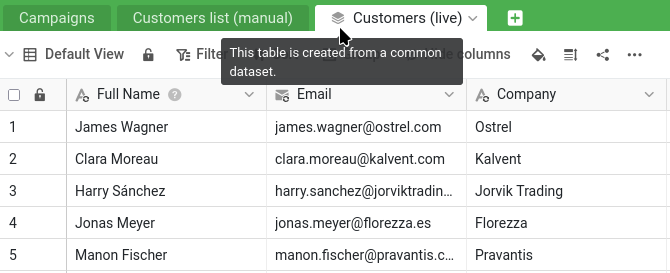


Aquí es donde lo dejó:

- Su base `Sales CRM` está en el grupo `Commercial`, y la ha compartido con Malika con permiso `Lectura-escritura` (pasos 1 y 2).
- Habló de `James Bennett` con ella en un hilo de comentarios: ella cambió su sector (`Industry`) a `Technology`, y usted cerró el hilo (paso 3).
- Encontró su cambio de `Status` en el registro de la base y lo restauró, mientras que su corrección posterior del teléfono (`Phone`) se mantuvo (paso 4).

Para retomarlo, también puede volver a abrir `Sales CRM` e iniciar el plugin de cursos en línea: su lista de pasos le muestra dónde está y le permite repasar los pasos anteriores.


Muchas empresas se encuentran con un problema como este: marketing también necesita la lista de clientes, pero no debe tocar los datos comerciales y, desde luego, no debería modificar su lista de referencia. Así que en algún momento alguien exportó los clientes a una copia aparte para marketing. Esa copia fue exacta muy poco tiempo. Desde entonces no ha dejado de desfasarse: faltan clientes nuevos, los segmentos antiguos son incorrectos, etc.

Los conjuntos de datos comunes son una función central de la colaboración, porque resuelven precisamente este problema. Le permiten compartir con otro equipo una versión de sus datos siempre actualizada, y que ese equipo construya sobre ella, sin darle ningún acceso a sus cifras confidenciales y sin ningún riesgo de que modifique sus datos de origen.

## Preparar el escenario: la base de marketing

Primero, marketing necesita un grupo y una base propios. Cree un grupo llamado `Marketing` (el departamento de Malika) y añada a Malika como miembro. Después descargue el siguiente archivo e impórtelo como nueva base **en el grupo `Marketing`**, igual que importó `Sales CRM` en el grupo `Commercial` en el paso 1:

[SeaTable Course 3 - Campaign Hub.dtable](/SeaTable-Course-3-Campaign-Hub.dtable)

Puede hacerlo porque usted creó el grupo, lo que le convierte en su propietario. Colocar una base en un grupo está reservado a su propietario y a sus administradores: un simple miembro puede trabajar en las bases que ya están en él, pero no añadir ninguna. En una organización real, Malika lo haría ella misma, como administradora del grupo de su departamento; aquí es usted quien prepara el lado de marketing por ella.

`Campaign Hub` es la pequeña base propia de marketing. Tiene una tabla `Campaigns` y, lo que nos interesa aquí, una tabla llamada `Customers list (manual)`. Ábrala y mírela con atención: contiene unos 150 clientes, frente a los 350 de su lista de referencia; los clientes más recientes simplemente no están, las etiquetas de segmento están desfasadas y todas las fechas de «última actualización» se remontan a hace unos años. Esta es la copia desfasada que vamos a retirar. Su zona de plugins contiene también una pizarra de marketing: déjela de momento, volveremos a ella en el paso 6.

## ¿Por qué no dar simplemente a Malika acceso de solo lectura?

Después del paso 4, podría sacar una conclusión sencilla: si el permiso de lectura y escritura permitió a Malika cambiar su lista de referencia por error, basta con pasarla a solo lectura. Así sus datos estarían a salvo, pero marketing no tendría lo que necesita. Una compañera con acceso de solo lectura puede consultar sus clientes, pero no puede construir nada sobre ellos: ningún segmento de campaña, ningún enlace, ninguna columna propia. Su única forma de trabajar con los datos sería hacerse su propia copia, y una copia estática es exactamente la tabla `Customers list (manual)` desfasada que acaba de ver en `Campaign Hub`. La solo lectura devolvería a marketing al punto de partida.

Lo que necesita marketing es una tercera opción: datos tan protegidos como con un acceso de solo lectura, pero sobre los que se puede construir como en una base propia. Eso es un conjunto de datos común. Da a Malika, dentro de `Campaign Hub`, una copia siempre actualizada de su lista de clientes: puede ampliarla con sus propias columnas, enlazarla con sus campañas de la tabla `Campaigns` y actualizarla cuando quiera, mientras su lista de referencia queda intacta y sus cifras confidenciales nunca salen de su base. Seguro y útil a la vez.

## Los conjuntos de datos comunes requieren grupos

Un conjunto de datos común pasa de un grupo a otro: por eso `Sales CRM` entró en un grupo ya en el paso 1. Su base `Sales CRM` está en el grupo `Commercial`, y la base `Campaign Hub` de marketing está en el grupo `Marketing`. Publicar desde `Commercial` y poner el conjunto de datos a disposición de `Marketing` es lo que une las dos.



## Publicar el conjunto de datos

Recuerde las dos vistas del paso 1. ` All customers` lo muestra todo, incluida la columna confidencial `Total Deal Value`; ` Active customers` es la vista reducida que oculta las cifras confidenciales y se puede compartir sin riesgo. Va a publicar esta última; y como un conjunto de datos común lleva consigo el filtro y las columnas ocultas de su vista, los datos confidenciales nunca salen de su base.

Abra la vista `Active customers` de la tabla `Customers`, la que se puede compartir sin riesgo, y elija ` Publicar como conjunto de datos común` en su menú. Dé al conjunto de datos un nombre claro, por ejemplo `Customers (live)`, y confirme.

El conjunto de datos ya existe, construido a partir de la vista segura. Fíjese en lo que ha incluido y en lo que no: los clientes actuales y las columnas sin riesgo, y nada de los datos comerciales ni de las cifras de ventas. Por ahora, sin embargo, solo existe en su grupo `Commercial`: marketing todavía no lo ve.

## Dar acceso al conjunto de datos a otro grupo

Para poner su lista en manos de marketing, dé acceso a su grupo. A diferencia de compartir una base, esto se hace desde la página de inicio: abra la pestaña ` Conjuntos de datos comunes`, busque `Customers (live)` y dé acceso al grupo `Marketing` mediante sus `Permisos de acceso`. Su lista de clientes siempre actualizada ya está a disposición de marketing, y todo lo que dejó fuera se queda en su base.

{{< warning headline="Compartir con otro grupo requiere ser miembro de él" text="Para compartir un conjunto de datos común con otro grupo, tiene que ser miembro de ese grupo, no solo propietario de la base de origen. Aquí usted mismo creó el grupo Marketing, así que ya cumple la condición y el uso compartido funciona directamente. Conviene conocer un matiz: quien tiene que tener un pie en el otro grupo es quien publica (un propietario o administrador del grupo de origen), no quienes usan el conjunto de datos; Malika nunca necesita acceso a su grupo Commercial para recibir los datos. En una organización real, donde el responsable de la lista de clientes no forma parte de marketing, este uso compartido entre grupos suele configurarlo un administrador del equipo, que pertenece a todos los grupos y puede conectarlos sin que ningún departamento invada el terreno del otro." />}}

## Suscribirse desde el otro lado

Pase ahora al lado de marketing. A partir de aquí trabaja en `Campaign Hub` y hace lo que Malika haría para su equipo: como miembro del grupo `Marketing`, usted también tiene acceso a la base. En `Campaign Hub`, añada una nueva tabla y elija ` Importar conjunto de datos común`; después seleccione `Customers (live)`.

Aparece una nueva tabla, marcada con un pequeño icono de pila que indica que procede de un conjunto de datos común. Contiene sus clientes actuales (la lista completa y al día, sin los clientes perdidos que la vista filtra) y solo las columnas sin riesgo. Junto a la tabla desfasada `Customers list (manual)`, la diferencia salta a la vista.

Tenga en cuenta que cada columna sincronizada se muestra con un icono de sincronización `` encima del icono habitual de su tipo.

## Adaptarlo a las necesidades de marketing

La tabla sincronizada no está congelada: marketing puede construir sobre ella. Añada una columna propia a la tabla sincronizada, por ejemplo una columna de selección única ` Segment` para clasificar a los clientes de cara a las campañas. Es la anotación de marketing, junto a los datos sincronizados. Fíjese en que su nueva columna no lleva el icono de sincronización ``, a diferencia de las columnas sincronizadas que tiene al lado: es precisamente esa marca la que permite distinguirlas de un vistazo. Las columnas sincronizadas vienen de la fuente y se actualizan en cada sincronización; las que no llevan la marca son de marketing y no cambian.

Aquí es donde el sentido único de un conjunto de datos común se hace visible. Vuelva a su base `Sales CRM` y mire la vista `Active customers` (la fuente del conjunto de datos común). La columna `Segment` de marketing no está. Y nunca estará. Los datos circulan en una sola dirección: de su fuente a la copia de marketing. Lo que marketing añade en su lado se queda en su lado.

## Recuperar los datos antiguos

La nueva columna `Segment` empieza vacía, pero el trabajo de marketing sobre estos clientes no era poca cosa. La antigua tabla `Customers list (manual)` lo contenía: el segmento de cada cliente y, en la columna ` Acquired via`, la campaña que lo captó en su momento. Añada a `Customers (live)` una columna de selección única `Acquired via` junto a `Segment`, y deje que SeaTable traslade las dos en un solo paso, haciendo coincidir las direcciones de correo electrónico.

Cree una operación `Comparar y copiar` desde ` Tratamiento de datos`, en el menú de la tabla `Customers (live)`:

- de `Customers list (manual)` a `Customers (live)`,
- haciendo coincidir las filas en las que `Email` es igual a `Email`,
- copiando `Segment` a `Segment` y `Acquired via` a `Acquired via`.

Ejecútela: cada cliente que figuraba en la lista antigua recupera su segmento y su campaña de captación en la tabla actualizada, y SeaTable vuelve a crear las opciones a medida que copia. Los clientes que no estaban en la lista antigua, los más recientes de su lista de referencia, simplemente quedan en blanco, listos para completarse.



## Comprobar que todo sigue sincronizado

Llega la recompensa. En `Sales CRM`, haga un cambio en la fuente: modifique un valor de un cliente de la vista `Active customers`, por ejemplo su cargo. Después, de vuelta en `Campaign Hub`, sincronice el conjunto de datos. Con ` Sincronizar con el conjunto de datos`, en el menú de la tabla `Customers (live)`, puede sincronizar cuando lo necesite o activar una sincronización periódica para que SeaTable lo haga automáticamente. Si recibe un error porque la última sincronización es demasiado reciente, puede forzar la sincronización desde la fuente, en el menú del conjunto de datos de la pestaña ` Conjuntos de datos comunes` de la página de inicio.

La tabla sincronizada se actualiza según su fuente: el cambio aparece, igual que aparecería un cliente nuevo añadido a la vista. Y la columna `Segment` que añadió marketing no se ha tocado: los clientes ya clasificados conservan su segmento. Los datos se actualizan desde su lista de referencia, y el trabajo que marketing ha construido encima se conserva.

{{< warning headline="La copia sincronizada no es para editarla" text="Como los datos circulan en un solo sentido, cualquier cambio que marketing haga en las propias columnas sincronizadas es provisional: la siguiente sincronización lo sobrescribe con los valores de su fuente. Esa es la idea: la lista de referencia es la que manda. Las columnas que marketing añade por su cuenta, como Segment, son la excepción y se conservan. En resumen: lea los datos sincronizados y construya sobre ellos, pero haga las correcciones de la lista de clientes en la base de origen." />}}

## Retirar la copia desfasada

`Campaign Hub` tiene ahora una lista de clientes exacta y siempre actualizada, con los segmentos antiguos copiados en ella. La tabla `Customers list (manual)` ya no aporta nada: elimínela. No se rompe nada, porque esa tabla era una copia manual independiente: nada más en la base dependía de ella. Marketing ha pasado de una copia que se desfasó enseguida a una lista que nunca se desfasa.



Ya ha hecho llegar datos siempre actualizados de un equipo a otro, manteniendo su lista de referencia privada y como única fuente válida: el corazón de la colaboración en SeaTable. Queda una herramienta, ligera y agradable, antes de terminar.

## Para profundizar

`Acquired via` es lo máximo que podía ofrecer la lista antigua: un único nombre de campaña escrito en un campo. La copia manual nunca estuvo enlazada con las filas reales de `Campaigns`, así que no podía indicar que un cliente pertenece a **varias** campañas, ni encontrar los clientes de una campaña. Reconstruir la tabla es el momento de arreglarlo.

En `Campaign Hub`, añada a la tabla `Campaigns` una columna de enlace ` Audience` que apunte a `Customers (live)`. A partir de ahora, cuando marketing lance una campaña, elegirá allí mismo sus clientes destinatarios: un verdadero enlace de muchos a muchos, no una simple etiqueta.

{{< warning headline="Mejorar una estructura sobre la marcha" text="El nuevo enlace Audience empieza vacío y se va llenando con cada nueva campaña. No se puede completar con carácter retroactivo: Acquired via solo conserva la única campaña que la copia antigua llegó a registrar, y el historial completo de las campañas de cada cliente nunca se guardó, así que no se puede reconstruir. Es el precio habitual de mejorar una estructura sobre la marcha: datos más limpios a partir de ahora, y los datos antiguos tal como estaban." />}}

## Artículo de ayuda con más información

- [Añadir un miembro del equipo a un grupo]()
- [Cómo funcionan los conjuntos de datos comunes]()
- [Tratamiento de datos: comparar y copiar]()
- [Exportar e importar las opciones de una selección única]()
