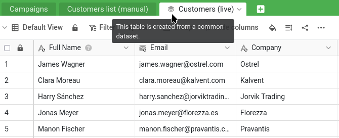


Voici où vous en êtes :

- votre base `Sales CRM` se trouve dans le groupe `Commercial`, et vous l'avez partagée avec Malika en `Lecture / écriture` (étapes 1 et 2) ;
- vous avez parlé de `James Bennett` avec elle dans un fil de commentaires : elle a remplacé `Industry` par `Technology`, et vous avez clos la discussion (étape 3) ;
- vous avez retrouvé sa modification de `Status` dans le journal de la base et l'avez annulée, tandis que votre correction ultérieure du numéro de téléphone restait en place (étape 4).

Pour reprendre, vous pouvez également rouvrir `Sales CRM` et lancer le plugin de cours en ligne : la liste d'étapes vous permet de voir où vous en êtes et de vous remémorer les étapes précédentes.


Beaucoup d'entreprises connaissent ce problème : le marketing a lui aussi besoin de la liste des clients, mais il n'a pas à toucher aux données commerciales, ni à modifier votre fichier de référence. Un jour, quelqu'un a donc exporté les clients dans une copie à part pour le marketing. Cette copie n'a été exacte que très peu de temps. Depuis, elle dérive : nouveaux clients absents, segments périmés, etc.

Les jeux de données communs sont une fonction centrale de la collaboration, parce qu'ils apportent une solution à ce problème précis : ils vous permettent de partager avec une autre équipe une version de vos données toujours à jour, sur laquelle cette équipe peut construire, sans lui donner accès à vos chiffres confidentiels et sans aucun risque qu'elle modifie vos données sources.

## Le décor : la base du marketing

Le marketing a d'abord besoin de son propre groupe et de sa propre base. Créez un groupe nommé `Marketing`, le service de Malika, et ajoutez-y Malika comme membre. Téléchargez ensuite le fichier suivant et importez-le comme nouvelle base **dans le groupe `Marketing`**, comme vous avez importé `Sales CRM` dans le groupe `Commercial` à l'étape 1 :

[SeaTable Course 3 - Campaign Hub.dtable](/SeaTable-Course-3-Campaign-Hub.dtable)

Vous pouvez le faire parce que vous avez créé le groupe, ce qui fait de vous son propriétaire. Placer une base dans un groupe est réservé à son propriétaire et à ses administrateurs : un simple membre peut travailler dans les bases qui s'y trouvent déjà, mais pas en ajouter. Dans une vraie organisation, Malika s'en chargerait elle-même, en tant qu'administratrice du groupe de son service ; ici, c'est vous qui préparez le côté marketing pour elle.

`Campaign Hub` est la base utilisée par le marketing. Elle contient un tableau `Campaigns` et, c'est ce qui nous intéresse, un tableau nommé `Customers list (manual)`. Ouvrez-le et regardez de près : il contient environ 150 clients, contre 350 dans votre fichier de référence ; les clients les plus récents en sont tout simplement absents, les segments sont périmés et les dates de « dernière mise à jour » remontent toutes à plusieurs années. C'est cette copie périmée que nous allons remplacer. Le panneau des plugins contient aussi un tableau blanc du marketing : laissez-le de côté pour l'instant, nous y reviendrons à l'étape 6.

## Pourquoi ne pas simplement passer Malika en lecture seule ?

Après l'étape 4, une conclusion simple pourrait s'imposer : si l'accès en lecture et écriture a permis à Malika de modifier votre fichier par erreur, il suffit de la passer en lecture seule. Vos données seraient bien à l'abri, mais le marketing n'aurait pas ce dont il a besoin. Une collègue en lecture seule peut consulter vos clients, mais elle ne peut rien construire dessus : pas de segment de campagne, pas de lien, pas de colonne à elle. Son seul moyen de travailler avec ces données serait d'en faire sa propre copie, et une copie figée, c'est exactement le tableau `Customers list (manual)` périmé que vous venez de voir dans `Campaign Hub`. La lecture seule ramènerait le marketing à son point de départ.

Ce qu'il faut au marketing, c'est une troisième voie : des données protégées comme avec un partage en lecture seule, mais sur lesquelles on peut construire comme dans sa propre base. C'est cela, un jeu de données commun. Il donne à Malika, dans `Campaign Hub`, une copie toujours à jour de votre liste de clients : elle peut l'enrichir de ses propres colonnes, la relier à ses campagnes du tableau `Campaigns` et l'actualiser quand elle le souhaite, tandis que votre fichier de référence reste intact et que vos chiffres confidentiels ne sortent jamais. Sûr et utile à la fois.

## Les jeux de données communs passent par les groupes

Un jeu de données commun circule d'un groupe à un autre : c'est pourquoi `Sales CRM` a été placée dans un groupe dès l'étape 1. Votre base `Sales CRM` se trouve dans le groupe `Commercial`, et la base `Campaign Hub` du marketing dans le groupe `Marketing`. Publier depuis `Commercial` et donner accès à `Marketing` à ce jeu de données, c'est ce qui relie les deux.



## Publier le jeu de données

Souvenez-vous des deux vues de l'étape 1. ` All customers` montre tout, y compris la colonne confidentielle `Total Deal Value` ; ` Active customers` est la vue allégée qui masque les chiffres confidentiels, sans risque pour un partage. C'est donc celle-ci que vous allez publier ; et comme un jeu de données commun emporte avec lui le filtre et les colonnes masquées de sa vue, les données confidentielles ne quittent jamais votre base.

Ouvrez la vue `Active customers` du tableau `Customers` et choisissez ` Publier comme jeu de données commun` dans son menu. Donnez au jeu de données un nom clair, par exemple `Customers (live)`, et confirmez.

Le jeu de données existe désormais, construit à partir de la vue sûre à partager. Remarquez ce que vous y avez mis et ce que vous avez laissé de côté : les clients actuels et les colonnes sans risque, rien des chiffres de vente. Pour l'instant cependant, ce jeu de données n'existe que dans votre groupe `Commercial` : le marketing ne le voit pas encore.

## Donner accès au jeu de données à un autre groupe

Pour mettre votre liste entre les mains du marketing, donnez accès à son groupe au jeu de données. Contrairement au partage d'une base, cela se fait depuis la page d'accueil : ouvrez l'onglet ` Jeux de données communs`, trouvez `Customers (live)` et donnez accès au groupe `Marketing` dans ses `Permissions d'accès`. Votre liste de clients toujours à jour est maintenant à la disposition du marketing, tandis que tout ce que vous avez laissé de côté reste dans votre base.

{{< warning headline="Partager avec un autre groupe demande d'en être membre" text="Pour partager un jeu de données commun avec un autre groupe, vous devez être membre de ce groupe, et pas seulement propriétaire de la base source. Ici, vous avez créé vous-même le groupe Marketing : vous remplissez donc la condition, et le partage fonctionne tout de suite. Une subtilité mérite d'être connue : c'est le propriétaire ou un administrateur du groupe initiateur du jeu de données qui doit avoir un pied dans l'autre groupe, pas l'utilisateur du jeu de données ; Malika n'a jamais besoin d'accéder à votre groupe Commercial pour recevoir les données. Dans une vraie organisation, où la personne qui gère la liste des clients ne fait pas partie du marketing, ce partage entre groupes est généralement mis en place par un administrateur d'équipe, qui appartient à tous les groupes et peut relier les deux sans qu'aucun des services n'empiète sur l'autre." />}}

## Utiliser les données depuis l'autre côté

Passez maintenant du côté du marketing. À partir d'ici, vous travaillez dans `Campaign Hub` et faites ce que Malika ferait pour son équipe : comme membre du groupe `Marketing`, la base vous est ouverte à vous aussi. Dans `Campaign Hub`, ajoutez un nouveau tableau et choisissez ` Importer un jeu de données commun`, puis sélectionnez `Customers (live)`.

Un nouveau tableau apparaît, marqué d'une petite icône de pile qui indique qu'il provient d'un jeu de données commun. Il contient vos clients actuels (la liste complète et à jour, sans les clients perdus que filtre la vue) et uniquement les colonnes sans risque. À côté du tableau périmé `Customers list (manual)`, la différence saute aux yeux.

Notez que chaque colonne synchronisée porte une icône de synchronisation `` en plus de l'icône habituelle de son type.

## Adaptation aux besoins du marketing

Le tableau synchronisé n'est pas figé : le marketing peut construire dessus. Ajoutez au tableau synchronisé une colonne à vous, par exemple une colonne de sélection unique ` Segment` pour classer les clients par campagne. C'est l'annotation du marketing, à côté des données synchronisées. Remarquez que votre nouvelle colonne ne porte pas l'icône de synchronisation ``, contrairement aux colonnes synchronisées voisines : c'est précisément ce badge qui permet de les distinguer d'un coup d'œil. Les colonnes synchronisées viennent de la source et sont actualisées à chaque synchronisation ; celles sans badge appartiennent au marketing et ne bougent pas.

C'est ici que le sens unique d'un jeu de données commun devient visible : revenez dans votre base `Sales CRM` et regardez la vue `Active customers` (la source du jeu de données). La colonne `Segment` du marketing n'y figure pas, et n'y figurera jamais. Les données ne circulent que dans un sens : de votre source vers la copie du marketing. Ce que le marketing ajoute de son côté reste de son côté.

## Reprendre les anciennes données

La nouvelle colonne `Segment` est vide au départ, mais le marketing a déjà travaillé sur certains clients. L'ancien tableau `Customers list (manual)` contient ce travail : le segment de chaque client, et la campagne qui a permis de le capter initialement dans la colonne ` Acquired via`. Ajoutez une colonne de sélection unique `Acquired via` à `Customers (live)`, à côté de `Segment`, puis laissez SeaTable récupérer les données des deux colonnes en une seule étape, à travers une mise en correspondance des adresses e-mail.

Créez une opération `Comparer et copier` depuis ` Traitement de données`, dans le menu du tableau `Customers (live)` :

- de `Customers list (manual)` vers `Customers (live)` ;
- en faisant correspondre les lignes où `Email` est égal à `Email` ;
- en copiant `Segment` vers `Segment` et `Acquired via` vers `Acquired via`.

Lancez-la : chaque client qui figurait dans l'ancienne liste retrouve son segment et sa campagne d'acquisition dans le tableau à jour, SeaTable recréant les options au fil de la copie. Les clients absents de l'ancienne liste, les plus récents de votre fichier de référence, restent simplement vides, prêts à être complétés.

{{< warning headline="Conserver les couleurs d'origine des segments" text="Comparer et copier recrée les options de segment, mais leur attribue de nouvelles couleurs par défaut. Si vous voulez retrouver exactement les couleurs de l'ancienne liste, exportez les options de sa colonne Segment, dans Customers list (manual), et importez-les dans la nouvelle colonne Segment de Customers (live) avant de lancer l'opération. Les options sont reprises dans tous les cas ; cette précaution ne sert qu'à garder les couleurs." />}}

## Vérifier que tout reste synchronisé

Voici le moment décisif. Dans `Sales CRM`, modifiez la source : changez une valeur d'un client de la vue `Active customers`, son poste par exemple. Puis, de retour dans `Campaign Hub`, synchronisez le jeu de données. Avec ` Synchroniser avec dataset`, dans le menu du tableau `Customers (live)`, vous pouvez synchroniser à la demande ou activer une synchronisation périodique pour que SeaTable s'en charge automatiquement. (Si une erreur vous signale que la dernière synchronisation est trop récente, vous pouvez toujours forcer la synchronisation depuis la source, dans le menu du jeu de données de l'onglet ` Jeux de données communs` de la page d'accueil.)

Le tableau synchronisé se met à jour d'après votre source : la modification apparaît, comme apparaîtrait un nouveau client ajouté à la vue. Et la colonne `Segment` ajoutée par le marketing n'a pas bougé : les clients déjà classés gardent leur segment. Les données s'actualisent depuis votre fichier de référence, et le travail que le marketing a construit par-dessus est préservé.

{{< warning headline="La copie synchronisée n'est pas modifiable" text="Comme les données circulent dans un seul sens, toute modification faite par le marketing dans les colonnes synchronisées elles-mêmes est provisoire : la synchronisation suivante l'écrase avec les valeurs de votre source. C'est voulu : le fichier de référence fait foi. Les colonnes ajoutées par le marketing, comme Segment, font exception et sont conservées. En résumé : lisez les données synchronisées et construisez dessus, mais corrigez la liste des clients dans la base source uniquement, sous peine de perdre vos modifications à la synchronisation suivante." />}}

## Se débarrasser de la copie périmée

`Campaign Hub` dispose désormais d'une liste de clients exacte et toujours à jour, dans laquelle les anciens segments ont été repris. Le tableau `Customers list (manual)` n'a plus rien à offrir : supprimez-le. Rien ne casse, car ce tableau était une copie manuelle isolée : rien d'autre dans la base n'en dépendait. Le marketing est passé d'une copie qui était rapidement devenue obsolète à une liste qui n'est jamais périmée.



Vous avez maintenant transmis des données toujours à jour d'une équipe à l'autre, tout en gardant votre fichier de référence privé et faisant foi : c'est le cœur de la collaboration dans SeaTable. Il reste un outil, léger et plaisant, à découvrir avant de conclure.

## Pour aller plus loin

`Acquired via` est le mieux que pouvait faire l'ancienne liste : un seul nom de campagne saisi dans un champ. La copie manuelle n'a jamais été reliée aux vrais enregistrements de `Campaigns` : elle ne pouvait donc pas indiquer qu'un client appartient à **plusieurs** campagnes, ni retrouver les clients d'une campagne. Reconstruire le tableau est le bon moment pour y remédier.

Dans `Campaign Hub`, ajoutez au tableau `Campaigns` une colonne de lien ` Audience` qui pointe vers `Customers (live)`. Désormais, quand le marketing lance une campagne, il choisit ses clients cibles directement là : un véritable lien plusieurs-à-plusieurs, et non une simple étiquette.

{{< warning headline="Améliorer une structure en cours de route" text="Le nouveau lien Audience est vide au départ et se remplit à chaque nouvelle campagne. Impossible de le compléter rétroactivement : Acquired via ne garde que la seule campagne que l'ancienne copie avait enregistrée, et l'historique complet des campagnes de chaque client n'a jamais été conservé ; il ne peut donc pas être reconstitué. C'est le compromis habituel quand on améliore une structure en cours de route : des données plus propres à partir du changement de structure, les anciennes données restant telles quelles, et donc incomplètes selon la nouvelle architecture." />}}

## Article d'aide avec plus d'informations

- [Ajouter un membre de l'équipe à un groupe]()
- [Fonctionnement des jeux de données communs]()
- [Traitement des données : comparer et copier]()
- [Exporter et importer des options]()
