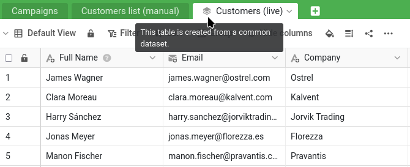


Eis onde ficou:

- A sua base `Sales CRM` está no grupo `Commercial` e partilhou-a com a Malika com a permissão `Ler escrever` (passos 1 e 2).
- Discutiu `James Bennett` com ela numa conversa de comentários: ela mudou o valor `Industry` dele para `Technology`, e deu a conversa por resolvida (passo 3).
- Encontrou a alteração de `Status` feita por ela no registo da base e restaurou-a, enquanto a sua correção posterior do número de telefone se manteve (passo 4).

Para retomar a partir daí, também pode reabrir `Sales CRM` e abrir o plugin de cursos online: a lista de passos mostra-lhe onde está e permite-lhe rever os passos anteriores.


Muitas empresas conhecem este problema: o marketing também precisa da lista de clientes, mas não deve mexer nos dados comerciais, e muito menos editar a sua lista de referência. Por isso, a dada altura, alguém exportou os clientes para uma cópia à parte para o marketing. Essa cópia só esteve correta durante muito pouco tempo. Desde então, tem vindo a desatualizar-se: faltam clientes novos, os segmentos antigos estão errados, e assim por diante.

Os conjuntos de dados comuns são uma funcionalidade central da colaboração, porque resolvem precisamente este problema. Permitem partilhar com outra equipa uma versão sempre atualizada dos seus dados, e deixar essa equipa construir sobre ela, sem lhe dar acesso aos seus valores confidenciais e sem qualquer risco de ela alterar os seus dados de origem.

## O cenário: a base do marketing

Primeiro, o marketing precisa de um grupo e de uma base próprios. Crie um grupo chamado `Marketing`, o departamento da Malika, e adicione-lhe a Malika como membro. Depois, descarregue o seguinte ficheiro e importe-o como nova base **no grupo `Marketing`**, tal como importou `Sales CRM` no grupo `Commercial` no passo 1:

[SeaTable Course 3 - Campaign Hub.dtable](/SeaTable-Course-3-Campaign-Hub.dtable)

Pode fazê-lo porque criou o grupo, o que faz de si o seu proprietário. Colocar uma base num grupo está reservado ao proprietário e aos administradores do grupo: um simples membro pode trabalhar nas bases que já lá estão, mas não pode acrescentar nenhuma. Numa organização real, seria a própria Malika a fazê-lo, como administradora do grupo do seu departamento; aqui, prepara o lado do marketing em nome dela.

`Campaign Hub` é a pequena base do próprio marketing. Tem uma tabela `Campaigns` e, o que aqui nos interessa, uma tabela chamada `Customers list (manual)`. Abra-a e observe com atenção: tem cerca de 150 clientes, contra os 350 da sua lista de referência; os clientes mais recentes simplesmente não estão lá, os segmentos estão desatualizados e as datas de «última atualização» remontam todas a alguns anos atrás. É esta cópia desatualizada que vamos aposentar. A área de plugins desta base contém também um quadro branco do marketing: deixe-o de lado por agora, vamos voltar a ele no passo 6.

## Porque não dar simplesmente à Malika acesso só de leitura?

Depois do passo 4, pode chegar a uma conclusão simples: se a permissão de leitura e escrita deixou a Malika alterar a sua lista por engano, basta passá-la para apenas leitura. Isso protege os seus dados, mas não dá ao marketing aquilo de que precisa. Uma colega com acesso só de leitura pode consultar os seus clientes, mas não pode construir nada sobre eles: nenhum segmento de campanha, nenhuma ligação, nenhuma coluna própria. A única forma de ela trabalhar com os dados é fazer uma cópia própria, e uma cópia estática é exatamente a tabela desatualizada `Customers list (manual)` que acabou de ver em `Campaign Hub`. O acesso só de leitura levaria o marketing de volta ao ponto de partida.

O que o marketing precisa é de uma terceira via: dados tão protegidos como numa partilha de apenas leitura, mas sobre os quais se pode construir como numa base própria. É isso um conjunto de dados comum. Dá à Malika, dentro de `Campaign Hub`, uma cópia sempre atualizada da sua lista de clientes, que ela pode enriquecer com as suas próprias colunas, ligar às campanhas da tabela `Campaigns` e atualizar sempre que quiser, enquanto a sua lista de referência fica intacta e os seus valores confidenciais nunca saem da sua base. Seguro e útil ao mesmo tempo.

## Os conjuntos de dados comuns passam pelos grupos

Um conjunto de dados comum circula de um grupo para outro: é por isso que `Sales CRM` foi colocada num grupo logo no passo 1. A sua base `Sales CRM` está no grupo `Commercial`, e a base `Campaign Hub` do marketing está no grupo `Marketing`. Publicar a partir de `Commercial` e dar acesso ao conjunto de dados a `Marketing` é o que liga os dois.



## Publicar o conjunto de dados

Lembre-se das duas vistas do passo 1. ` All customers` mostra tudo, incluindo a coluna confidencial `Total Deal Value`; ` Active customers` é a vista reduzida, segura para partilhar, que oculta os valores confidenciais. É esta que vai publicar e, como um conjunto de dados comum leva consigo o filtro e as colunas ocultas da sua vista, os dados confidenciais nunca saem da sua base.

Abra a vista `Active customers` da tabela `Customers` e escolha ` Publicar como Registo Partilhado` no menu da vista. Dê ao conjunto de dados um nome claro, por exemplo `Customers (live)`, e confirme.

O conjunto de dados existe agora, criado a partir da vista segura. Repare no que incluiu e no que deixou de fora: os clientes atuais e as colunas sem risco, e nada dos dados comerciais nem dos valores de vendas. Por agora, porém, só existe no seu grupo `Commercial`: o marketing ainda não o vê.

## Dar acesso ao conjunto de dados a outro grupo

Para pôr a sua lista nas mãos do marketing, dê acesso ao grupo dele. Ao contrário da partilha de uma base, isto faz-se a partir da página inicial: abra o separador ` Registo de dados partilhados`, encontre `Customers (live)` e dê acesso ao grupo `Marketing` através das respetivas `Permissões de acesso`. A sua lista de clientes sempre atualizada está agora à disposição do marketing, e tudo o que deixou de fora fica na sua base.

{{< warning headline="Partilhar com outro grupo exige ser membro dele" text="Para partilhar um conjunto de dados comum com outro grupo, tem de ser membro desse grupo, e não apenas proprietário da base de origem. Aqui, criou o grupo Marketing, por isso cumpre a condição e a partilha funciona de imediato. Há uma subtileza que vale a pena conhecer: é quem publica (um proprietário ou administrador do grupo de origem) que tem de ter um pé no outro grupo, e não quem usa o conjunto de dados; a Malika nunca precisa de acesso ao seu grupo Commercial para receber os dados. Numa organização real, onde quem gere a lista de clientes não faz parte do marketing, esta partilha entre grupos é normalmente configurada por um administrador da equipa, que pertence a todos os grupos e pode ligar os dois sem que nenhum dos departamentos entre no espaço do outro." />}}

## Subscrever a partir do outro lado

Passe agora para o lado do marketing. A partir daqui, trabalha em `Campaign Hub` e faz o que a Malika faria para a sua equipa: como membro do grupo `Marketing`, também tem acesso à base. Em `Campaign Hub`, adicione uma nova tabela e escolha ` Importar Registo Partilhado`; depois, selecione `Customers (live)`.

Aparece uma nova tabela, marcada com um pequeno ícone de pilha que indica que vem de um conjunto de dados comum. Contém os seus clientes atuais (a lista completa e atualizada, sem os clientes perdidos que a vista filtra) e apenas as colunas sem risco. Ao lado da tabela desatualizada `Customers list (manual)`, a diferença salta à vista.

Repare que cada coluna sincronizada mostra um ícone de sincronização `` por cima do ícone habitual do seu tipo.

## Adaptar os dados às necessidades do marketing

A tabela sincronizada não está congelada: o marketing pode construir sobre ela. Adicione à tabela sincronizada uma coluna sua, por exemplo uma coluna de seleção única ` Segment` para classificar os clientes por campanha. É a anotação do marketing, ao lado dos dados sincronizados. Repare que a sua nova coluna não tem o ícone de sincronização ``, ao contrário das colunas sincronizadas ao lado: é precisamente esse ícone que permite distingui-las num relance. As colunas sincronizadas vêm da origem e são atualizadas a cada sincronização; as que não o têm pertencem ao marketing e não mudam.

É aqui que o sentido único de um conjunto de dados comum se torna visível. Volte à sua base `Sales CRM` e olhe para a vista `Active customers` (a origem do conjunto de dados). A coluna `Segment` do marketing não está lá, e nunca vai estar. Os dados circulam num só sentido: da sua origem para a cópia do marketing. O que o marketing acrescenta do seu lado fica do seu lado.

## Recuperar os dados antigos

A nova coluna `Segment` começa vazia, mas o marketing já tinha trabalhado sobre estes clientes. Esse trabalho estava na antiga `Customers list (manual)`: o segmento de cada cliente e, na coluna ` Acquired via`, a campanha que o trouxe inicialmente. Adicione uma coluna de seleção única `Acquired via` a `Customers (live)`, ao lado de `Segment`, e deixe o SeaTable transferir as duas de uma só vez, fazendo corresponder as linhas pelo endereço de e-mail.

Crie uma operação `Comparar e copiar` a partir de ` Processamento de dados`, no menu da tabela `Customers (live)`:

- de `Customers list (manual)` para `Customers (live)`;
- fazendo corresponder as linhas em que `Email` é igual a `Email`;
- copiando `Segment` para `Segment` e `Acquired via` para `Acquired via`.

Execute-a: cada cliente que existia na lista antiga recupera, na tabela atualizada, o seu segmento e a sua campanha de aquisição, e o SeaTable recria as opções à medida que copia. Os clientes que não estavam na lista antiga, os mais recentes da sua lista de referência, ficam simplesmente em branco, prontos a ser preenchidos.



## Ver a sincronização em ação

Agora, a recompensa. Em `Sales CRM`, faça uma alteração na origem: edite um valor de um cliente da vista `Active customers`, o cargo, por exemplo. Depois, de volta a `Campaign Hub`, sincronize o conjunto de dados. Com ` Sincronizar com registo`, no menu da tabela `Customers (live)`, pode sincronizar quando quiser ou ativar uma sincronização periódica para que o SeaTable sincronize automaticamente. Se aparecer um erro porque a última sincronização foi demasiado recente, pode ainda forçar a sincronização a partir da origem, no menu do conjunto de dados, no separador ` Registo de dados partilhados` da página inicial.

A tabela sincronizada atualiza-se de acordo com a sua origem: a alteração aparece, tal como apareceria um novo cliente acrescentado à vista. E a coluna `Segment` que o marketing adicionou não foi tocada: os clientes já classificados mantêm o seu segmento. Os dados atualizam-se a partir da sua lista de referência, e o trabalho que o marketing construiu por cima é preservado.

{{< warning headline="A cópia sincronizada não é para editar" text="Como os dados circulam num só sentido, qualquer alteração que o marketing faça nas próprias colunas sincronizadas é temporária: a sincronização seguinte substitui-a pelos valores da sua origem. É esse o objetivo: a lista de referência continua a ser a fonte de verdade. As colunas que o marketing acrescenta por conta própria, como Segment, são a exceção e mantêm-se. Em resumo: leia os dados sincronizados e construa sobre eles, mas faça as correções à lista de clientes na base de origem." />}}

## Aposentar a cópia desatualizada

`Campaign Hub` tem agora uma lista de clientes exata e sempre atualizada, para a qual os antigos segmentos foram copiados. A tabela `Customers list (manual)` já não tem nada para oferecer: elimine-a. Nada se estraga, porque essa tabela era uma cópia manual isolada: nada mais na base dependia dela. O marketing passou de uma cópia que rapidamente se desatualizou para uma lista que nunca fica desatualizada.



Acabou de disponibilizar dados sempre atualizados entre equipas, mantendo a sua lista de referência privada e como única fonte de verdade: é o coração da colaboração no SeaTable. Resta uma ferramenta, leve e agradável, antes de concluirmos.

## Para ir mais longe

`Acquired via` é o melhor que a lista antiga conseguia fazer: um único nome de campanha escrito num campo. A cópia manual nunca esteve ligada às verdadeiras linhas de `Campaigns`, por isso não conseguia indicar que um cliente pertence a **várias** campanhas, nem encontrar os clientes de uma campanha. Reconstruir a tabela é o momento certo para corrigir isso.

Em `Campaign Hub`, adicione à tabela `Campaigns` uma coluna de ligação ` Audience` que aponte para `Customers (live)`. A partir de agora, quando o marketing lançar uma campanha, escolhe aí mesmo os clientes visados: uma verdadeira ligação de muitos para muitos, e não uma simples etiqueta.



## Artigo de ajuda com mais informações

- [Adicionar um membro da equipa a um grupo]()
- [Como funcionam os Conjuntos de Dados Partilhados]()
- [Processamento de dados: Comparar e copiar]()
- [Exportar e importar opções]()
