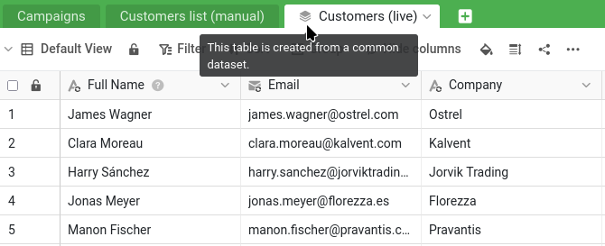


Вот на чём вы остановились:

- Ваша база `Sales CRM` находится в группе `Commercial`, и вы открыли к ней доступ Малике с правами `Чтение-Запись` (шаги 1 и 2).
- Вы обсудили с ней `James Bennett` в ветке комментариев: она изменила его отрасль (`Industry`) на `Technology`, а вы закрыли обсуждение (шаг 3).
- Вы нашли её изменение статуса (`Status`) в журнале базы и восстановили прежнее значение, а ваше более позднее исправление телефона (`Phone`) сохранилось (шаг 4).

Чтобы продолжить, можно также снова открыть `Sales CRM` и запустить плагин онлайн-курсов: в списке шагов видно, где вы находитесь, и можно ещё раз просмотреть предыдущие шаги.


Многие компании сталкиваются с похожей проблемой: отделу маркетинга тоже нужен список клиентов, но доступа к воронке продаж у него быть не должно, и уж точно он не должен редактировать ваш основной список. Поэтому когда-то кто-то выгрузил клиентов в отдельную копию для маркетинга. Эта копия была точной совсем недолго. С тех пор она всё больше расходится с оригиналом: новых клиентов нет, сегменты устарели и так далее.

Общие наборы данных — ключевая функция совместной работы, потому что они решают именно эту проблему. Они позволяют передать другому отделу всегда актуальную версию ваших данных и дают ему возможность строить на их основе свою работу — без доступа к вашим конфиденциальным цифрам и без риска, что он изменит ваши исходные данные.

## Подготовка: база отдела маркетинга

Сначала отделу маркетинга нужны собственная группа и база. Создайте группу `Marketing` — это отдел Малики — и добавьте Малику в неё как участника. Затем скачайте следующий файл и импортируйте его как новую базу **в группу `Marketing`** — так же, как на шаге 1 вы импортировали `Sales CRM` в группу `Commercial`:

[SeaTable Course 3 - Campaign Hub.dtable](/SeaTable-Course-3-Campaign-Hub.dtable)

Вы можете это сделать, потому что создали группу и поэтому являетесь её владельцем. Добавлять базу в группу могут только её владелец и администраторы: обычный участник может работать в базах, которые уже там есть, но не может добавить новую. В реальной организации Малика сделала бы это сама как администратор группы своего отдела; здесь вы готовите сторону маркетинга за неё.

`Campaign Hub` — небольшая собственная база отдела маркетинга. В ней есть таблица `Campaigns` и — что здесь важно — таблица `Customers list (manual)`. Откройте её и присмотритесь: в ней около 150 клиентов, тогда как в вашем основном списке их 350, самых новых клиентов просто нет, обозначения сегментов устарели, а даты последнего обновления — все многолетней давности. Именно эту устаревшую копию мы и выведем из употребления. В разделе плагинов этой базы есть ещё и белая доска отдела маркетинга; пока не трогайте её, она понадобится на шаге 6.

## Почему бы просто не дать Малике права только для чтения?

После шага 4 напрашивается простой вывод: раз права на чтение и запись позволили Малике по ошибке изменить ваш основной список, достаточно перевести её на права только для чтения. Это действительно защитит ваши данные, но не даст отделу маркетинга того, что ему нужно. С правами только для чтения Малика может просматривать ваших клиентов, но ничего не может на их основе построить: ни сегмента для кампании, ни связи, ни собственного столбца. Единственный способ для неё работать с данными — сделать собственную копию, а статичная копия — это и есть устаревшая `Customers list (manual)`, которую вы только что видели в `Campaign Hub`. Права только для чтения вернули бы маркетинг в исходную точку.

Отделу маркетинга нужен третий вариант: данные, такие же защищённые, как при доступе только для чтения, но на основе которых можно строить работу, как в собственной базе. Это и есть общий набор данных. Он даёт Малике внутри `Campaign Hub` актуальную копию вашего списка клиентов, которую она может дополнять своими столбцами, связывать со своими `Campaigns` и обновлять когда угодно, — при этом ваш основной список остаётся нетронутым, а конфиденциальные цифры никуда не уходят. Безопасно и продуктивно одновременно.

## Общим наборам данных нужны группы

Общий набор данных передаётся из одной группы в другую — именно поэтому на шаге 1 `Sales CRM` попала в группу. Ваша база `Sales CRM` находится в группе `Commercial`, а база отдела маркетинга `Campaign Hub` — в группе `Marketing`. Публикация из `Commercial` и предоставление набора данных группе `Marketing` и связывают их.



## Публикация набора данных

Вспомните два представления из шага 1. ` All customers` показывает всё, включая конфиденциальный столбец `Total Deal Value`; ` Active customers` — облегчённое представление, которое можно спокойно передавать другим, потому что конфиденциальные цифры в нём скрыты. Вы опубликуете безопасное — и поскольку общий набор данных переносит фильтр и скрытые столбцы своего представления, конфиденциальные данные никогда не покинут вашу базу.

Откройте представление `Active customers` таблицы `Customers` — безопасное — и выберите в его меню ` Опубликовать как общий набор данных`. Дайте набору понятное название, например `Customers (live)`, и подтвердите.

Набор данных создан на основе безопасного представления. Обратите внимание, что вы включили, а что нет: текущих клиентов и безопасные столбцы — и ничего из воронки продаж или данных о выручке. Но пока он существует только в вашей группе `Commercial`, и отдел маркетинга его ещё не видит.

## Доступ к набору данных для другой группы

Чтобы передать свой список отделу маркетинга, предоставьте доступ его группе. В отличие от общего доступа к базе, это делается на главной странице: откройте вкладку ` Общие наборы данных`, найдите `Customers (live)` и через `Управление доступом` предоставьте доступ группе `Marketing`. Теперь ваш актуальный список клиентов доступен отделу маркетинга, а всё, что вы исключили, остаётся в вашей базе.

{{< warning headline="Для обмена между группами нужно членство" text="Чтобы предоставить общий набор данных другой группе, нужно быть участником этой группы, а не только владельцем исходной базы. Здесь вы сами создали группу Marketing, так что это условие уже выполнено и доступ открывается сразу. Есть одна тонкость: доступ к другой группе нужен тому, кто публикует набор (владельцу или администратору исходной группы), а не тем, кто им пользуется, — Малике никогда не нужен доступ к вашей группе Commercial, чтобы получать данные. В реальной организации, где владелец списка клиентов не входит в отдел маркетинга, такой обмен между группами обычно настраивает администратор команды: он состоит во всех группах и может связать их, не заставляя один отдел вторгаться в другой." />}}

## Подписка с другой стороны

Теперь займите сторону маркетинга. Дальше вы работаете в `Campaign Hub` и делаете то, что Малика сделала бы для своей команды: как участнику группы `Marketing`, эта база открыта и вам. В `Campaign Hub` добавьте новую таблицу, выберите ` Импортировать общий набор данных`, а затем — `Customers (live)`.

Появится новая таблица, отмеченная маленьким значком стопки: он показывает, что таблица получена из общего набора данных. В ней ваши текущие клиенты — полный актуальный список без ушедших клиентов, которых отфильтровывает представление, — и только безопасные столбцы. Рядом с устаревшей `Customers list (manual)` разница видна сразу.

Обратите внимание: у каждого синхронизируемого столбца поверх обычного значка типа отображается значок синхронизации ``.

## Маркетинг дополняет данные

Синхронизированная таблица не заморожена — отдел маркетинга может строить на её основе свою работу. Добавьте в синхронизированную таблицу собственный столбец, например столбец с одиночным выбором ` Segment`, чтобы помечать клиентов для кампаний. Это пометки маркетинга, которые находятся рядом с синхронизированными данными. Заметьте, что у нового столбца, в отличие от синхронизированных столбцов рядом, нет значка синхронизации ``. Именно по этому значку их и различают с первого взгляда: синхронизированные столбцы приходят из источника и обновляются при каждой синхронизации, а столбцы без значка принадлежат маркетингу и остаются как есть.

Здесь однонаправленность общего набора данных становится наглядной. Вернитесь в свою базу `Sales CRM` и посмотрите на представление `Active customers` (источник общего набора данных). Столбца `Segment` отдела маркетинга там нет — и не будет. Данные передаются только в одном направлении: из вашего источника в копию маркетинга. То, что маркетинг добавляет на своей стороне, там и остаётся.

## Перенос старых данных

Новый столбец `Segment` поначалу пуст — но ведь маркетинг уже немало поработал с этими клиентами. Эта работа хранилась в старой `Customers list (manual)`: сегмент каждого клиента и кампания ` Acquired via`, которая когда-то его привлекла. Добавьте в `Customers (live)` рядом с `Segment` столбец с одиночным выбором `Acquired via`, а затем поручите SeaTable перенести оба значения за один шаг, сопоставив клиентов по адресу электронной почты.

Создайте операцию `Сравнить и скопировать` через ` Обработка данных` в меню таблицы `Customers (live)`:

- из `Customers list (manual)` в `Customers (live)`;
- сопоставляя строки, у которых `Email` равен `Email`;
- копируя `Segment` в `Segment` и `Acquired via` в `Acquired via`.

Запустите её, и каждый клиент, который был в старом списке, снова получит в актуальной таблице свой сегмент и кампанию, через которую он пришёл; варианты значений SeaTable создаёт заново при копировании. Клиенты, которых в старом списке не было, — более новые, добавленные в ваш основной список, — просто остаются пустыми и ждут заполнения.



## Синхронизация в действии

А теперь самое интересное. В `Sales CRM` измените источник — отредактируйте какое-нибудь значение клиента в представлении `Active customers`, например его должность. Затем вернитесь в `Campaign Hub` и синхронизируйте набор данных. Через ` Синхронизировать с набором данных` в меню таблицы `Customers (live)` можно синхронизировать данные вручную или включить периодическую синхронизацию, чтобы SeaTable делал это автоматически. Если появится ошибка из-за того, что последняя синхронизация была слишком недавно, синхронизацию всё равно можно запустить принудительно со стороны источника — через меню набора данных на вкладке ` Общие наборы данных` на главной странице.

Синхронизированная таблица обновляется в соответствии с источником: правка появляется точно так же, как появился бы новый клиент, добавленный в представление. А столбец `Segment`, добавленный маркетингом, остаётся нетронутым: уже помеченные клиенты сохраняют свои пометки. Актуальные данные обновляются из вашего основного списка, а собственная работа маркетинга поверх них сохраняется.

{{< warning headline="Синхронизированную копию не стоит редактировать" text="Поскольку данные передаются в одном направлении, всё, что маркетинг меняет в самих синхронизированных столбцах, временно: следующая синхронизация перезапишет это значениями из источника. В этом и смысл — главным остаётся основной список. Исключение составляют столбцы, которые маркетинг добавил сам, например Segment: они сохраняются. Итак, читайте синхронизированные данные и стройте на их основе свою работу, но исправления в самом списке клиентов вносите в исходной базе." />}}

## Прощание с устаревшей копией

Теперь в `Campaign Hub` есть актуальный и точный список клиентов, в который скопированы старые сегменты. Таблице `Customers list (manual)` больше нечего предложить. Удалите её. Ничего не сломается, потому что эта таблица была самостоятельной копией, сделанной вручную, и ничто в базе от неё не зависело. Маркетинг перешёл от копии, которая быстро устарела, к списку, который не устаревает никогда.



Теперь вы умеете передавать актуальные данные между отделами, сохраняя основной список закрытым и главным, — это суть совместной работы в SeaTable. Перед подведением итогов остаётся ещё один лёгкий и приятный инструмент.

## Для углублённого изучения

`Acquired via` — лучшее, на что был способен старый список: название одной кампании, введённое в поле. Плоская ручная копия никогда не была связана с настоящими записями `Campaigns`, поэтому не могла показать, что клиент относится к **нескольким** кампаниям, или привести от кампании к её клиентам. Перестройка таблицы — подходящий момент, чтобы это исправить.

В `Campaign Hub` добавьте в таблицу `Campaigns` столбец ссылок ` Audience`, указывающий на `Customers (live)`. С этого момента, запуская кампанию, маркетинг будет выбирать её целевых клиентов прямо здесь — полноценной связью «многие ко многим», а не одной пометкой.



## Справочная статья с дополнительной информацией

- [Добавить члена команды в группу]()
- [Как работают общие наборы данных]()
- [Обработка данных: сравнение и копирование]()
- [Экспорт и импорт вариантов одиночного выбора]()
