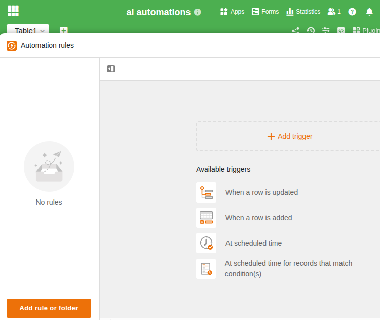
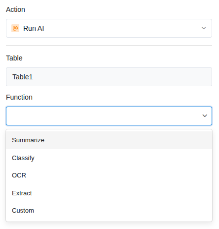
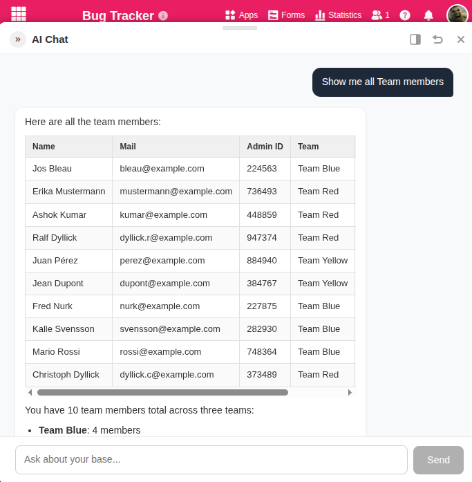
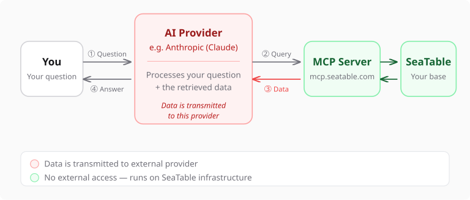

Stellen Sie sich vor, Sie öffnen Ihre SeaTable-Base mit 2.000 Projekteinträgen. Doch statt Filter zu setzen, Ansichten zu konfigurieren und Formeln zu schreiben, tippen Sie:

> „Welche Projekte sind überfällig? Gruppiere sie nach Verantwortlichem."

Und die KI antwortet. Nicht mit einer vagen Vermutung, sondern mit den echten Daten aus Ihrer Base. Und das innerhalb von Sekunden. Das ist keine Zukunftsmusik. Das geht jetzt mit dem neuen KI-Chat-Plugin in SeaTable.

Aber fangen wir vorne an. Denn KI in SeaTable ist mehr als ein Chatbot.

## Bisher: KI-Automationen, die unsichtbaren Helfer

Mit SeaTable 6.0 haben wir KI-Automationen eingeführt. Das Prinzip: Sie definieren eine Aufgabe und die KI erledigt sie automatisch im Hintergrund. Zeile für Zeile, ohne dass Sie aktiv warten müssen.

Vier Funktionen stehen bereit: **Summarize, OCR, Extract und Classify**. Dazu kommt eine **Custom Function**, mit der Sie eigene Prompts definieren können.

### Was heißt das konkret?

- **Rechnungsverarbeitung:** Eingehende Rechnungen werden per OCR ausgelesen. Rechnungsnummer, Datum, Betrag und Absender landen automatisch in den richtigen Spalten, ohne manuelles Abtippen.
- **Support-Tickets:** Eingehende Anfragen werden analysiert, kategorisiert und dem richtigen Team zugeordnet. Bevor ein Mensch die Anfrage sieht, ist sie schon sortiert.
- **Dokumenten-Zusammenfassung:** Ein 20-seitiger Bericht wird in wenigen Sekunden auf die wesentlichen Punkte komprimiert.
- **Mehrsprachige Klassifizierung:** Ob Deutsch, Englisch oder Französisch: die KI erkennt die Sprache und ordnet den Inhalt korrekt ein.

### Wo laufen diese Automationen?

Auf **unserem eigenen KI-Server in Deutschland**, im Rechenzentrum von Exoscale. Wir betreiben ein eigenes Sprachmodell, das die Verarbeitung übernimmt. Ihre Daten verlassen zu keinem Zeitpunkt unsere europäische Infrastruktur.

Für Organisationen, die Wert auf DSGVO-Konformität und [Datensouveränität]() legen (Universitäten, Forschungseinrichtungen, öffentlicher Sektor), ist das entscheidend. Keine Daten fließen an OpenAI, Google oder andere US-Anbieter.

SeaTable-Kunden erhalten so viele KI-Credits, wie im jeweiligen Abonnement enthalten sind.

## Ab sofort: Der KI-Chatbot. Sprechen Sie mit Ihren Daten

Die Automationen sind leistungsstark, aber sie arbeiten nach festen Regeln: eine Zeile rein, ein Ergebnis raus. Was aber, wenn Sie eine offene Frage haben? Wenn Sie nicht wissen, welchen Filter Sie setzen müssen, oder wenn Sie eine Analyse Ihrer gesamten Datenbasis brauchen?

Dafür gibt es ab SeaTable 6.1 das **KI-Chat-Plugin**.

### So funktioniert es

Sie öffnen den Chat in Ihrer Base und stellen Ihre Frage in natürlicher Sprache. Die KI kennt die Struktur Ihrer Base (Tabellen, Spalten, Verknüpfungen) und fragt gezielt die relevanten Daten ab. Kein Export, kein Copy-Paste, kein Erklären der Tabellenstruktur.

Einige Beispiele:

- *„Wie viele offene Deals haben wir über 10.000 Euro, die seit 30 Tagen keinen Kontakt hatten?"*
- *„Fasse die Support-Anfragen der letzten Woche zusammen und zeige die häufigsten Themen."*
- *„Erstelle für jeden überfälligen Task einen Follow-up-Eintrag in der Aktivitäten-Tabelle."*

Ja, der Chatbot kann nicht nur lesen, sondern auch **schreiben**: Zeilen erstellen, aktualisieren, verknüpfen und löschen. Alles direkt in Ihrer Base.

### Wie ist das möglich?

Hinter dem Chatbot steckt der **SeaTable MCP Server**. MCP steht für Model Context Protocol, ein offener Standard, der es KI-Modellen ermöglicht, aktiv mit Datenquellen zu interagieren. Statt der KI Ihre Daten in den Chat zu kopieren, fragt die KI über MCP eigenständig ab, was sie braucht. Live, in Echtzeit, immer aktuell.

Das unterscheidet unseren Ansatz grundlegend von Lösungen, bei denen Sie Daten als CSV exportieren und in ein ChatGPT-Fenster einfügen. Der Chatbot arbeitet direkt mit Ihrer Base, ohne Umwege und ohne Informationsverlust.

### Welche Modelle werden unterstützt?

Standardmäßig nutzt das Plugin die SeaTable AI – unser eigenes, bei Exoscale gehostetes KI-Modell. Wenn Sie möchten, können Sie aber ebenso leistungsstarke externe KI-Modelle anbinden, die komplexe Fragen beantworten und mehrstufig mit Ihren Daten arbeiten können. Aktuell unterstützen wir:

- **Anthropic Claude** (Haiku und Sonnet)
- **OpenAI** (GPT-6.1 Sol und GPT-6 Luna)
- **Mistral** (Mistral Large und Mistral Small)

Sie bringen Ihren eigenen API-Key mit und zahlen die Token-Kosten direkt beim jeweiligen Anbieter. Das ist transparent: Sie sehen genau, was jede Interaktion kostet, und behalten die volle Kontrolle.

## Warum zwei Wege statt einem?

Eine berechtigte Frage. Warum nicht einfach alles über den Chatbot laufen lassen?

Die Antwort: Weil unterschiedliche Aufgaben unterschiedliche Anforderungen haben.

| | KI-Automationen | KI-Chatbot |
|---|---|---|
| **Aufgabe** | Definiert: OCR, Zusammenfassung, Klassifizierung | Offen: Fragen, Analysen, explorative Suche |
| **Interaktion** | Im Hintergrund, automatisch | Echtzeit-Dialog |
| **Daten** | Eine Zeile als Input | Ganze Base als Grundlage |
| **KI-Modell** | Unser Server in Deutschland | SeaTable AI oder externes Modell (Claude, OpenAI oder Mistral) |
| **Datensouveränität** | Maximal: Daten bleiben auf unserer Infrastruktur | Sie entscheiden, an welchen KI-Anbieter die Daten gehen |
| **Kosten** | Im jeweiligen SeaTable-Abo enthalten | SeaTable AI oder Token-Kosten beim KI-Anbieter |

Beide Wege ergänzen sich. Nutzen Sie Automationen für wiederkehrende Aufgaben, die zuverlässig im Hintergrund laufen sollen. Nutzen Sie den Chatbot, wenn Sie Fragen haben, die Sie nicht mit einem Filter beantworten können.

## Ihre Daten bleiben unter Ihrer Kontrolle

Unabhängig davon, welchen Weg Sie wählen: Kontrolle und Sicherheit stehen an erster Stelle.

**Bei Automationen** verlassen Ihre Daten nie unsere europäische Infrastruktur. Das Sprachmodell läuft auf unserem eigenen Server in Deutschland.

**Beim Chatbot** werden Daten an den KI-Anbieter übermittelt, den Sie gewählt haben. Das ist technisch notwendig, damit das Modell Ihre Fragen beantworten kann. Aber Sie entscheiden, welcher Anbieter das ist.

Doch nicht nur das: Das KI-Chat-Plugin unterscheidet automatisch zwischen Leseoperationen und destruktiven Aktionen wie Löschungen oder Updates. Bevor Daten geändert werden, fragt das Plugin um Ihre Bestätigung: was genau geändert wird und wie viele Zeilen betroffen sind. Sie können einmalig zustimmen, ähnliche Aktionen für die gesamte Session erlauben oder ablehnen. Auch bei besonders großen Ergebnismengen wird nachgefragt, bevor die KI Tausende von Zeilen verarbeitet.

## So starten Sie

### KI-Automationen

Ab Version 6.1 verfügbar für alle Kunden in SeaTable Cloud und für Self-Hoster. Erstellen Sie eine neue Automation in Ihrer Base, wählen Sie eine KI-Funktion (Summarize, OCR, Extract, Classify oder Custom) und definieren Sie Input- und Output-Spalte. Die Automation läuft ab sofort bei jedem neuen Ereignis.

Eine detaillierte Anleitung finden Sie in unserem [Hilfebereich]().

### KI-Chatbot

Ab SeaTable 6.1 können Sie auch das KI-Chat-Plugin in Ihrer Base installieren. Starten Sie direkt mit der SeaTable AI oder hinterlegen Sie Ihren API-Key (Claude, OpenAI oder Mistral) in den Plugin-Einstellungen. Stellen Sie Ihre erste Frage. Der Chatbot erkennt die Struktur Ihrer Base automatisch und wird Ihre Frage beantworten.

## Ausblick

Wir arbeiten kontinuierlich an der Erweiterung der KI-Funktionen in SeaTable:

- **Verbessertes API-Key-Management:** Aktuell wird der API-Key in den Plugin-Einstellungen gespeichert. Für eine zukünftige Version arbeiten wir an einer zentralen, sichereren Lösung für die Verwaltung von API-Keys.
- **KI Usage Tracking:** Transparente Übersicht über Ihren Token-Verbrauch.
- **Allgemeiner KI-Assistent:** Ein Assistent, der Sie mit mehreren Bases gleichzeitig sprechen lässt.

Die Möglichkeiten, KI in Ihre tägliche Arbeit zu integrieren, wachsen rasant. Mit SeaTable haben Sie die Werkzeuge an der Hand, um davon zu profitieren, ohne Kompromisse bei der Kontrolle über Ihre Daten einzugehen.


