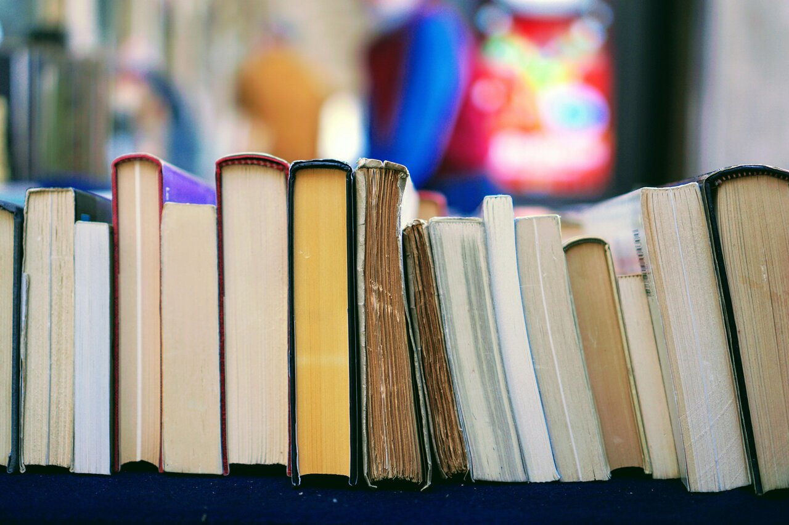

¿Le encanta leer y no se cansa de los libros? Eso es maravilloso, porque no hay mejor manera de sumergirse en mundos ajenos que con un libro. Pero, ¿sabe exactamente cuántos y qué libros posee en ese momento? ¿Y dónde se encuentra actualmente cada libro? Si no es así, existe la solución perfecta, porque con las aplicaciones adecuadas podrá catalogar sus libros de forma fácil, rápida y sin mucho esfuerzo.

Este artículo explica las ventajas decisivas, qué aplicaciones le ayudan específicamente a catalogar sus libros y los mejores consejos para una gestión sensata de su propia colección de libros.

## Catalogación de libros: ¿por qué hacerlo?

La utilidad de catalogar sus libros depende, en primer lugar, del tamaño de su colección privada. Si puede contar sus libros con las dos manos, seguro que no necesita un organizador digital para gestionar su colección de libros. Sin embargo, a partir del momento en que su consumo de libros empiece a moverse en la dirección del ratón de biblioteca, existen varios argumentos a favor de la catalogación de libros.

### La catalogación de sus libros aporta claridad

Cuantos más libros posea, más difícil le resultará hacer un seguimiento de todos ellos. Puede ocurrir que uno o dos libros se compren dos veces. Si tiene los libros bien catalogados, puede evitar esas compras duplicadas. Catalogar los libros también ayuda a llevar la cuenta de los libros prestados y a no olvidarse de devolverlos.

¿Tiene más de una estantería y la ubicación de sus libros está repartida en varias habitaciones? Entonces también es muy útil catalogar sus libros. Con la aplicación de libros adecuada, sabrá exactamente qué libro está en cada lugar y no tendrá que buscarlo cuando lo necesite rápidamente.

Catalogación de libros © Yaroslava Holiachenko / Unsplash

### Puede llevar fácilmente listas de deseos de libros

Nunca se tienen suficientes libros. Pero, ¿cómo se llama esa obra de la que oyó hablar el otro día? Es bueno tener anotados en una lista digital de deseos los libros que aún quiere leer. Eso también se soluciona perfectamente con una aplicación que le ayuda a catalogar sus libros. Además: a través de la [lista de deseos]() puede ayudar de forma óptima a sus amigos y familiares a elegir los regalos en el momento del cumpleaños.

### Catalogar libros fomenta el intercambio

Incluso si suele leer solo, para muchos ratones de biblioteca es imprescindible relacionarse con personas que compartan sus mismas aficiones. Una aplicación de biblioteca para catalogar libros también puede ayudar. Muchas aplicaciones incluyen ahora también una función de foro que facilita el intercambio de ideas con otros aficionados a la lectura.

¿Quién ha leído el libro más grueso? ¿Y quién ha devorado más libros? Además de la posibilidad de catalogar libros e intercambiar ideas entre ellos, muchas aplicaciones de libros también ofrecen diversos retos de lectura en sus foros, en los que puede participar cualquier persona de la comunidad.

### Las estadísticas se conservan mejor cuando se tiene una visión general de todos los hechos

Si no sólo quiere catalogar sus libros, sino también registrar cuántos libros ha leído en qué periodo, cuál es el tiempo medio de lectura y qué libros no ha terminado, también puede hacerlo utilizando una app de libros. La mayoría de las aplicaciones para bibliotecas ofrecen diversas funciones estadísticas que proporcionan a los lectores información detallada sobre su consumo de libros.

## Estas son las formas de catalogar los libros

¿Ha decidido que quiere catalogar sus libros? Ahora es el momento de encontrar el método adecuado. La primera opción es la versión "de la vieja escuela", con un cuaderno y una lista escrita a mano. Sin embargo, la desventaja es que así cataloga sus libros, pero nada más. Esto se debe a que un cuaderno no le ofrece ni funciones de búsqueda automática, ni estadísticas, ni la opción de trabajar en red con otras personas. Además, hay que introducir cada obra manualmente y es difícil modificar la lista posteriormente.

Es similar si organiza sus libros con Excel o Google Sheets. Aquí también tiene que introducir usted mismo cada título y la información asociada. Eso lleva mucho tiempo. ¿Automatización, trabajo en red y estadísticas? Tampoco existen.

Si quiere catalogar, organizar y gestionar sus libros de forma sensata, debería utilizar una aplicación para libros o una aplicación para bibliotecas. Es rápido, sencillo y no requiere papel ni bolígrafo.

Catalogación de libros © Vitaly Gariev / Unsplash

## ¿Cómo funciona una aplicación para libros?

En primer lugar, las aplicaciones para libros y bibliotecas están ahí para facilitarle la gestión de sus obras coleccionadas. El principio es muy sencillo: escanee el [ISBN](https://es.wikipedia.org/wiki/ISBN) o la reseña, asígnelo a una categoría adecuada y listo. A continuación le mostramos cuáles son las aplicaciones para libros más conocidas y qué funciones ofrecen:

### Book Stats

Los libros pueden añadirse mediante búsqueda o escaneado de código de barras/ISBN y ordenarse por varias categorías como título, autor, portada, número de página y género. Esta app gratuita para catalogar libros también ofrece la creación de varias estadísticas y diferentes listas (leídos, no leídos, lista de deseos, etc.). Book Stats puede utilizarse tanto para dispositivos Android como iOS.

### Codex

Si quiere catalogar libros con el menor esfuerzo posible, esta aplicación gratuita para bibliotecas es la opción adecuada. Tanto si se escanea el ISBN o el código de barras, como si se introducen los libros de forma automática o manual, se anotan las categorías y el estado de los préstamos y la propiedad, se buscan las obras automáticamente o se marcan los libros favoritos, todo es posible.

### Goodreads

Además de la posibilidad de registrar los libros leídos, esta plataforma gratuita ofrece a los lectores la oportunidad de intercambiar ideas con personas de ideas afines, pero también con los autores de sus libros favoritos. También puede puntuar libros y acceder a las valoraciones de los demás. Si lo desea, puede añadir miembros de la comunidad a su propia lista de amigos y ver lo que los demás están leyendo o recomendando. La desventaja es que hay que introducir cada libro manualmente. Tampoco hay una función de catalogación que le ayude a controlar las existencias o la ubicación de los libros.

### Mi biblioteca

Esta aplicación gratuita de libros utiliza numerosas bases de datos en línea como Amazon, Google, Open Library, Libris y muchas más para buscar títulos. Los títulos que la aplicación no encuentra deben introducirse manualmente. La gran ventaja de esta aplicación es que convierte automáticamente los textos de las fotografías en texto, lo que ahorra tiempo. También ofrece una lista separada para cómics. Sin embargo, esta aplicación sólo funciona en dispositivos Android para catalogar libros.

### SeaTable

Si desea [crear una lista de inventario]() utilizando tablas sencillas, SeaTable es la herramienta adecuada para usted. Basta con introducir el título correspondiente en una lista, añadir más información sobre el autor y el editor si es necesario y organizarla de forma clara (por ejemplo, por género, estado de lectura o clasificación). ¿Quiere poner su catálogo de libros a disposición de otras personas? Puede hacerlo fácilmente compartiendo sus listas.



Puede abrir la versión gratuita en la nube de SeaTable directamente en su navegador. [Regístrese]() hoy mismo y comience con nuestra [plantilla gratuita]() para su lista de libros o biblioteca. Por cierto: la herramienta también es adecuada para la [gestión de bibliografía]() académica.

## Tres consejos para catalogar mejor los libros

Independientemente del medio que acabe utilizando, hay tres factores que determinan la capacidad de catalogar sus libros y qué aplicación es realmente la adecuada:

1. **Sistematización sensata**: Antes de empezar a registrar sus libros, considere qué sistema de archivo se adapta mejor a sus necesidades.
2. **Información inteligente**: La información que desea registrar también es importante a la hora de elegir la aplicación adecuada. ¿Es suficiente con el título y el autor o deberían incluirse también otros aspectos como el género, el estado de lectura, etc.?
3. **Gestión del tiempo**: cuantos más libros tenga, más tiempo tardará en catalogarlos. Para no perder la motivación, planifique más tiempo. Al final, se verá recompensado con una completa biblioteca particular.

Catalogación de libros © Tom Hermans / Unsplash

## Conclusión

Cuantos más libros, mayor será el placer de la lectura. Y para que siga siendo así, utilizar una app o una solución alternativa como SeaTable para **catalogar los libros** es más que sensato. Porque de esta manera siempre tiene una visión general de todas sus obras.
