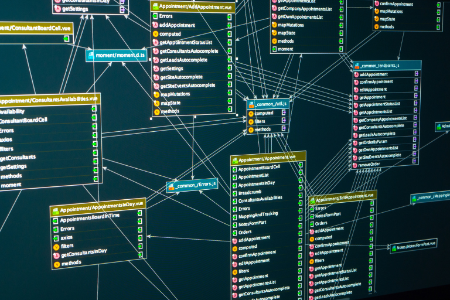

Muitas empresas começam com o Excel ou o Microsoft Access como estrutura de base de dados para gerir os seus dados e organizar os processos internos. No início, isto costuma funcionar bem, mas, à medida que o volume de dados aumenta, torna-se cada vez mais difícil manter uma visão de conjunto.

Muitas vezes, isto deve-se ao facto de a base de dados não ter sido devidamente planeada desde o início. Se criar tabelas sem uma estrutura de base de dados clara, prescindir de IDs únicos ou não ligar entre si os dados relacionados, surgem rapidamente informações duplicadas e contraditórias. Isto torna o trabalho diário moroso e dificulta ajustes posteriores. No pior dos casos, terá de reconstruir a sua base de dados por completo ou até de mudar para um novo sistema.

Com um esquema de base de dados bem pensado, cria uma base sólida para a gestão dos seus dados. Determina que informações guarda em que tabelas e como os diferentes registos se relacionam entre si. Assim, mantém a visão de conjunto e pode continuar a expandir a sua base de dados sem problemas quando os seus requisitos mudarem. As [bases de dados no-code](), em particular, oferecem-lhe opções flexíveis para isso, sem que precise de conhecimentos aprofundados de programação.

Neste artigo, ficará a saber que modelos de bases de dados existem, a que deve prestar atenção ao planear o seu esquema de base de dados e que cinco erros típicos pode evitar. Além disso, mostramos-lhe, com um exemplo prático, como estruturar e ligar os seus dados de forma sensata.

## Os 4 tipos clássicos de modelos de bases de dados
Antes de planear a sua base de dados, deve conhecer os diferentes modelos de bases de dados. Estes diferem na forma como armazenam as informações e as ligam entre si. O modelo adequado para si depende dos dados que gere e da forma como os pretende utilizar.

### O modelo de base de dados relacional
O modelo de base de dados relacional está particularmente difundido nas empresas. Organiza as informações em tabelas compostas por linhas e colunas. Cada linha contém um registo, enquanto as colunas descrevem as diferentes características. Através de chaves únicas, pode ligar registos de diferentes tabelas.

Um exemplo é uma [base de dados de clientes](). Guarda os dados dos clientes numa tabela e os projetos noutra. Através de um ID de cliente comum, associa cada projeto ao cliente correspondente. Assim, não precisa de voltar a introduzir as informações do cliente em cada projeto.

### O modelo de base de dados hierárquico
O modelo hierárquico organiza os dados como uma árvore. Um registo principal pode conter vários registos subordinados. Cria-se assim uma estrutura clara de pai e filho entre os registos.

Isto é adequado, por exemplo, para [organigramas]() ou diretórios nos quais existe uma hierarquia fixa. No entanto, assim que um registo tiver de ser associado a várias entradas principais, este modelo atinge os seus limites.

### O modelo de base de dados em rede
O modelo em rede permite ligações mais complexas do que o modelo hierárquico. Um registo pode estar ligado a vários outros registos. Desta forma, também é possível representar relações em que várias entradas estão relacionadas entre si.

Isto é particularmente útil quando os dados apresentam muitas ligações diferentes. Contudo, a estrutura da base de dados pode tornar-se rapidamente complexa e, por isso, mais difícil de compreender e manter.

### O modelo de base de dados orientado a objetos
O modelo orientado a objetos armazena as informações como objetos. Para além de dados, estes podem conter também propriedades e funções. O modelo é especialmente adequado para aplicações que trabalham com estruturas de dados complexas, por exemplo no desenvolvimento técnico ou em simulações.

Para muitas aplicações empresariais típicas, o [modelo de base de dados relacional]() é uma boa base. Com ele, pode organizar clientes, projetos, tarefas ou colaboradores em tabelas próprias e ligá-los através de relações. Assim, mantém cada informação clara e evita duplicações desnecessárias.

As bases de dados no-code como o SeaTable adotam este princípio e tornam-no utilizável mesmo sem conhecimentos aprofundados de programação. Cria tabelas e campos de forma visual e liga diretamente entre si os registos relacionados. O no-code não é um modelo de base de dados próprio, mas sim uma abordagem que lhe permite criar e adaptar aplicações de bases de dados de forma mais simples.

## Porque é que uma estrutura de base de dados bem pensada compensa a longo prazo
Uma estrutura de base de dados bem pensada facilita o seu trabalho diário e ajuda-o a desenvolver a sua base de dados a longo prazo. Beneficia sobretudo das seguintes vantagens:

- **Menos silos de dados e redundâncias:** reúne de forma centralizada as informações relacionadas, evita entradas duplicadas e garante que todas as equipas trabalham com um conjunto de dados uniforme.
- **Menos esforço nos ajustes:** acrescenta tabelas, campos e ligações de forma direcionada, em vez de ter de reconstruir por completo a sua base de dados a cada novo requisito.
- **Maior escalabilidade:** tem em conta desde cedo o crescimento do volume de dados, utilizadores adicionais e novos processos de negócio. Assim, a sua base de dados cresce com os requisitos da sua empresa.
- **Melhor qualidade dos dados e manutenção:** IDs únicos, relações claras e uma estrutura compreensível ajudam-no a evitar erros e a manter os seus dados de forma fiável.

## Como planear corretamente a estrutura de uma base de dados
Antes de criar a sua base de dados, deve refletir sobre a sua conceção. Uma estrutura clara ajuda-o a organizar as informações de forma lógica, a evitar dados duplicados e a implementar expansões posteriores com maior facilidade. Um esquema de base de dados bem pensado dá-lhe a base certa para isso.

Ao planear, tenha em atenção os seguintes pontos:



Pense primeiro nas informações que pretende registar e nas tabelas de que precisa para isso. Numa base de dados de projetos, poderiam ser, por exemplo, clientes, projetos, tarefas e colaboradores. Atribua a cada conjunto de informações relacionadas uma tabela própria.





Determine que dados cada tabela deve conter. Escolha para cada campo um tipo de dados adequado, como texto, número, data ou caixa de verificação. Assim, garante que os seus dados são armazenados de forma uniforme e coerente.





Cada registo precisa de um identificador único através do qual possa ser reconhecido. Para isso, é adequada uma chave primária, por exemplo um número sequencial ou um ID alfanumérico. Esta evita confusões e constitui a base para as ligações a outras tabelas.





Se várias tabelas estiverem relacionadas, deve definir as relações correspondentes. As chaves estrangeiras remetem para registos noutras tabelas e ajudam-no a ligar as informações entre si, em vez de as guardar várias vezes.





Pense se existem relações 1:1, 1:N ou N:M entre as suas tabelas. Uma normalização adequada ajuda-o também a evitar redundâncias de dados e a manter as informações coerentes. As três primeiras formas normais oferecem regras importantes para isso.





Registe o seu esquema de base de dados num diagrama entidade-relação (ER) ou noutra representação visual. Assim, vê rapidamente que tabelas existem, que campos contêm e como os diferentes dados estão ligados entre si.



## Os cinco erros mais comuns na criação de uma base de dados
Mesmo que conheça os fundamentos de uma base de dados, podem ocorrer erros durante o planeamento e a implementação. Muitas vezes, só são detetados quando o volume de dados aumenta ou quando várias pessoas trabalham com a base de dados. Por isso, deve evitar estes cinco problemas desde o início.

### 1. Falta de uma estrutura lógica
Se criar novas tabelas de forma espontânea sem ter em conta a conceção global da base de dados, surge rapidamente um conjunto de dados confuso. As informações acabam nas tabelas erradas ou aparecem várias vezes. Isto dificulta a manutenção e torna os ajustes posteriores morosos.

**Como evitar o erro:** pense antecipadamente nas informações que pretende registar e na forma como se relacionam. Divida os seus dados em tabelas estruturadas de forma lógica e utilize uma nomenclatura uniforme.

### 2. Falta de IDs únicos
Sem identificadores únicos, é difícil distinguir os diferentes registos. Isto torna-se particularmente problemático quando vários clientes têm o mesmo nome ou quando as informações mudam ao longo do tempo. A ligação entre tabelas também fica dificultada.

**Como evitar o erro:** atribua a cada registo uma chave primária única. Um número sequencial ou um ID alfanumérico são adequados para isso. Em seguida, pode estabelecer relações com outras tabelas através de chaves estrangeiras.

### 3. Guardar dados várias vezes em vez de os ligar
Se guardar as mesmas informações em várias tabelas, surgem redundâncias de dados desnecessárias. Se, por exemplo, a morada de um cliente mudar, terá de a atualizar em todos os locais. Se se esquecer de uma entrada, a sua base de dados conterá informações contraditórias.

**Como evitar o erro:** guarde cada registo, sempre que possível, apenas uma vez e utilize ligações para o reutilizar noutras tabelas. Assim, gere as informações de forma centralizada e mantém os seus dados coerentes.

### 4. Modelar incorretamente as relações entre tabelas
Não basta ligar as tabelas entre si. Também tem de definir como os dados estão realmente relacionados. Sem relações claramente definidas, surgem associações incorretas e estruturas de dados difíceis de compreender. As diferenças entre as relações 1:N e N:M são particularmente importantes neste contexto.

**Como evitar o erro:** defina as relações logo no planeamento do seu esquema de base de dados. Utilize um diagrama ER para visualizar as ligações entre as tabelas. Assim, percebe atempadamente se a estrutura da sua base de dados é lógica.

### 5. Não preparar a base de dados para o crescimento futuro
Uma base de dados que hoje é suficiente para poucos utilizadores e volumes de dados reduzidos pode atingir rapidamente os seus limites quando os requisitos aumentam. Se não tiver em conta utilizadores adicionais, novos processos ou volumes de dados maiores, arrisca-se a ajustes morosos e a mudanças de sistema dispendiosas.

**Como evitar o erro:** planeie a sua base de dados desde o início de forma a poder acrescentar mais tarde outras tabelas, campos e utilizadores. Garanta uma estrutura de base de dados flexível e verifique se uma base de dados na nuvem ou no-code escalável se adequa melhor aos seus requisitos a longo prazo.

## Exemplo prático: conceção de uma base de dados de projetos
A melhor forma de perceber como planear a estrutura da sua base de dados é através de um exemplo concreto. Imagine que pretende gerir projetos de forma centralizada e, ao mesmo tempo, acompanhar clientes, colaboradores, tarefas e o progresso dos projetos. Em vez de reunir todas as informações numa única tabela, divide os seus dados em várias tabelas ligadas entre si.

### Dividir as tabelas de forma sensata
Para uma [base de dados de projetos]() simples, precisa, por exemplo, das seguintes tabelas:

- Clientes com nome do cliente, pessoa de contacto, dados de contacto e ID de cliente
- Projetos com título do projeto, data de início, estado, cliente responsável e ID de projeto
- Tarefas com descrição da tarefa, prazo, estado e ID do projeto associado
- Colaboradores com nome, departamento, dados de contacto e ID de colaborador

Cada tabela representa uma área própria. Desta forma, evita ter de voltar a introduzir as informações do cliente em cada projeto ou que tarefas e colaboradores se percam numa tabela geral confusa.

### Ligar os registos entre si
Para que a sua base de dados não seja composta por tabelas isoladas, ligue os diferentes registos entre si. Um cliente pode, por exemplo, ter vários projetos. Entre clientes e projetos existe, portanto, uma relação 1:N. Um projeto, por sua vez, abrange várias tarefas, pelo que também aqui existe uma relação 1:N. Já se vários colaboradores trabalharem em diferentes projetos, surge uma relação N:M. Um colaborador pode estar associado a vários projetos e um projeto pode incluir vários colaboradores. Este tipo de relações pode ser representado através de uma tabela de associação adicional.

### Porque é que esta conceção de base de dados faz sentido
Com esta estrutura, guarda as informações apenas uma vez e acede-lhes através de ligações sempre que necessário. Se, por exemplo, o número de telefone de um cliente mudar, atualiza o registo na tabela de clientes, em vez de ajustar a informação em vários projetos.

Além disso, pode expandir a sua base de dados a qualquer momento. Acrescente, por exemplo, uma tabela para orçamentos, documentos ou equipas de projeto, sem ter de alterar por completo a conceção existente da base de dados.

Sobretudo com uma base de dados no-code, pode representar visualmente estas tabelas e ligações. Assim, vê diretamente como os seus dados estão relacionados e adapta a estrutura a novos requisitos sem ter de criar a base de dados de raiz.

## SeaTable vs. MS Access: quando vale a pena mudar?
O Microsoft Access é adequado para criar aplicações de bases de dados mais pequenas e representar processos internos. Sobretudo se já trabalha com o Microsoft Office, pode criar rapidamente tabelas, formulários e consultas. No entanto, com o aumento dos requisitos, de utilizadores e da complexidade dos processos, o desenvolvimento torna-se cada vez mais moroso.

As bases de dados no-code modernas como o SeaTable oferecem-lhe uma abordagem mais flexível. Cria tabelas, liga registos e utiliza a visualização da estrutura da base de dados para identificar relações e adaptar a sua base de dados com flexibilidade – sem consultas SQL nem programação extensa.

|                     | **SeaTable**          | **MS Access**         |
| ------------------- | --------------------- | --------------------- |
| **Modelo de base de dados** | Base de dados no-code com estruturas de dados relacionais e colunas de ligação | Base de dados relacional com tabelas, chaves primárias e estrangeiras |
| **Conceção da base de dados** | Criação visual de tabelas e colunas através de uma interface semelhante a uma folha de cálculo | Criação de tabelas e campos através da vista de folha de dados e da vista de estrutura |
| **Ligação de tabelas** | Ligação direta de registos através de colunas de ligação especiais | Relações através de chaves primárias e estrangeiras |
| **Modelação de relações** | Ligação de um ou vários registos; relações N:M possíveis sem tabela de associação adicional | Relações 1:1 e 1:N; relações N:M através de tabelas de associação |
| **Visualização do esquema de base de dados** | Representação gráfica da estrutura das tabelas e das suas ligações através do plugin de relações de tabela | Representação gráfica das tabelas e relações na janela Relações |
| **Adaptação da estrutura da base de dados** | Adição e edição de tabelas, tipos de coluna e ligações diretamente na interface de utilizador | Adaptação de tabelas, campos e relações através da vista de estrutura e da janela Relações |
| **Conhecimentos de programação** | Conceção básica da base de dados sem programação; automatizações baseadas em regras e scripts opcionais | Funções básicas utilizáveis sem programação; funções avançadas através de macros, SQL e VBA |
| **Escalabilidade** | Por predefinição, até 100 000 registos ativos por base; registos adicionais através do armazenamento Big Data com limitações funcionais | Máximo de 2 GB por ficheiro de base de dados do Access; expansão possível através de servidores de bases de dados externos como o SQL Server |
| **Colaboração** | Edição conjunta de dados em tempo real no navegador | Utilização multiutilizador através de partilhas de rede, bases de dados divididas ou servidores de bases de dados externos |
| **Gestão de permissões** | Permissões individuais ao nível da base, da vista, da tabela e da coluna, consoante o plano | Baseada em ficheiros; permissões de utilizador diferenciadas, por exemplo, através de um servidor de base de dados externo |
| **Modelo de funcionamento** | [Solução na nuvem]() ou self-hosting na sua própria infraestrutura de servidores | Base de dados local de ambiente de trabalho, solução de rede ou ligação a servidores de bases de dados externos |
| **Proteção de dados** | Em conformidade com o RGPD | Em conformidade com o RGPD |

### Quando vale a pena mudar?
Se a estrutura da sua base de dados Access atingir os seus limites, se fizer ajustes com frequência ou se pretender tornar a sua base de dados acessível a vários colaboradores, pode valer a pena mudar para uma plataforma de bases de dados moderna.

Com o SeaTable, pode reconstruir a estrutura da sua base de dados existente, ligar tabelas entre si e expandir os processos passo a passo. Mantém o controlo sobre os seus dados e pode adaptar as suas aplicações a novos requisitos sem ter de planear trabalhos de desenvolvimento morosos a cada alteração.
Especialmente para sistemas de CRM, gestão de projetos, planeamento de recursos ou gestão de processos individuais, uma abordagem no-code oferece a possibilidade de conceber aplicações de bases de dados de forma mais flexível e de as desenvolver a longo prazo.

## Como manter a estrutura da sua base de dados a longo prazo
Uma estrutura de base de dados bem planeada só é útil a longo prazo se for mantida regularmente. Novos requisitos, tabelas adicionais e processos alterados podem tornar a conceção da sua base de dados mais complexa com o tempo. Para que os seus dados se mantenham coerentes e compreensíveis, deve ter em atenção alguns pontos.

- **Documentar o esquema de base de dados e as relações:** registe que tabelas existem, que campos de dados contêm e como as tabelas estão ligadas entre si. Uma documentação compreensível facilita os ajustes posteriores para si e para a sua equipa.
- **Dar nomes uniformes às tabelas e aos campos de dados:** utilize designações claras e coerentes. Convenções de nomenclatura uniformes ajudam-no a identificar rapidamente tabelas e campos e a evitar mal-entendidos na manutenção dos dados.
- **Verificar regularmente a qualidade dos dados:** verifique os seus dados quanto a entradas duplicadas, informações em falta ou desatualizadas e ligações incorretas. Assim, garante que a sua base de dados fornece informações fiáveis a longo prazo.
- **Documentar e testar as alterações:** quando expandir o seu esquema de base de dados ou ajustar relações existentes, deve documentar as alterações de forma compreensível e testá-las antes da utilização em produção. Assim, evita erros que possam afetar os processos existentes.
- **Definir permissões e responsabilidades:** defina quem pode editar dados, alterar tabelas ou criar novos campos. Responsabilidades claras reduzem alterações descontroladas e facilitam a colaboração.
- **Desenvolver visualmente a estrutura da base de dados:** utilize diagramas ER ou modelação visual de dados para manter a visão de conjunto sobre as suas tabelas e relações. As plataformas no-code permitem-lhe ainda implementar alterações diretamente e tornar os processos recorrentes mais eficientes através de automatizações.

## Conclusão: planear o futuro com um esquema de base de dados escalável
Uma conceção de base de dados bem pensada determina a fiabilidade e a flexibilidade com que pode gerir os seus dados a longo prazo. Se estruturar as tabelas de forma lógica, atribuir IDs únicos e modelar as relações de forma sensata, evita dados redundantes, facilita a manutenção e cria uma base para futuras expansões.

Por isso, não planeie o seu esquema de base de dados apenas para os requisitos atuais, mas tenha também em conta possíveis mudanças e o crescimento. Com uma base de dados no-code como o SeaTable, pode conceber, visualizar e adaptar tabelas e ligações de forma flexível, sem programação extensa. Assim, a sua base de dados mantém-se clara e cresce com a sua empresa.

## Perguntas frequentes

Para muitas empresas, é adequada uma base de dados relacional, uma vez que armazena dados estruturados de forma clara e os liga entre si. Com ela, é possível gerir de forma centralizada, por exemplo, clientes, projetos, colaboradores e processos de negócio. Se procura uma solução flexível que possa ser adaptada sem programação extensa, uma base de dados no-code pode ser uma alternativa sensata aos sistemas de bases de dados clássicos.



Os quatro modelos clássicos de bases de dados são o modelo relacional, o hierárquico, o de rede e o orientado a objetos. Diferem na forma como os dados são organizados e ligados.
- Modelo relacional com tabelas e ligações
- Modelo hierárquico com estruturas em árvore
- Modelo de rede com ligações complexas
- Modelo orientado a objetos com objetos e propriedades



O Microsoft Access é adequado para aplicações de bases de dados mais pequenas e processos simples. No entanto, quando mais utilizadores acedem simultaneamente à base de dados, o volume de dados aumenta ou as aplicações se tornam mais complexas, cresce o esforço de manutenção e desenvolvimento. As empresas atingem então os limites de uma estrutura de base de dados Access sobretudo nos seguintes pontos:
- Escalabilidade com volumes de dados crescentes
- Colaboração entre diferentes localizações
- Adaptação a processos de negócio mais complexos
- Manutenção e desenvolvimento das aplicações existentes



As bases de dados modernas ajudam as empresas a gerir e ligar de forma centralizada diferentes informações.
- Bases de dados de CRM para clientes e processos de vendas
- Bases de dados de projetos para tarefas, recursos e progresso
- Bases de dados de pessoal e de candidatos para processos de RH
- Bases de dados de inventário e de produtos para existências e cadeias de abastecimento



Pode exportar uma base de dados SQL guardando os dados nela contidos e, se necessário, a estrutura das tabelas através da função de exportação do seu sistema de base de dados. Para migrar para outro sistema, deve seguir estes passos:
- Exportar tabelas e registos
- Verificar a estrutura de dados e as relações
- Ajustar os tipos de dados e os mapeamentos de campos
- Importar os dados para o sistema de destino e validá-los em seguida

