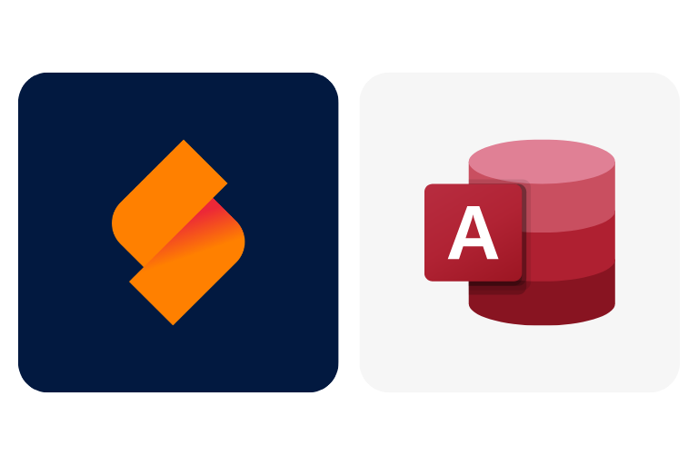

Многие компании начинают с Excel или Microsoft Access в качестве структуры базы данных, чтобы управлять своими данными и организовывать внутренние процессы. На первых порах это, как правило, хорошо работает, но с ростом объема данных сохранять общую картину становится все сложнее.

Часто причина в том, что базу данных изначально не спланировали должным образом. Если вы создаете таблицы без четкой структуры базы данных, отказываетесь от уникальных идентификаторов или не связываете между собой взаимосвязанные данные, быстро появляется дублирующаяся и противоречивая информация. Это усложняет ежедневную работу и затрудняет последующие изменения. В худшем случае вам придется полностью перестраивать базу данных или даже переходить на новую систему.

Продуманная схема базы данных создает прочную основу для управления вашими данными. Вы определяете, какую информацию хранить в каких таблицах и как отдельные записи связаны друг с другом. Так вы сохраняете общую картину и можете без проблем расширять базу данных, даже когда ваши требования меняются. Особенно [no-code базы данных]() предлагают для этого гибкие возможности, не требуя глубоких знаний программирования.

Из этой статьи вы узнаете, какие существуют модели баз данных, на что обратить внимание при планировании схемы базы данных и каких пяти типичных ошибок можно избежать. Кроме того, на практическом примере мы покажем, как разумно структурировать и связывать данные.

## 4 классических типа моделей баз данных
Прежде чем планировать базу данных, вам стоит познакомиться с различными моделями баз данных. Они различаются тем, как хранят информацию и связывают ее между собой. Какая модель подойдет вам, зависит от того, какими данными вы управляете и как хотите их использовать.

### Реляционная модель базы данных
Реляционная модель базы данных особенно широко распространена в компаниях. Она организует информацию в таблицах, состоящих из строк и столбцов. Каждая строка содержит запись, а столбцы описывают отдельные характеристики. С помощью уникальных ключей вы можете связывать записи из разных таблиц.

Пример — [база данных клиентов](). Вы храните данные клиентов в одной таблице, а проекты — в другой. С помощью общего идентификатора клиента вы привязываете каждый проект к нужному клиенту. Так вам не нужно заново вводить информацию о клиенте для каждого проекта.

### Иерархическая модель базы данных
Иерархическая модель организует данные в виде дерева. Родительская запись может содержать несколько дочерних записей. Благодаря этому между записями возникает четкая структура «родитель — потомок».

Это подходит, например, для [организационных структур]() или каталогов с фиксированной иерархией. Однако как только запись нужно отнести к нескольким родительским элементам, эта модель достигает своих пределов.

### Сетевая модель базы данных
Сетевая модель допускает более сложные связи, чем иерархическая. Одна запись может быть связана с несколькими другими записями. Это позволяет отображать и такие отношения, в которых несколько элементов связаны друг с другом.

Это особенно полезно, когда данные имеют множество разных связей. Однако структура базы данных может быстро стать сложной, и поэтому ее труднее охватить взглядом и поддерживать.

### Объектно-ориентированная модель базы данных
Объектно-ориентированная модель хранит информацию в виде объектов. Помимо данных, они могут содержать также свойства и функции. Модель подходит прежде всего для приложений, работающих со сложными структурами данных, например в технических разработках или при моделировании.

Для многих типичных корпоративных приложений [реляционная модель базы данных]() — хорошая основа. С ее помощью вы можете организовать клиентов, проекты, задачи или сотрудников в отдельных таблицах и связать их через отношения. Так каждая единица информации остается наглядной, а лишних дублирований не возникает.

No-code базы данных, такие как SeaTable, используют этот принцип и делают его доступным без глубоких знаний программирования. Вы визуально создаете таблицы и поля и напрямую связываете между собой взаимосвязанные записи. No-code — это не отдельная модель базы данных, а подход, позволяющий проще создавать и адаптировать приложения баз данных.

## Почему продуманная структура базы данных окупается в долгосрочной перспективе
Продуманная структура базы данных облегчает вашу ежедневную работу и помогает развивать базу данных в долгосрочной перспективе. Прежде всего вы получаете следующие преимущества:

- **Меньше разрозненных данных и избыточности:** вы централизованно объединяете взаимосвязанную информацию, избегаете дублирующихся записей и обеспечиваете работу всех команд с единым набором данных.
- **Меньше усилий при изменениях:** вы целенаправленно добавляете таблицы, поля и связи, вместо того чтобы при каждом новом требовании полностью перестраивать базу данных.
- **Больше масштабируемости:** вы заранее учитываете рост объема данных, новых пользователей и новые бизнес-процессы. Так ваша база данных растет вместе с требованиями вашей компании.
- **Более высокое качество данных и удобство сопровождения:** уникальные идентификаторы, четкие отношения и понятная структура помогают вам избегать ошибок и надежно поддерживать данные.

## Как правильно спланировать структуру базы данных
Прежде чем создавать базу данных, вам стоит продумать ее устройство. Четкая структура помогает логически организовать информацию, избежать дублирования данных и проще реализовать последующие расширения. Продуманная схема базы данных создает для этого правильную основу.

При планировании обратите внимание на следующие пункты:



Сначала подумайте, какую информацию вы хотите собирать и какие таблицы для этого нужны. Для базы данных проектов это могут быть, например, клиенты, проекты, задачи и сотрудники. Выделите для каждой группы взаимосвязанной информации отдельную таблицу.





Определите, какие сведения должна содержать каждая таблица. Выберите для каждого поля подходящий тип данных, например текст, число, дату или флажок. Так вы обеспечите единообразное и осмысленное хранение данных.





Каждой записи нужен уникальный идентификатор, по которому ее можно распознать. Для этого подходит первичный ключ, например порядковый номер или буквенно-цифровой идентификатор. Он предотвращает путаницу и служит основой для связей с другими таблицами.





Если несколько таблиц связаны между собой, вам следует определить соответствующие отношения. Внешние ключи ссылаются на записи в других таблицах и помогают связывать информацию, а не хранить ее многократно.





Подумайте, какие отношения существуют между вашими таблицами: 1:1, 1:N или N:M. Разумная нормализация также помогает избежать избыточности данных и сохранять информацию согласованной. Первые три нормальные формы задают для этого важные правила.





Зафиксируйте схему базы данных в ER-диаграмме или другом визуальном представлении. Так вы с первого взгляда увидите, какие таблицы существуют, какие поля они содержат и как связаны между собой отдельные данные.



## Пять самых частых ошибок при создании базы данных
Даже если вы знаете основы баз данных, при планировании и реализации могут возникать ошибки. Часто они становятся заметны только тогда, когда растет объем данных или с базой работают несколько человек. Поэтому этих пяти проблем стоит избегать с самого начала.

### 1. Отсутствие логической структуры
Если вы спонтанно создаете новые таблицы, не учитывая общее устройство базы данных, быстро возникает запутанный массив данных. Информация попадает не в те таблицы или появляется несколько раз. Это затрудняет сопровождение и делает последующие изменения трудоемкими.

**Как избежать ошибки:** заранее продумайте, какую информацию вы хотите собирать и как она взаимосвязана. Разделите данные на логически выстроенные таблицы и следите за единообразием названий.

### 2. Отсутствие уникальных идентификаторов
Без уникальных идентификаторов отдельные записи трудно различать. Особенно проблематично это становится, когда у нескольких клиентов одинаковое имя или информация со временем меняется. Связывание таблиц при этом тоже затрудняется.

**Как избежать ошибки:** присвойте каждой записи уникальный первичный ключ. Для этого хорошо подходит порядковый номер или буквенно-цифровой идентификатор. Затем с помощью внешних ключей вы можете устанавливать отношения с другими таблицами.

### 3. Многократное хранение данных вместо связывания
Если вы храните одну и ту же информацию в нескольких таблицах, возникает ненужная избыточность данных. Например, если меняется адрес клиента, вам придется обновлять его в каждом месте. Если вы забудете одну запись, база данных будет содержать противоречивую информацию.

**Как избежать ошибки:** по возможности храните каждую запись только один раз и используйте связи, чтобы повторно использовать ее в других таблицах. Так вы централизованно поддерживаете информацию и сохраняете согласованность данных.

### 4. Неправильное моделирование отношений между таблицами
Недостаточно просто связать таблицы между собой. Вам также нужно определить, как данные связаны на самом деле. Без четко определенных отношений возникают неверные привязки и трудные для понимания структуры данных. Особенно важны здесь различия между отношениями 1:N и N:M.

**Как избежать ошибки:** определите отношения уже на этапе планирования схемы базы данных. Используйте ER-диаграмму, чтобы визуализировать связи между таблицами. Так вы заранее увидите, логично ли выстроена структура вашей базы данных.

### 5. База данных не рассчитана на будущий рост
База данных, которой сегодня достаточно для нескольких пользователей и небольших объемов данных, при росте требований может быстро достичь своих пределов. Если вы не учитываете дополнительных пользователей, новые процессы или большие объемы данных, вам грозят трудоемкие изменения и дорогостоящая смена системы.

**Как избежать ошибки:** с самого начала планируйте базу данных так, чтобы впоследствии можно было добавлять новые таблицы, поля и пользователей. Позаботьтесь о гибкой структуре базы данных и проверьте, не подойдет ли для ваших долгосрочных требований лучше масштабируемая облачная или no-code база данных.

## Практический пример: проектирование базы данных проектов
Как спланировать структуру базы данных, лучше всего понять на конкретном примере. Представьте, что вы хотите централизованно управлять проектами и при этом держать в поле зрения клиентов, сотрудников, задачи и ход выполнения проектов. Вместо того чтобы собирать всю информацию в одной таблице, вы распределяете данные по нескольким связанным таблицам.

### Разумное разделение таблиц
Для простой [базы данных проектов]() вам понадобятся, например, следующие таблицы:

- Клиенты: название клиента, контактное лицо, контактные данные и идентификатор клиента
- Проекты: название проекта, дата начала, статус, соответствующий клиент и идентификатор проекта
- Задачи: описание задачи, срок, статус и идентификатор связанного проекта
- Сотрудники: имя, отдел, контактные данные и идентификатор сотрудника

Каждая таблица охватывает отдельную область. Так вам не придется заново вводить информацию о клиенте для каждого проекта, а задачи и сотрудники не потеряются в запутанной общей таблице.

### Связывание записей между собой
Чтобы ваша база данных не состояла из изолированных таблиц, вы связываете отдельные записи между собой. Например, у одного клиента может быть несколько проектов. Между клиентами и проектами, таким образом, существует отношение 1:N. Проект, в свою очередь, включает несколько задач, так что здесь тоже имеется отношение 1:N. Если же несколько сотрудников работают над разными проектами, возникает отношение N:M. Сотрудник может быть назначен на несколько проектов, а в проекте могут участвовать несколько сотрудников. Такие отношения можно отобразить с помощью дополнительной связующей таблицы.

### Почему такое устройство базы данных целесообразно
При такой структуре вы храните информацию только один раз и при необходимости обращаетесь к ней через связи. Если, например, меняется номер телефона клиента, вы обновляете запись в таблице клиентов, а не корректируете информацию в нескольких проектах.

Кроме того, вы можете в любой момент расширить базу данных. Добавьте, например, таблицу для бюджетов, документов или проектных команд, не меняя полностью существующее устройство базы данных.

Особенно в no-code базе данных вы можете наглядно отобразить эти таблицы и связи. Так вы сразу видите, как связаны ваши данные, и адаптируете структуру к новым требованиям, не создавая базу данных с нуля.

## SeaTable и MS Access: когда стоит переходить?
Microsoft Access хорошо подходит для создания небольших приложений баз данных и отображения внутренних процессов. Особенно если вы уже работаете с Microsoft Office, вы можете быстро создавать таблицы, формы и запросы. Однако с ростом требований, числа пользователей и сложности процессов дальнейшее развитие становится все более трудоемким.

Современные no-code базы данных, такие как SeaTable, предлагают более гибкий подход. Вы создаете таблицы, связываете записи и используете визуализацию структуры базы данных, чтобы видеть взаимосвязи и гибко адаптировать базу данных — без SQL-запросов и сложного программирования.

|                     | **SeaTable**          | **MS Access**         |
| ------------------- | --------------------- | --------------------- |
| **Модель базы данных** | No-code база данных с реляционными структурами данных и столбцами связей | Реляционная база данных с таблицами, первичными и внешними ключами |
| **Проектирование базы данных** | Визуальное создание таблиц и столбцов через интерфейс, похожий на электронную таблицу | Создание таблиц и полей в режиме таблицы и в режиме конструктора |
| **Связывание таблиц** | Прямое связывание записей через специальные столбцы связей | Отношения через первичные и внешние ключи |
| **Моделирование отношений** | Связывание одной или нескольких записей; отношения N:M возможны без дополнительной связующей таблицы | Отношения 1:1 и 1:N; отношения N:M через связующие таблицы |
| **Визуализация схемы базы данных** | Графическое представление структуры таблиц и их связей с помощью плагина отношений таблиц | Графическое представление таблиц и отношений в окне «Схема данных» |
| **Изменение структуры базы данных** | Добавление и редактирование таблиц, типов столбцов и связей прямо в пользовательском интерфейсе | Изменение таблиц, полей и отношений в режиме конструктора и в окне «Схема данных» |
| **Знания программирования** | Базовое проектирование базы данных без программирования; автоматизации на основе правил и опциональные скрипты | Базовые функции доступны без программирования; расширенные функции через макросы, SQL и VBA |
| **Масштабируемость** | По умолчанию до 100 000 активных записей на базу; дополнительные записи через хранилище Big Data с функциональными ограничениями | Максимум 2 ГБ на файл базы данных Access; расширение возможно через внешние серверы баз данных, например SQL Server |
| **Совместная работа** | Совместное редактирование данных в реальном времени через браузер | Многопользовательский режим через сетевые папки, разделенные базы данных или внешние серверы баз данных |
| **Управление правами доступа** | Индивидуальные права на уровне базы, представления, таблицы и столбца в зависимости от тарифа | На основе файлов; дифференцированные права пользователей, например, через внешний сервер базы данных |
| **Модель эксплуатации** | [Облачное решение]() или self-hosting на собственной серверной инфраструктуре | Локальная настольная база данных, сетевое решение или подключение к внешним серверам баз данных |
| **Защита данных** | Соответствует GDPR | Соответствует GDPR |

### Когда стоит переходить?
Если структура вашей базы данных Access достигла своих пределов, вы все чаще вносите изменения или хотите сделать базу данных доступной для нескольких сотрудников, переход на современную платформу баз данных может оказаться выгодным.

С SeaTable вы можете заново выстроить существующую структуру базы данных, связать таблицы между собой и постепенно расширять процессы. Вы сохраняете контроль над своими данными и можете адаптировать приложения к новым требованиям, не планируя трудоемкую разработку при каждом изменении.
Особенно для CRM-систем, управления проектами, планирования ресурсов или индивидуального управления процессами no-code подход дает возможность создавать более гибкие приложения баз данных и развивать их в долгосрочной перспективе.

## Как поддерживать структуру базы данных в долгосрочной перспективе
Хорошо спланированная структура базы данных полезна в долгосрочной перспективе лишь при условии регулярного сопровождения. Новые требования, дополнительные таблицы и изменившиеся процессы со временем могут усложнить устройство вашей базы данных. Чтобы данные оставались согласованными и понятными, вам стоит учитывать несколько моментов.

- **Документируйте схему базы данных и отношения:** зафиксируйте, какие таблицы существуют, какие поля данных они содержат и как таблицы связаны между собой. Понятная документация облегчает вам и вашей команде последующие изменения.
- **Называйте таблицы и поля данных единообразно:** используйте четкие и согласованные названия. Единые соглашения об именовании помогают быстро ориентироваться в таблицах и полях и избегать недоразумений при сопровождении данных.
- **Регулярно проверяйте качество данных:** проверяйте данные на дубликаты, отсутствующие сведения, устаревшую информацию и ошибочные связи. Так вы обеспечите, что база данных и в долгосрочной перспективе предоставляет надежную информацию.
- **Документируйте и тестируйте изменения:** если вы расширяете схему базы данных или изменяете существующие отношения, вам следует понятно документировать изменения и тестировать их перед использованием в рабочей среде. Так вы избежите ошибок, которые могут нарушить существующие процессы.
- **Определите права доступа и зоны ответственности:** установите, кто может редактировать данные, изменять таблицы или создавать новые поля. Четкое распределение ответственности сокращает неконтролируемые изменения и облегчает совместную работу.
- **Развивайте структуру базы данных визуально:** используйте ER-диаграммы или визуальное моделирование данных, чтобы сохранять обзор таблиц и отношений. No-code платформы, кроме того, позволяют сразу вносить изменения и делать повторяющиеся процессы эффективнее с помощью автоматизаций.

## Заключение: планируйте будущее с масштабируемой схемой базы данных
Продуманное устройство базы данных определяет, насколько надежно и гибко вы сможете управлять данными в долгосрочной перспективе. Если вы логично структурируете таблицы, назначаете уникальные идентификаторы и разумно моделируете отношения, вы избегаете избыточных данных, упрощаете сопровождение и создаете основу для будущих расширений.

Поэтому планируйте схему базы данных не только с учетом текущих требований, но и с учетом возможных изменений и роста. С no-code базой данных, такой как SeaTable, вы можете гибко создавать, визуализировать и адаптировать таблицы и связи без сложного программирования. Так ваша база данных остается наглядной и растет вместе с вашей компанией.

## Часто задаваемые вопросы

Многим компаниям подходит реляционная база данных, поскольку она наглядно хранит структурированные данные и связывает их между собой. С ее помощью можно централизованно управлять, например, клиентами, проектами, сотрудниками и бизнес-процессами. Если вы ищете гибкое решение, которое можно адаптировать без сложного программирования, no-code база данных может стать разумной альтернативой классическим системам баз данных.



К четырем классическим моделям баз данных относятся реляционная, иерархическая, сетевая и объектно-ориентированная модели. Они различаются способом организации и связывания данных.
- Реляционная модель с таблицами и связями
- Иерархическая модель с древовидными структурами
- Сетевая модель со сложными связями
- Объектно-ориентированная модель с объектами и свойствами



Microsoft Access хорошо подходит для небольших приложений баз данных и несложных процессов. Однако когда к базе данных одновременно обращается больше пользователей, растет объем данных или приложения становятся сложнее, увеличиваются затраты на сопровождение и развитие. Тогда компании упираются в ограничения структуры базы данных Access прежде всего в следующих аспектах:
- Масштабируемость при растущих объемах данных
- Совместная работа из разных офисов
- Адаптация к более сложным бизнес-процессам
- Сопровождение и развитие существующих приложений



Современные базы данных помогают компаниям централизованно управлять разнообразной информацией и связывать ее между собой.
- CRM-базы данных для клиентов и процессов продаж
- Базы данных проектов для задач, ресурсов и хода работ
- Базы данных персонала и кандидатов для HR-процессов
- Базы данных складских запасов и продуктов для остатков и цепочек поставок



Вы можете экспортировать базу данных SQL, сохранив содержащиеся в ней данные и при необходимости структуру таблиц с помощью функции экспорта вашей системы баз данных. Для миграции в другую систему выполните следующие шаги:
- Экспортируйте таблицы и записи
- Проверьте структуру данных и отношения
- Скорректируйте типы данных и сопоставление полей
- Импортируйте данные в целевую систему и затем проверьте их

