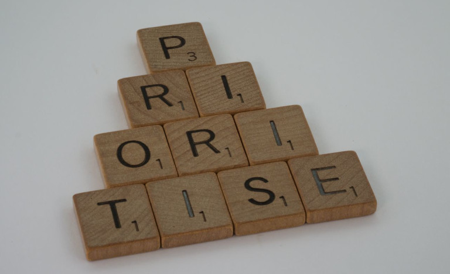

## O que é a procrastinação? Significado e definição

A procrastinação, chamada em tom de brincadeira também *a doença do adiamento*, é a designação científica para o **comportamento crónico de adiamento**. O que para uns é apenas um hábito irritante pode tornar-se para outros um problema grave. A procrastinação ganha sobretudo relevância quando **adiamos desnecessariamente ações planeadas e necessárias**, embora saibamos que isso terá consequências negativas. Ao contrário da procrastinação do dia a dia, trata-se de uma problemática a levar a sério, que pode prejudicar tanto o desempenho privado como o escolar, académico e profissional.

Procrastinar tem, no entanto, pouco a ver com **preguiça**: quem é preguiçoso evita o trabalho e sente-se bem quando não faz nada. Já quem sofre de procrastinação não se sente nada bem, apesar de estar a fazer alguma coisa. Na maioria dos casos, essa pessoa preenche com outras atividades o tempo que deveria dedicar à tarefa prioritária. O procrastinador crónico procura estas chamadas **ações substitutivas** como saída, para não ter de enfrentar a tarefa a realizar.

## Diferentes tipos de procrastinação

Uma característica decisiva da procrastinação face ao simples adiamento é o **sofrimento** que provoca. Distinguem-se dois tipos de pessoas:

- Os **adiadores por excitação** só realizam as tarefas à última hora, porque precisam de uma certa dose de agitação como motivação para poderem trabalhar de forma produtiva e eficiente. É certo que ficam sob pressão de tempo, mas depois atingem o máximo desempenho e acabam mesmo por concluir as atividades que têm de realizar.
- Em contrapartida, os **adiadores por evitação** sofrem de medo do fracasso e fogem desses sentimentos negativos. Por isso evitam completamente as tarefas difíceis. Torna-se problemático quando se falha em exames na escola, na universidade ou no trabalho, ou quando se adiam trabalhos até se acabar por ser despedido ou excluído do curso.

Além disso, podem observar-se diferentes tipos de procrastinação, consoante a área em que ocorrem:

- **Procrastinação do dia a dia**: Refere-se ao adiamento de tarefas quotidianas desagradáveis, por exemplo marcar por telefone uma consulta no dentista ou [limpar]() a casa de banho. Estas tarefas não têm muitas vezes prioridade elevada nem consequências negativas imediatas, pelo que são adiadas com especial facilidade.
- **Procrastinação administrativa**: Trata-se aqui do adiamento de tarefas administrativas aborrecidas, nas quais é, no entanto, muitas vezes importante executá-las com cuidado e não falhar prazos. No contexto profissional, isso pode dizer respeito à [faturação]() ou ao fecho de contas anual; no privado, à declaração de impostos.
- **Procrastinação académica**: Esta forma de procrastinação afeta sobretudo os estudantes, que podem realizar as suas tarefas de forma autónoma ao longo de um período alargado. Adiam muitas vezes os trabalhos avaliados porque só têm de os concluir em datas de entrega que parecem ainda distantes. A isto chama-se também *síndrome do estudante*.
- **Procrastinação funcional**, também designada por espera estratégica: Neste tipo de adiamento espera-se que os problemas se resolvam por si com o tempo, percam relevância ou que as próprias opções de atuação melhorem. Esta tática é frequentemente interpretada como ponderação e associada a políticos e quadros dirigentes.

## Círculo vicioso da procrastinação: quando adiar se torna um problema

Quando consideramos uma tarefa aborrecida, exigente ou desagradável, não a abordaremos com tanto gosto como algo que sentimos ser mais entusiasmante, mais fácil ou mais agradável. É por isso que o nosso cérebro reage com ações de fuga e de substituição à **relutância perante uma tarefa desagradável**. Evitar algo desagradável e fazer em vez disso algo que dá mais prazer é totalmente compreensível e absolutamente normal. 

Por norma, tendemos a preferir ações substitutivas com um efeito positivo imediato, porque queremos sentir-nos bem já. A curto prazo, isso traz uma **satisfação rápida** e os sentimentos desagradáveis, como o medo, diminuem. A longo prazo, porém, quanto mais regularmente se procrastina, mais se condiciona o cérebro à fuga. Se a pessoa se sente sobrecarregada e receia não estar à altura da tarefa, isso também favorece o adiamento – porque **o medo impede logo o começar**. Assim, a procrastinação afeta o desempenho de muitas pessoas.

Entretanto, as **consequências** podem tornar-se cada vez piores: trabalhos entregues com atraso, insucessos e más avaliações estão associados a **culpa e vergonha** e alimentam o medo de voltar a falhar da próxima vez. Quanto mais frequentemente se associam os desafios a estas emoções negativas, mais difícil se torna começar as tarefas, manter-se nelas e levá-las até ao fim. Convém quebrar cedo este círculo vicioso, para superar a procrastinação e voltar a registar êxitos.

## Porque procrastinamos: as verdadeiras causas em resumo

Quem anda constantemente a empurrar algo importante para a frente pode fazê-lo pelos mais diversos motivos. As causas da procrastinação são muito variadas, mas podem dividir-se grosso modo em **problemas organizacionais e psicológicos**. Afirmar que alguém é simplesmente preguiçoso ou que não se esforça o suficiente não atinge o cerne da procrastinação, pois as suas causas são mais profundas.

### Causas organizacionais

- **Montanhas de tarefas esmagadoras**: Tanto os projetos gigantescos e pouco claros como as listas de tarefas intermináveis e sem estrutura geram bloqueios mentais e a sensação de não se saber por onde começar.
- **Objetivos pouco claros**: Muitas pessoas afetadas pela procrastinação têm dificuldade em ver o sentido de atividades desagradáveis mas necessárias, em imaginar o estado futuro positivo após a sua conclusão e em manter o objetivo à vista.
- **Má gestão do tempo**: Quem nunca aprendeu a definir prioridades sensatas e a distribuir o tempo com antecedência favorece o facto de reprimir tarefas urgentes e desperdiçar o tempo com ações substitutivas sem importância.
- **Falta de estrutura**: Segundo vários estudos, as pessoas que não têm uma rotina diária estruturada tendem muito mais para a procrastinação do que as pessoas bem organizadas.
- **Demasiadas distrações**: Os fatores de perturbação no ambiente de trabalho, por exemplo as mensagens que se acendem no smartphone, tornam fácil a fuga para ações substitutivas. Algumas pessoas têm medo de perder alguma coisa, distraem-se rapidamente e desperdiçam muito tempo com as [redes sociais]() e outras aplicações.

### Causas psicológicas

- **Medo do fracasso**: Muitas pessoas que procrastinam têm grande medo de não corresponder às suas próprias exigências ou a critérios de avaliação externos e de receber comentários negativos.
- **Medo do sucesso**: Ainda que à primeira vista possa surpreender, o medo do sucesso pode igualmente levar à procrastinação. Cada êxito aumenta as expectativas e traz consigo o risco de falhar na tarefa seguinte.
- **Predisposição pessoal**: Vários estudos comprovaram ainda que a procrastinação está relacionada com determinados traços de personalidade. Quem é menos consciencioso e controla mal os impulsos tende, por conseguinte, mais a procrastinar.
- **Perfecionismo**: Muitas vezes também os perfeccionistas procrastinam. É que a exigência de realizar uma tarefa na perfeição impede-os frequentemente logo de dar o primeiro passo.
- **Comorbilidade**: Por último, doenças psíquicas graves como a PHDA ou a depressão podem provocar falta de concentração ou apatia e estar relacionadas com a procrastinação.



Por vezes investiga-se mais a fundo em que medida a procrastinação se deve a causas da infância. Experiências negativas na infância, como **uma elevada pressão de desempenho e uma severidade excessiva perante más notas**, podem levar as crianças a desenvolver comportamentos de adiamento por medo de falhar e a interiorizá-los como padrão. Também as pessoas que na infância viveram **pouca estabilidade e estrutura** podem vir a ter problemas de autorregulação e procrastinação. Não admira: em condições caóticas é naturalmente difícil para as crianças desenvolver capacidades de organização.



## Quais são os sintomas da procrastinação?

É certo que a procrastinação em si **não é considerada uma doença psíquica autónoma, mas sim um padrão de comportamento**; existem, no entanto, sintomas que a podem acompanhar ou dela resultar. Se concorda maioritariamente com as afirmações seguintes, isso indica que procrastina numa medida preocupante:

- Adia repetidamente a realização de tarefas importantes até ao limite e não consegue mudar o seu comportamento, **apesar de sofrer com isso**.
- A **pressão crónica de tempo** pesa no seu dia a dia nos estudos, na profissão ou na vida privada.
- Devido ao adiamento, zanga-se muitas vezes consigo mesmo, **desvaloriza-se e sente-se um falhado**.
- Tem constantemente **má consciência**, porque não faz o que devia fazer.
- O comportamento de adiamento provoca-lhe **insatisfação, mal-estar, stress, tensão e inquietação interior**.
- Já sofre consequências negativas devido a **quebras de desempenho**, p. ex. ter de se contentar com más notas, não passar em exames ou não ser promovido.
- O seu comportamento **prejudica cada vez mais as suas relações interpessoais**, por exemplo porque não cumpre promessas e compromissos.
- O adiamento tem **consequências financeiras**, porque falha prazos para pagar faturas, cancelar subscrições ou saldar dívidas.

## Superar a procrastinação passo a passo: 8 dicas comprovadas na prática

**A boa notícia**: A procrastinação é um padrão de comportamento que, por regra, pode quebrar e alterar por si próprio. As pessoas afetadas muitas vezes simplesmente não aprenderam a organizar-se bem ou a enfrentar tarefas desagradáveis apesar da relutância. Por isso não sabem como aproveitar o seu tempo de forma eficiente e manter-se consistentemente numa tarefa. Aproveite oito dicas práticas que o ajudam a superar a procrastinação!

### 1. Definir objetivos e prioridades claros

As pessoas que procrastinam têm normalmente dificuldade em **priorizar as tarefas importantes**.  Um método simples para ordenar as coisas segundo a sua importância e urgência é a chamada **matriz de Eisenhower**. Por exemplo, comprar um presente de aniversário pode ser urgente mas, ainda assim, não ser especialmente importante. Para avaliar melhor o valor de tarefas para as quais ainda tem muito tempo, ajuda definir objetivos claros e visualizá-los, por exemplo, num **vision board**, para os manter à vista.

### 2. Dividir os grandes projetos em pequenas tarefas parciais

Nada convida mais a procrastinar do que um projeto de longo prazo em que **o resultado ainda está muito longe**. Mesmo os talentos da organização podem aqui perder a visão de conjunto e enganar-se no esforço. Tanto mais importante é **dividir o projeto em pacotes de tarefas mais pequenos**, mais fáceis de realizar e cuja conclusão traz muito mais depressa sensações de êxito. Um meio eficaz para isso é uma [estrutura analítica do trabalho]().

### 3. Tornar os progressos visíveis 

Para superar a procrastinação de forma duradoura, é essencial manter a sua **motivação**. Tal como os seus objetivos, deveria por isso tornar também visíveis os seus progressos, por exemplo com a ajuda de [listas de tarefas](), [quadros Kanban]() ou [diários de aprendizagem](). Procure manter os objetivos de curto prazo realistas, para os alcançar na sua maioria, e celebre os seus êxitos! Também pequenas **recompensas** após tarefas concluídas podem ser motivadoras.

### 4. Começar e parar a horas

Um método comprovado para superar a procrastinação é a **restrição do tempo de trabalho**. Nela limita rigorosamente o seu tempo diário de trabalho ou de estudo a **janelas de tempo curtas** e claramente definidas. Comece, por exemplo, com 10 minutos por dia. Só quando os tiver usado exclusivamente para a tarefa é que poderá alargar o período. Através das **horas de início e de fim vinculativas**, o tempo de trabalho disponível é artificialmente encurtado, o que comprovadamente aumenta a produtividade e a eficiência durante o período de trabalho. Ao mesmo tempo, a restrição do tempo de trabalho reduz a **barreira de entrada**. 

### 5. Conseguir começar

O problema ao procrastinar é, na maioria dos casos, que assumimos demasiado e **nem sequer começamos**. Mais eficaz é colocar a fasquia tão baixa que quase não gere resistência. Facilite o arranque e pesquise primeiro na internet **instruções e modelos** para a sua tarefa. Assim que tiver conseguido começar, pode também experimentar "**Eat the Frog**". Este método diz que deve enfrentar logo a tarefa mais desagradável do dia. Mesmo que custe: depois de uma sensação de êxito destas, tudo o resto lhe sairá com mais facilidade. 

> A primeira tentativa não tem de ser perfeita. Permita-se começar mal e ir otimizando passo a passo.

### 6. Eliminar as fontes de distração

Basta uma chamada inesperada ou apenas um olhar para o telemóvel – e a sua concentração desaparece. As **fontes de distração no ambiente de trabalho** são fatais, porque servem as ações substitutivas em bandeja e afastam-no do seu foco. E quando já está a procrastinar, raramente volta a encontrar o caminho de regresso à tarefa. Pode preveni-lo com o [detox digital](): retire-se, por exemplo, para um lugar calmo e desligue o smartphone ou ative pelo menos o modo de voo.

### 7. Quebrar padrões de pensamento negativos

Insucessos, contratempos, consequências negativas: por vezes a procrastinação já está tão acentuada **que tudo parece correr mal**. Nessa altura, um [diário de gratidão]() pode prestar-lhe bons serviços. É que, quando escreve o que conseguiu (mesmo que tenha sido apenas uma ação substitutiva), começa novamente a ver êxitos. Isso pode **reforçar a sua autoconfiança** e contribuir para quebrar padrões de pensamento negativos. Quem acredita em si e tem consciência das suas capacidades consegue superar mais facilmente a procrastinação e dedicar-se de forma mais eficaz às tarefas que tem pela frente.

### 8. Automatizar tarefas recorrentes

São sobretudo as **tarefas administrativas maçadoras e redundantes** que geram em muitas pessoas uma resistência interior. Mal conseguem motivar-se, porque a repetição manual constante de passos de trabalho é mentalmente desgastante, aborrecida e custa desnecessariamente muito tempo. Felizmente, as **soluções digitais modernas** oferecem a possibilidade de automatizar muitas tarefas recorrentes. Assim, pode mandar executar rapidamente tarefas que antes ficavam frequentemente por fazer devido à procrastinação administrativa e aproveitar o tempo para atividades mais úteis.

## Superar a procrastinação com o SeaTable: assim organiza o seu dia a dia sem esforço

O SeaTable é uma [plataforma no-code com IA]() que permite estruturar grandes volumes de dados, criar aplicações e automatizar processos sem conhecimentos de programação. Inúmeras funções ajudam-no a organizar o seu trabalho de forma eficiente e a superar a procrastinação. Particularmente úteis são as várias possibilidades de visualização:

- Com as [colunas de seleção única]() pode definir prioridades com toda a facilidade e ordenar as tarefas por importância e urgência.
- Graças às vistas de [calendário]() e de [linha de tempo]() mantém sempre as datas debaixo de olho e pode ajustar as prioridades consoante a urgência.
- Na [vista de árvore]() pode dividir grandes projetos em tarefas parciais e representá-los de forma estruturada em vários níveis.
- A [vista Kanban]() agrupa as tarefas por estado de processamento e torna os progressos bem visíveis.
- Com as [colunas de caixa de seleção]() pode assinalar as tarefas concluídas e marcar diretamente os êxitos.

Pode ainda configurar [automatizações e funções de IA]() para tornar dispensáveis as intervenções manuais em atividades repetitivas e construir fluxos de trabalho eficientes. Além disso, o SeaTable oferece imensos modelos para começar de imediato: 

- [Modelo para uma lista de tarefas estruturada]()
- [Modelo para uma estrutura analítica do trabalho]()
- [Modelo para um rastreador de hábitos]()
- [Modelo para um plano de aprendizagem eficiente]()

{{< tabs
title1="Lista de tarefas"
text1="Priorize as suas tarefas com uma lista de tarefas estruturada."
id1="6381c036ff2649739c80"
submit1="Utilizar modelo"

title2="Estrutura analítica do trabalho"
text2="Com uma estrutura analítica do trabalho divide os projetos em tarefas parciais e mantém a visão de conjunto."
id2="898485ee9b7949c5b987"
submit2="Utilizar modelo"

title3="Rastreador de hábitos"
text3="Com um rastreador de hábitos acompanha os seus objetivos e quantos dias se mantém firme."
id3="c7a62de5f2664659bce2"
submit3="Utilizar modelo"

title4="Plano de aprendizagem"
text4="Use um plano de aprendizagem para gerir uma grande carga de estudo e conduzir o seu processo de aprendizagem."
id4="0ef3605355e24164a3cb"
submit4="Utilizar modelo" >}}

- [Modelo para um quadro Kanban flexível]()
- [Modelo para um plano de limpeza bem organizado]()

Prioridades claras também ajudam as equipas: o nosso artigo sobre a [gestão de tarefas]() mostra como distribuir e planear as tarefas em equipa.

## Conclusão: superar a procrastinação de forma duradoura com a estrutura certa

Raramente superará a procrastinação propondo-se muito e querendo realizar uma tarefa na perfeição. Com isso coloca-se sob pressão desnecessária, alimenta o medo do fracasso e as autocríticas. Mais eficaz é priorizar as suas tarefas, dividi-las em tarefas parciais mais pequenas e trabalhá-las em blocos de tempo fixos, para reduzir a barreira de entrada e [estabelecer rotinas](). Tente além disso eliminar conscientemente as fontes de distração, para evitar ações substitutivas. A melhor forma de se motivar é começar em pequeno, tornar os seus progressos visíveis e manter os seus objetivos à vista. Também as ferramentas digitais o podem ajudar nisso.

## Perguntas frequentes sobre como superar a procrastinação



Não existe uma única razão principal. Muitas vezes juntam-se problemas organizacionais, como objetivos pouco claros, falta de estrutura e prioridades erradas, a fatores psicológicos, como a sobrecarga, o medo do fracasso ou o perfecionismo.





Adiar ocasionalmente no dia a dia é algo que todos conhecem. Um limiar essencial é ultrapassado quando o seu comportamento leva de forma duradoura a sofrimento ou limitações consideráveis – por exemplo através de uma forte sobrecarga psíquica ou de problemas nos estudos, na profissão e na vida privada. Se tiver a sensação de já não conseguir superar sozinho a procrastinação, deve procurar ajuda profissional.





Passos pequenos e concretos parecem menos avassaladores do que objetivos grandes e abstratos, situados muito longe. Assim diminui a barreira de entrada e os progressos são alcançáveis mais depressa. Não é o planeamento perfeito que o põe em ação, mas a primeira tarefa exequível.





Os modelos reduzem as incertezas do início, oferecendo um caminho de solução exemplar para uma tarefa difícil. Em vez de ter de reinventar a roda, pode recorrer a uma estrutura já existente e começar mais depressa a tarefa propriamente dita.





Sim, é possível controlar o comportamento de adiamento de forma duradoura. É certo que a procrastinação não se supera de um dia para o outro, mas existem muitos métodos com os quais pode melhorar a sua gestão do tempo e de si próprio. Ao criar estruturas claras, pequenas sensações de êxito e um ambiente de trabalho sem distrações, aumenta a motivação e reduz a longo prazo a suscetibilidade à procrastinação.


