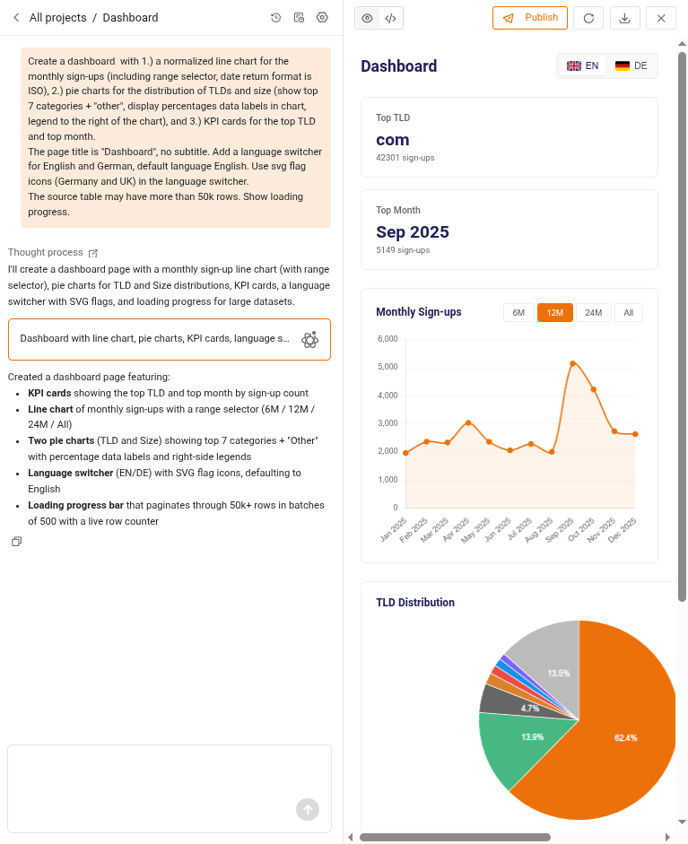
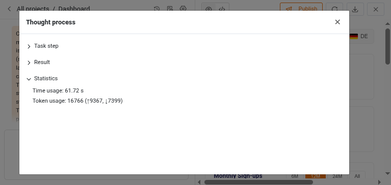
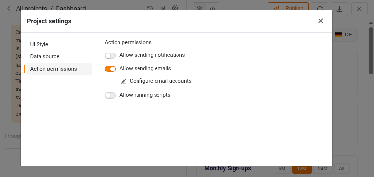
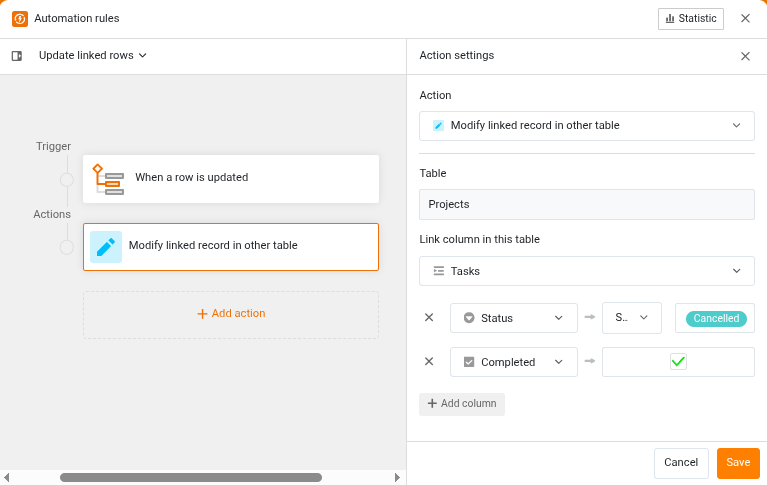

Mit Version 7.0 macht SeaTable einen großen Schritt in Sachen künstlicher Intelligenz. Zwei Neuerungen stechen besonders hervor: Im App Builder können Sie HTML-Seiten jetzt mit KI erstellen – Sie beschreiben einfach, was die Seite können und wie sie aussehen soll. Und das KI-Chat-Plugin, das wir mit SeaTable 6.1 als Beta eingeführt haben, ist nun bereit für den produktiven Einsatz. Hinter beiden Funktionen steht ein leistungsfähigeres KI-Modell, das bei SeaTable Cloud auf der Infrastruktur unseres Partners Exoscale läuft.

Doch SeaTable 7.0 hat mehr zu bieten als KI. Das SDK für HTML-Seiten, das auch von KI-generierten Seiten genutzt wird, erhält vier Verbesserungen, die sich unsere Nutzer gewünscht haben. Automatisierungen bekommen zwei neue Aktionen für verknüpfte Datensätze, und zwei bestehende Aktionen werden vielseitiger. Hinter den Kulissen haben wir in der neuen Version zahlreiche Fehler beseitigt und mit einem verstärkten Fokus auf das Thema Sicherheit der akuten Bedrohung durch KI-gestützte Bots und automatisch generierte Exploits Rechnung getragen. Kleinere Verbesserungen bei Formularen, Statistiken und der Zwei-Faktor-Authentifizierung runden das Release ab. Und eine Funktion geht in den Ruhestand: Neue Datenabfrage-Apps lassen sich nicht mehr erstellen, bestehende funktionieren aber weiterhin.

Heute Morgen haben wir SeaTable Cloud auf Version 7.0 aktualisiert. Allen Administratoren selbstgehosteter Systeme empfehlen wir, es uns gleichzutun – nicht zuletzt wegen der Sicherheitsverbesserungen. Das Docker Image für SeaTable 7.0 steht auf [Docker Hub](https://hub.docker.com/r/seatable/seatable-enterprise/) zum Download bereit. Die vollständige Liste der Änderungen finden Sie wie immer im [Changelog](#release-7).

## Mit KI ganz einfach zu einer HTML-Seite

Mit SeaTable 7.0 erstellen Sie HTML-Seiten direkt im App Builder – im Chat mit einer KI. Sie beschreiben in natürlicher Sprache, was die Seite tun und wie sie aussehen soll, und die KI baut sie für Sie. Dabei greift die KI auf das SDK für HTML-Seiten von SeaTable zurück (mehr dazu im nächsten Abschnitt). Eine KI-generierte Seite kann deshalb genauso viel wie eine von einem Menschen programmierte.

Der Einstieg ist denkbar einfach: Klicken Sie in der linken Leiste auf das AI-Icon. (AI steht für „Artificial Intelligence“, den englischen Begriff für künstliche Intelligenz.) Ein Assistent führt Sie durch die Einrichtung: Sie geben dem Projekt einen Namen, wählen einen User-Interface-Stil (UI-Stil), legen Datenquellen und Berechtigungen der Seite fest und beschreiben die gewünschte Seite. Die KI erstellt daraufhin eine erste Version und zeigt sie in einer Vorschau an. Im Gespräch mit der KI verfeinern Sie die Seite anschließend so lange, bis sie genau das tut, was Sie brauchen. Ein Klick auf „Veröffentlichen“ fügt die Seite Ihrer SeaTable App hinzu.

Der Chat speichert die gesamte Unterhaltung und jede Version der Seite. So können Sie jederzeit dort weitermachen, wo Sie aufgehört haben, oder zu einer früheren Version zurückkehren, falls eine Änderung nicht gelungen ist. Unterhaltungen und nicht veröffentlichte Seiten werden 365 Tage lang aufbewahrt. Und wer eine Seite lieber selbst feinschleifen möchte, kann sie herunterladen und von Hand optimieren.

Neugierig, was hinter den Kulissen passiert? Ein Klick auf den Link „Denkprozess“ im Chat zeigt Ihnen für jeden Schritt den System-Prompt, Ihre Eingabe und das Ergebnis der KI. Ein Statistikbereich ergänzt, wie lange der Schritt gedauert und wie viele Tokens er verbraucht hat.

Bei SeaTable Cloud läuft die Seitengenerierung auf einem leistungsstarken Open-Weights-Modell, das unser Infrastrukturpartner Exoscale hostet – derselbe Anbieter, der auch die Server von SeaTable Cloud betreibt. Ihre Prompts und Base-Schemata werden also von keinem weiteren Drittanbieter verarbeitet. Die Daten in Ihren Bases gelangen ohnehin nie zum KI-Modell. Administratoren selbstgehosteter Systeme können entweder ein Cloud-Modell eines der führenden KI-Anbieter nutzen oder ein selbstgehostetes Modell ihrer Wahl anbinden. SeaTable unterstützt alle LLMs mit einem OpenAI-kompatiblen Endpunkt.


Für die Erstellung von HTML-Seiten nutzen wir Qwen 3.8 27B, ein multimodales Large Language Model mit 27 Milliarden Parametern aus dem Haus Alibaba. Es ist auf anspruchsvolles logisches Denken, Programmierung, Recherche, Dokumentenverarbeitung und komplexe mehrstufige Aufgaben ausgelegt und steht unter der Apache-2.0-Lizenz. Qwen 3.8 27B löst außerdem das Open-Weights-Modell [Gemma 4 E4B von Google DeepMind](#ki-einsatz-ohne-kompromisse-beim-datenschutz) ab, das bisher für die KI-Aktionen in den Automatisierungen verantwortlich war.


## Erweitertes SDK für HTML-Seiten

Das SeaTable SDK für HTML-Seiten verbindet Ihre individuellen Seiten mit den Daten Ihrer Base – ob Sie die Seiten selbst schreiben oder von der KI erstellen lassen. In Reaktion auf Benutzerfeedback haben wir das SDK an vier Stellen erweitert und verbessert.

Erstens kennt das SDK jetzt die Namen der Benutzer. Bisher konnte es nur Zeilendaten aus der Base lesen und keine Namen nachschlagen. Seiten konnten daher nur interne Benutzernamen wie `a1b2c3…@auth.local` anzeigen. Jetzt sehen Sie auf Ihren Seiten auf einen Blick, wer wer ist.

Zweitens erkennt das SDK den angemeldeten Benutzer. Bisher hatte eine Seite keine Möglichkeit zu wissen, wer sie gerade ansieht. Mit der neuen Methode `getCurrentUser()` können Seiten Daten nach dem aktuellen Benutzer filtern und so z. B. jedem Teammitglied nur seine eigenen Aufgaben anzeigen.

Drittens bietet das SDK neue Methoden, um einzelne Verknüpfungen in Verknüpfungsspalten hinzuzufügen oder zu entfernen. Bisher ließ sich eine Verknüpfungsspalte mit der Methode `updateRow()` nur als Ganzes aktualisieren, wobei alle bestehenden Verknüpfungen ersetzt wurden. Mit den neuen Methoden fügen Sie ganz einfach eine Aufgabe zu einem Projekt oder eine Position zu einem Angebot hinzu oder melden einen Teilnehmer von einem Seminar ab – ohne die übrigen Verknüpfungen anzutasten.

Viertens unterstützt das SDK drei neue Aktionen: E-Mail senden, Benachrichtigung senden und Skript ausführen. Damit können HTML-Seiten per Schaltfläche Nachrichten verschicken und Skripte starten, etwa um eine Buchung direkt von der Seite aus per E-Mail zu bestätigen. Die E-Mail-Konten und Skripte, die Sie verwenden möchten, müssen in der Base eingerichtet sein.

## KI-Chat-Plugin bereit für den produktiven Einsatz

Das KI-Chat-Plugin haben wir mit [SeaTable 6.1](#chatten-sie-mit-einer-künstlichen-intelligenz) als Beta-Funktion eingeführt. Mit ihm bearbeiten und analysieren Sie Bases in natürlicher Sprache: Datensätze anlegen, Werte ändern, Zeilen verknüpfen oder Daten auswerten – auf Deutsch, Englisch, Französisch und in weiteren Sprachen. (Änderungen am Schema der Base sind nicht möglich.)

Mit SeaTable 7.0 verlässt das Plugin die Betaphase. Auf Basis des Nutzerfeedbacks haben wir sowohl das Plugin als auch den MCP-Server, den es nutzt, verbessert. Anfragen sind jetzt deutlich effizienter – der Tokenverbrauch sinkt dadurch erheblich. Außerdem haben wir die Liste der unterstützten Cloud-KI-Modelle aktualisiert.

Auch die Nutzung des Plugins ist deutlich einfacher geworden. In der Betaphase mussten Sie noch einen eigenen API-Token für ein unterstütztes LLM hinterlegen. Bei SeaTable Cloud nutzt das Plugin jetzt standardmäßig unser eigenes, bei Exoscale gehostetes KI-Modell. Die verbrauchten Tokens werden in KI-Credits umgerechnet und von Ihrem Guthaben abgezogen: 1 Million Input-Tokens entsprechen 500 KI-Credits, 1 Million Output-Tokens 1.500 KI-Credits. Wenn Sie das Standardmodell nicht nutzen möchten, können Sie eines der anderen unterstützten Modelle der führenden KI-Anbieter wählen.


Das KI-Chat-Plugin steht derzeit nur Kunden von SeaTable Cloud und SeaTable Dedicated zur Verfügung. In den kommenden Monaten werden wir das Plugin auch für selbstgehostete Systeme bereitstellen.


## Verbesserte Automatisierungen

SeaTable 7.0 bringt zwei neue Automationsaktionen, macht zwei bestehende Aktionen vielseitiger und sorgt für ein aussagekräftigeres Automationslog.

Die erste neue Aktion, „Eintrag in einer verknüpften Tabelle hinzufügen“, funktioniert ähnlich wie die bestehende Aktion „Neuen Eintrag in anderer Tabelle hinzufügen“: Sie legt einen neuen Datensatz in einer anderen Tabelle an. Zusätzlich verknüpft sie den neuen Datensatz mit dem Datensatz, der die Automatisierung ausgelöst hat. Die zweite neue Aktion, „Verknüpften Eintrag in anderer Tabelle bearbeiten“, ergänzt die erste: Mit ihr ändern Sie bestehende verknüpfte Datensätze in anderen Tabellen. Ändert sich zum Beispiel der Status eines Datensatzes, lassen sich alle abhängigen, verknüpften Datensätze sofort mit aktualisieren. Beide neuen Aktionen stehen mit dem Auslöser „Wenn eine Zeile geändert wird“ zur Verfügung.

Die Aktion „Seite in PDF-Datei umwandeln“ erstellt ein PDF auf Basis einer Vorlage aus dem Seitendesign-Plugin und speichert es in einer Dateispalte. In SeaTable 6.x war sie nur mit dem zeitgesteuerten Auslöser verfügbar. Jetzt können Sie sie mit allen Auslösern nutzen, die sich auf eine Zeile beziehen: „Wenn eine Zeile hinzugefügt wird“, „Wenn eine Zeile geändert wird“ und „Zu einer geplanten Zeit für Einträge, die Bedingungen erfüllen“. Damit werden vollautomatische Workflows möglich: Ein Kunde fragt ein Angebot an, SeaTable erstellt das Angebot (mit oder ohne KI-Unterstützung), und das Angebot geht per E-Mail an den Kunden.

Die Aktion „Termine in Google Kalender verwalten“ kann jetzt auch Termine aus einem Kalender löschen.

Und schließlich ist das Automationslog aussagekräftiger geworden: Neben dem Zeitpunkt der Auslösung verzeichnet es jetzt auch, wann die Ausführung beendet war.

## Und vieles mehr

Mehrseitige Formulare können jetzt einen Fortschrittsbalken anzeigen, sodass Teilnehmende jederzeit sehen, wie weit sie schon sind. Außerdem unterstützen Bestätigungsnachrichten nach dem Absenden jetzt formatierten Text.

Die Statistiken in SeaTable Apps basieren jetzt auf D3.js, einer weit verbreiteten und leistungsstarken JavaScript-Bibliothek zur Datenvisualisierung. Diese technische Umstellung ebnet den Weg für individuellere Diagramme in der Zukunft. Die Statistiken in der Base folgen im nächsten Minor Release.

Wenn Sie die Zwei-Faktor-Authentifizierung einrichten, zeigt SeaTable jetzt den geheimen Schlüssel an, damit Sie ihn in Ihrem Passwort-Manager speichern können.

Und noch etwas: Native SeaTable Apps für iOS und Android kommen in Kürze. Die letzten Tests laufen bereits. Bleiben Sie dran!

## Abschied von den Datenabfrage-Apps

Mit SeaTable 7.0 haben wir den Builder für Datenabfrage-Apps entfernt. Neue Datenabfrage-Apps lassen sich nicht mehr erstellen. Bestehende Datenabfrage-Apps sind davon nicht betroffen und funktionieren wie gewohnt weiter.

Für neue Apps nutzen Sie bitte Universelle Apps. Sie bieten dieselben Funktionen wie Datenabfrage-Apps – und noch mehr. Wie Sie Universelle Apps erstellen, erfahren Sie auf den [Hilfeseiten zu Universellen Apps]().
