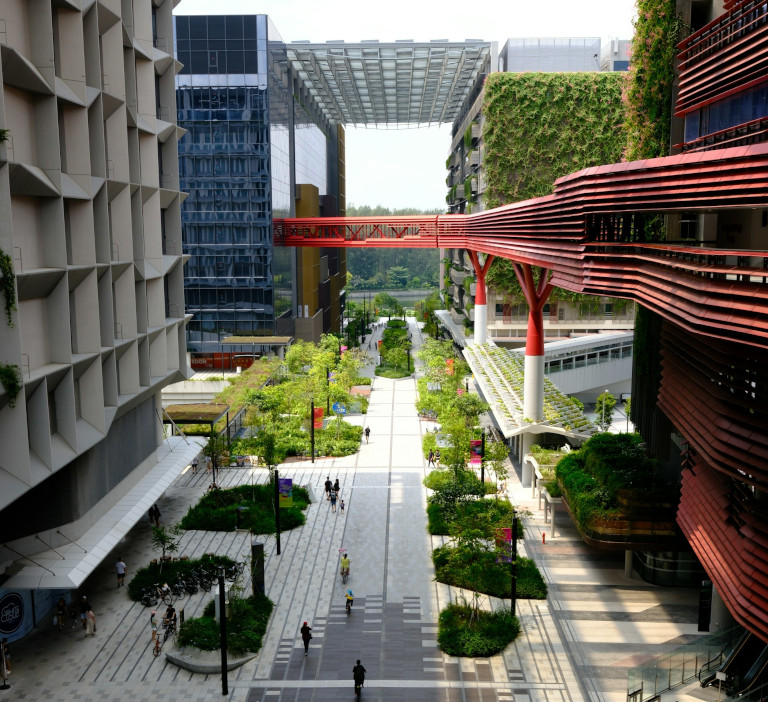
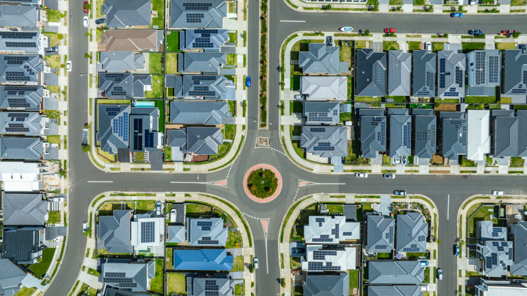
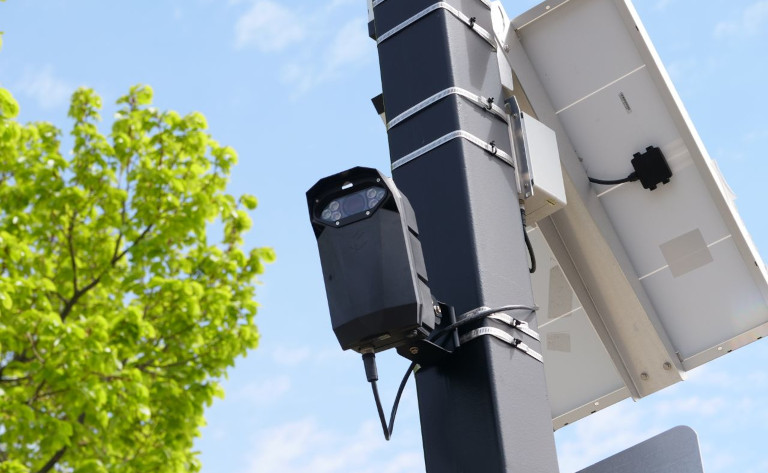
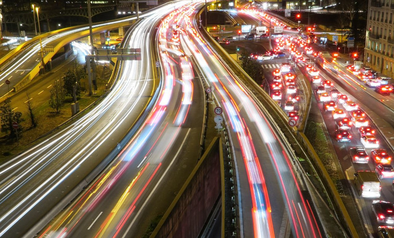

### Los principales ámbitos de actuación de una ciudad inteligente de un vistazo

*   **Gestión municipal eficiente**: conectar de forma inteligente y administrar de forma centralizada instalaciones como aparcamientos, contenedores de residuos y farolas.
*   **Infraestructura en tiempo real**: recopilar y analizar datos de sensores IoT para gestionar el tráfico, el consumo de energía y la contaminación ambiental según la situación.
*   **Eliminación de los silos de datos**: unificar los flujos de datos municipales y crear una base fiable para la planificación urbana y las decisiones políticas.
*   **Innovación cercana a la ciudadanía**: fomentar la participación ciudadana y trasladar a las necesidades locales los enfoques de ciudad inteligente que han dado buen resultado en otras ciudades y municipios.
*   **Gestión soberana de los datos**: diseñar procesos digitales con sistemas No-Code autoalojados y garantizar las interfaces, el control de acceso y la seguridad de los datos.

## La transformación de los espacios urbanos: por qué las ciudades deben reinventarse

Las ciudades de todo el mundo sienten una presión creciente para actuar, sobre todo cuando **el número de habitantes y visitantes no deja de aumentar**. Los edificios, el tráfico, las zonas de estancia y las zonas verdes compiten por un **espacio público escaso**; los fenómenos meteorológicos extremos aumentan las exigencias a la infraestructura; el aumento de los costes de energía y explotación pesa sobre los presupuestos. Al mismo tiempo, la ciudadanía espera una administración eficaz, decisiones transparentes y una alta calidad de vida.

### Los retos actuales de las administraciones municipales modernas

Muchos de estos problemas están relacionados entre sí. En las grandes aglomeraciones, **el sellado del suelo y la edificación densa** hacen que el microclima se caliente, se pierdan los corredores de aire fresco y las grandes cantidades de lluvia apenas puedan filtrarse. **Un tráfico lento y la búsqueda constante de aparcamiento** no solo alargan los tiempos de viaje, sino que también incrementan el ruido, los gases de escape y las emisiones contaminantes en unos centros urbanos ya de por sí asfixiantes. Si los municipios no **gestionan según la demanda** el alumbrado público, la recogida de residuos o la oferta de movilidad, malgastan innecesariamente recursos como la energía, el tiempo de trabajo y el dinero.

Como muchas empresas municipales de servicios y autoridades de medio ambiente, urbanismo y transporte trabajan con datos y sistemas diferentes, a menudo falta una visión común de la situación real sobre el terreno. Por ello, es decisivo **relacionar de forma útil los datos existentes** e integrar soluciones digitales transversales en la planificación urbana. Ya se trate de la [gestión del aparcamiento](), la protección frente al calor o la administración de inmuebles municipales, con una base de datos central los municipios pueden tomar decisiones mejor fundamentadas y utilizar los recursos de forma más específica.

Resumen de los mayores retos para los municipios:  

- **Calidad de vida local**: la vivienda y las vías de transporte para cada vez más personas compiten con las zonas de estancia y las zonas verdes, importantes para el esparcimiento cercano y el microclima. 
- **Volumen de tráfico incontrolable**: la falta de datos históricos y en tiempo real dificulta la gestión del aparcamiento, la regulación de los semáforos y la planificación del tráfico.
- **Derroche de recursos**: los intervalos de funcionamiento rígidos (p. ej., en el alumbrado, la recogida de residuos y el riego) a menudo no tienen suficientemente en cuenta la demanda real.
- **Digitalización compleja**: las laboriosas transiciones tecnológicas y las costosas adquisiciones desbordan los presupuestos de TI más reducidos y los limitados recursos de personal.
- **Fragmentación de los datos**: las empresas municipales de servicios, las oficinas y las autoridades administran la información en sistemas separados entre sí y no disponen de una visión común.

Aquí es precisamente donde interviene una ciudad inteligente: considera el municipio como un ecosistema conectado.

## La smart city explicada de forma sencilla: ¿qué hace que una ciudad sea realmente inteligente?

La ciudad inteligente, o smart city, es un espacio urbano en el que las tecnologías digitales y una [gestión de datos]() inteligente contribuyen a **mejorar la calidad de vida de los ciudadanos mediante la sostenibilidad y la eficiencia de la gestión municipal**. La transformación digital en los municipios no se refiere solo a los servicios administrativos clásicos (palabra clave: [oficina digital de atención ciudadana]()), sino también a la infraestructura de los servicios básicos, como la movilidad, el suministro de energía o los edificios.

### ¿Cuáles son los objetivos de una ciudad inteligente?

- uso moderado de los recursos y eficiencia energética
- economía y empleo locales
- oferta variada de vivienda y ocio
- desarrollo urbano sostenible y mejor calidad de vida
- soluciones de movilidad atractivas y gestión activa del tráfico
- seguridad y limpieza en el espacio público
- protección frente al ruido, el calor y las inundaciones, y protección del medio ambiente
- participación social y accesibilidad
- menos carga administrativa gracias a la digitalización

### ¿En qué consiste un concepto de ciudad inteligente?

Un concepto viable de ciudad inteligente abarca tres niveles:

1. **Tecnologías de la ciudad inteligente**: sensores, controladores, actuadores, redes inteligentes de comunicación y de electricidad (smart grids), plataformas centrales de datos
2. **Datos de la ciudad inteligente**: una gestión de datos que intercambia información a través de interfaces, la unifica de forma estructurada y la hace utilizable para la planificación urbana y la gestión municipal
3. **Organización inteligente**: responsabilidades y flujos de trabajo claros para que la base de datos común dé lugar a decisiones y medidas bien fundamentadas

## Las tecnologías de la ciudad inteligente en conjunto: internet de las cosas, edge computing y No-Code

Se denomina **internet de las cosas (IoT)** a la interconexión de objetos y dispositivos que, mediante sensores, controladores y actuadores, recopilan y analizan determinados datos y ejecutan acciones automatizadas. Esta tecnología clave de la ciudad inteligente también se conoce por la Industria 4.0 y el hogar inteligente.

### ¿Cómo funcionan los sensores IoT?

Un sensor IoT es un dispositivo de medición que detecta **cambios físicos** (p. ej., temperatura, humedad, calidad del aire, ruido, luminosidad, presión, radiofrecuencias o movimientos) en su entorno, los convierte en señales digitales y las transmite a través de una **red** a una plataforma central. El sistema puede analizar los datos en tiempo real y activar acciones automáticas para contrarrestar la situación si es necesario. La ventaja: los sensores IoT proporcionan **información en directo** sin necesidad de que nadie esté presente. Esto ayuda a utilizar los recursos de forma específica según la demanda y, de este modo, a ahorrar energía, tiempo y costes.

### ¿Qué es el edge computing?

El edge computing se refiere al **procesamiento descentralizado de datos** mediante controladores automatizados directamente en la fuente en la que se generan o cerca de ella, en lugar de reenviarlos a un centro de datos o a una nube. El objetivo es **evitar flujos de datos innecesarios** y descargar las redes analizando, filtrando y procesando los datos, al menos en parte, en el propio lugar. Esto puede contribuir a reducir costes, acelerar los tiempos de respuesta y aumentar la seguridad de los datos, ya que estos **no tienen que recorrer largas vías de transmisión**, sino que permanecen en la [infraestructura informática]() local.

### ¿Para qué sirven las plataformas No-Code?

Los sensores conectados y los controladores automatizados por sí solos no marcan la diferencia. Una ciudad inteligente también necesita una **base de datos central** en la que confluyan los datos y procesos digitales para la planificación y la explotación. Aquí es donde entran en juego las [plataformas No-Code](). Son ideales para unificar flujos de datos y diseñar procesos digitales sin depender de la programación clásica. De este modo, puede fomentar el [citizen development]() en su ciudad inteligente y permitir que también las personas con menos conocimientos técnicos desarrollen sus propias soluciones a medida.

Para que una ciudad inteligente pueda procesar **big data** –es decir, grandes volúmenes de datos procedentes de distintas fuentes que llegan con rapidez–, las plataformas de datos deben contar con cierta capacidad. Sin embargo, para la administración, lo decisivo no es necesariamente la cantidad de datos, sino su **calidad, contexto y utilidad**. Una medición ambiental llamativa, por ejemplo, solo resulta significativa cuando se conocen la ubicación, el momento de la medición y los factores de influencia relevantes. Las [bases de datos relacionales]() son especialmente adecuadas para ordenar y comprobar los datos de la ciudad inteligente y relacionarlos con su contexto.

## Ámbitos de aplicación concretos: cuando la gestión municipal se vuelve inteligente

Un aparcamiento en la ciudad inteligente notifica las plazas libres, los contenedores de residuos transmiten su nivel de llenado y las estaciones de medición registran valores ambientales como la temperatura y la calidad del aire: los ámbitos de aplicación de las tecnologías de la ciudad inteligente son variados e ilimitados. A continuación, veremos con más detalle algunos ejemplos de ciudades inteligentes.

### Movilidad inteligente: control del tráfico en tiempo real y aparcamiento en la ciudad inteligente

La búsqueda de aparcamiento genera tráfico adicional, cuesta tiempo y perjudica al medio ambiente. Por ello, un aparcamiento en la ciudad inteligente debería registrar los vehículos a la entrada y a la salida mediante el **reconocimiento automático de matrículas en la barrera**, además de calcular la ocupación y las tarifas. Con los datos de ocupación de las plazas, los **sistemas digitales de guiado al aparcamiento y los semáforos inteligentes** pueden optimizar el flujo de tráfico en tiempo real para acortar los trayectos y reducir las emisiones. Las **ofertas de carsharing** permiten además reservar vehículos disponibles en determinadas plazas, que idealmente también ofrecen infraestructura de recarga.

En el transporte público, los **datos de posición en tiempo real de autobuses y trenes** pueden transmitir las horas exactas de salida y los retrasos a **paneles digitales y apps**. Además, un concepto integral de ciudad inteligente tiene en cuenta el volumen de tráfico durante un periodo prolongado y en todos los modos de transporte. Así, la planificación del tráfico puede basarse en datos de uso reales para deducir medidas integrales como la **ampliación de los carriles bici, los aparcamientos subterráneos o el transporte público de cercanías**.

### Uso eficiente de los recursos: alumbrado y gestión de residuos según la demanda

La gestión municipal clásica suele orientarse a **calendarios fijos** (p. ej., intervalos de alumbrado y de vaciado). Son fáciles de administrar, pero no reflejan **el uso real ni la demanda actual**. Para el alumbrado de calles, pasos subterráneos y edificios, los sensores pueden detectar la luminosidad y/o los movimientos y favorecer una regulación según la demanda. En la gestión de residuos, los sensores de nivel de llenado informan sobre qué contenedores deben vaciarse realmente. Con una gestión municipal basada en datos como esta, se pueden **reducir los desplazamientos de control innecesarios y utilizar los recursos de forma más específica**.

### Gestión energética sostenible en edificios públicos

Las escuelas, los edificios administrativos y los [inmuebles]() municipales suelen tener un **alto consumo de energía**, sobre todo si se trata de edificios antiguos. Calentar o refrigerar de forma permanente salas que solo se usan esporádicamente supone un derroche especialmente grande. En primer lugar, los contadores digitales y los sensores pueden **registrar indicadores energéticos** y poner de manifiesto picos de carga inusuales, horarios de funcionamiento ineficientes o diferencias entre edificios comparables.  
  
A continuación, el sistema de gestión técnica del edificio puede revisar los ajustes automatizados, priorizar las rehabilitaciones e impulsar una **climatización según la demanda** (p. ej., según el plan de ocupación de las salas). Los termostatos inteligentes miden la temperatura y regulan automáticamente el aporte de calor o frío para mantener una temperatura ambiente fija. Dado que la calefacción y el aire acondicionado consumen mucha energía, conviene plantearse además medidas de **aislamiento, sombreado y ajardinamiento de cubiertas y fachadas**.

## Ejemplos de ciudades inteligentes en toda Europa: lo que pueden aprender los municipios

Los siguientes ejemplos de ciudades inteligentes muestran que la planificación urbana inteligente puede funcionar a escalas muy diferentes. No todos los municipios necesitan la misma infraestructura digital. Lo decisivo son los retos locales, los recursos disponibles y la apertura a integrar de forma duradera soluciones modernas en la gestión municipal.

### Barcelona, ciudad pionera: cómo la metrópolis optimiza el tráfico, el alumbrado y el riego

La ciudad inteligente de Barcelona es un conocido ejemplo internacional de digitalización municipal. Diversas iniciativas se ocupan de la movilidad inteligente, la infraestructura digital y el uso más eficiente de los recursos urbanos. Tres ejemplos:  
  
- **Supermanzanas:** se agrupan varias manzanas de edificios y las calles que quedan entre ellas se cierran al tráfico de paso. La transformación en favor de las personas y la naturaleza mejora la calidad de estas zonas de estancia, mientras que el tráfico se desvía a las vías principales, los carriles bici y el transporte público.  
- **Solar Hubs**: por toda Barcelona se distribuyen farolas solares conectadas digitalmente y repletas de sensores. Estas miden datos ambientales importantes, como la temperatura, la calidad del aire y el ruido, y al mismo tiempo proporcionan un alumbrado eficiente.  
- **Riego optimizado**: unas sondas instaladas bajo tierra miden continuamente la humedad, la temperatura y la salinidad del suelo. En función de las previsiones meteorológicas actuales y de las necesidades de las plantas, las válvulas de riego se abren o se cierran de forma totalmente automática. Así, la red IoT reduce el consumo de agua en las zonas verdes urbanas.

### Etteln, ciudad inteligente: electricidad verde, fibra óptica y app del pueblo

En 2024, el municipio alemán de Etteln ganó el título de mejor ciudad inteligente del mundo, por delante de metrópolis como Hong Kong. Sin embargo, este pueblo de 1800 almas situado cerca de Paderborn es más bien una smart village. Estos son los puntos más importantes del concepto de ciudad inteligente de esta localidad de Westfalia:

- **App del pueblo y movilidad inteligente**: a través de la app del pueblo se puede reservar una furgoneta eléctrica de carsharing u organizar un viaje compartido con poca antelación. Además, la app incluye un mercado digital de compraventa, noticias de la administración municipal e invitaciones a [eventos]() en el pueblo.  
- **Fibra óptica y sensores conectados**: todos los habitantes del municipio tienen una conexión de fibra óptica para disponer de internet rápido. Los sensores registran datos meteorológicos, el nivel de los arroyos, el nivel de llenado de los contenedores de ropa usada y otros datos que se pueden consultar digitalmente en un panel y que avisan con antelación de fenómenos meteorológicos extremos como las inundaciones.  
- **Electricidad verde y soberanía**: Etteln produce 34 veces más electricidad a partir de energías renovables de la que consume. Un aerogenerador suministra electricidad al centro de datos local, y un sistema de almacenamiento en baterías también garantiza la independencia de los proveedores externos y unos precios considerablemente más bajos.

### Otras fuentes de inspiración: Viena y Copenhague

Cuando se trata de las ciudades más habitables e inteligentes del mundo, Viena y Copenhague también obtienen siempre los primeros puestos en las clasificaciones. En ellas destacan los aspectos de la **neutralidad climática**, el suministro inteligente de energía y la movilidad sostenible. Viena opera una de las **redes urbanas de calefacción y refrigeración** más grandes de Europa, que conecta energéticamente viviendas, edificios públicos, hoteles e industria. Otro proyecto emblemático es la **depuradora principal** de Viena, que genera a partir de los lodos de depuración más energía de la que necesita para tratar las aguas residuales. Un modelo de éxito similar es la famosa central de cogeneración **CopenHill**, que inyecta energía procedente de residuos en el sistema de calefacción urbana de Copenhague.

El concepto de ciudad inteligente de Copenhague prevé además que los habitantes de la capital danesa puedan recorrer **tres cuartas partes de todos sus trayectos en bicicleta, en transporte público o a pie**. Ya existe una red de dispositivos y semáforos en las calles para observar el tráfico y regularlo si es necesario. Las **farolas inteligentes**, por ejemplo, pueden aumentar su intensidad en la oscuridad cuando un sensor registra el movimiento de una persona cercana. Esto mejora la seguridad vial y ahorra mucha energía en el alumbrado público.

## Proteger los datos de la ciudad inteligente y administrarlos de forma estructurada

La recopilación de grandes cantidades de datos en la ciudad inteligente no debe implicar una vigilancia innecesaria de la ciudadanía. La información sobre el volumen de tráfico o de visitantes en la ciudad, por ejemplo, debe estar **anonimizada y no ser apta para identificar vehículos o personas concretas**. Quien presente solicitudes digitales en la oficina de atención ciudadana también debe saber que sus datos están seguros. Por ello, es imprescindible que una ciudad inteligente conserve el [control sobre sus datos y sobre el uso que se hace de ellos]().

En el día a día, las oficinas de urbanismo y medio ambiente, las empresas municipales de servicios y las empresas de transporte y gestión de residuos suelen trabajar con sus propios **conjuntos de datos aislados**. Esto es fruto de la evolución histórica y a menudo resulta práctico para tareas concretas. Sin embargo, para tomar decisiones interdisciplinares se convierte en un obstáculo. Muchos municipios no fracasan por la falta de sensores y tecnologías de captura, sino por la **falta de conexión entre los sistemas existentes**. Los datos están dispersos en expedientes en papel, hojas de cálculo de Excel, documentos ofimáticos y software especializado. Esto da lugar a **discontinuidades entre medios, almacenamiento duplicado de datos y versiones diferentes**.

Por eso, una ciudad inteligente necesita una **plataforma de datos común** que rompa los silos de información, integre los sistemas especializados existentes y conecte los datos de forma útil. Así, un conjunto de soluciones digitales aisladas se convierte en una gestión coordinada de los datos de la ciudad inteligente.

## SeaTable: la base de datos No-Code central en la ciudad inteligente

En la ciudad inteligente, SeaTable actúa como un sistema central de base de datos que conecta señales individuales de sensores, datos de tráfico y procesos administrativos en una plataforma conforme al RGPD. La [plataforma de IA No-Code]() permite montar con unos pocos clics estructuras de datos, formularios, aplicaciones y flujos de trabajo automatizados, sin programación clásica. De este modo, los departamentos, dentro de una [gobernanza No-Code]() y de TI claramente definida, pueden probar nuevos procesos digitales con mayor rapidez y seguir desarrollándolos por sí mismos.

### Las ventajas de SeaTable para la ciudad inteligente

- **Integración**: SeaTable puede recibir datos de sensores y sistemas externos a través de interfaces API, importar archivos de Excel y CSV y administrar documentos ofimáticos.
- **Gestión y visualización de datos**: mediante vistas y apps, puede filtrar y estructurar los datos, prepararlos estadísticamente y presentarlos de forma comprensible.
- [Automatizaciones con IA](): a partir de reglas definidas, SeaTable puede iniciar acciones automatizadas para que los procesos estandarizados se ejecuten por sí solos o la IA se encargue de determinadas tareas.
- **Protección de datos**: en SeaTable puede gestionar conforme al RGPD los derechos de acceso, los plazos de conservación y el tratamiento de los datos personales. 
- **Disponibilidad**: todos los datos se almacenan de forma centralizada y las personas autorizadas pueden encontrarlos en cualquier momento mediante funciones de búsqueda, desde cualquier lugar del mundo y a todas horas.
- **Escalabilidad**: comience con proyectos concretos e incorpore progresivamente otros departamentos. SeaTable es altamente escalable y crece con sus necesidades.

### Posibles casos de uso de SeaTable en la ciudad inteligente

- **Gestión de infraestructuras**: puede registrar contenedores públicos de residuos, alumbrado, zonas verdes u otras instalaciones con su ubicación, estado e historial de mantenimiento en una [lista de inventario]().
- **Supervisión ambiental**: los sensores proporcionan valores de medición que usted puede documentar y analizar en SeaTable para determinar las medidas necesarias cuando se superen los valores límite.
- [Administración de inmuebles municipales](): con una base de datos central, puede coordinar el uso, el alquiler y la rehabilitación de los edificios públicos, así como su gestión energética.
- **Gestión de proyectos municipales**: con la [cartera de proyectos]() de SeaTable, puede hacer visibles de forma transversal las medidas, las responsabilidades, los avances, los costes y los indicadores.
- **Planificación del tráfico**: a partir de los datos de tráfico, el transporte motorizado privado se puede gestionar con tarifas de aparcamiento, [tarjetas de residente](), sistemas de guiado y ofertas de movilidad alternativas.
- [Gestión de flotas](): con SeaTable puede administrar su flota de vehículos municipales, p. ej., coches eléctricos para carsharing, grúas y camiones de basura o vehículos especiales como barredoras y esparcidoras de sal.

Disfrute de la comodidad de [SeaTable Cloud](), que almacena y procesa los datos exclusivamente en centros de datos alemanes, o conserve la plena soberanía de sus datos instalando y operando [SeaTable Server]() en su propia infraestructura municipal.

## Conclusión: hacer realidad las ideas para la ciudad del futuro

Una digitalización municipal exitosa no comienza con el mayor número posible de sensores, sino con un **concepto de ciudad inteligente**. ¿Cuáles son sus objetivos? ¿Menos tráfico en busca de aparcamiento, una gestión de residuos más eficiente, un consumo moderado de energía o una mejor colaboración entre las autoridades? Solo cuando la visión esté clara debería empezar a poner en marcha los proyectos adecuados. El poder de la ciudad inteligente surge de la **interacción entre tecnología, datos y organización**. Una plataforma No-Code flexible puede ayudarle a unificar distintas fuentes de datos, tomar decisiones sensatas y diseñar procesos automatizados.

## Preguntas frecuentes sobre la ciudad inteligente



Una ciudad inteligente es un municipio que utiliza tecnologías digitales y datos para hacer más eficientes y sostenibles los servicios públicos y las infraestructuras. El objetivo es una mayor calidad de vida con un menor uso de recursos. Los sensores conectados registran, por ejemplo, el volumen de tráfico, los valores ambientales o el [consumo de energía](). Las plataformas digitales unifican esta información y ayudan a la administración a planificar las medidas de forma más específica.





Los sensores IoT proporcionan información actualizada sobre los cambios en su entorno. Detectan, por ejemplo, movimientos cerca de las farolas, el nivel de llenado de los contenedores de residuos o valores ambientales como la temperatura, el ruido o la calidad del aire. Estos datos de la ciudad inteligente permiten activar acciones automatizadas en tiempo real o detectar a tiempo la necesidad de actuar en la gestión municipal y la planificación urbana. A diferencia de lo que ocurre con los intervalos fijos de alumbrado, recogida de residuos o calefacción, los recursos se utilizan en función del uso.





La clave del éxito está en eliminar los silos de datos y conectar de forma útil los sistemas existentes. Como primer paso, el municipio puede registrar sistemáticamente los conjuntos de datos y procesos existentes. A continuación, debería determinar qué información necesita de forma transversal y unificar las fuentes de datos en una base de datos No-Code central. Allí, la ciudad inteligente puede estructurar el big data (grandes cantidades de datos), prepararlo estadísticamente y ponerlo a disposición de forma clara.





Sí. Los municipios más pequeños también pueden crear beneficios concretos para sus ciudadanos con soluciones inteligentes. El ejemplo de Etteln como ciudad inteligente demuestra que la innovación digital también es posible en el medio rural. Los temas son los mismos que en los espacios urbanos: infraestructura conectada, participación ciudadana, movilidad inteligente y suministro de energía sostenible.





Debería tener en cuenta la protección y la seguridad de los datos ya desde el concepto de ciudad inteligente. Esto incluye la minimización de datos, los derechos de acceso basados en roles, las vías de transmisión seguras, los cambios trazables y los plazos de conservación regulados. No obstante, una solución conforme al RGPD no garantiza por sí sola un funcionamiento conforme a la normativa. Por ello, los municipios deberían estudiar detenidamente si quieren alojar sus sistemas ellos mismos o utilizar una nube, dónde se procesan los datos y qué proveedores de servicios participan.


