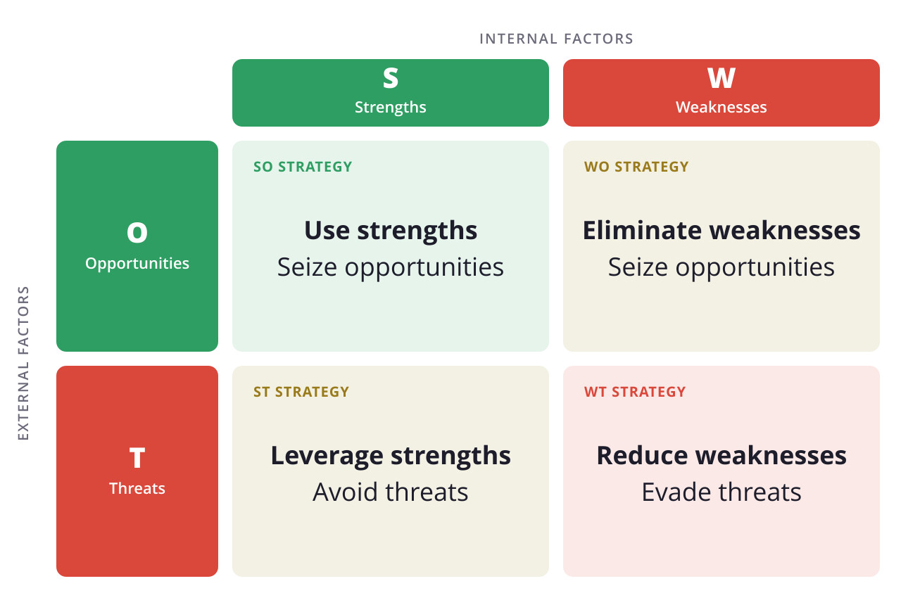

## A análise SWOT explicada de forma simples

### O que significa SWOT?

Vamos começar com uma definição. SWOT significa

- Strengths – Pontos fortes
- Weaknesses – Pontos fracos
- Opportunities – Oportunidades
- Threats – Ameaças

Análise SWOT © Scott Graham / Unsplash

A análise SWOT é um exemplo de como pode analisar a sua empresa (interna) e as influências ambientais relevantes (externas).

## O que é uma análise SWOT?

Numa análise SWOT, faz um **balanço da sua empresa ou equipa sob a forma de uma matriz**. Em primeiro lugar, analisa **os pontos fortes e fracos internos**: existem, por exemplo, produtos inovadores ou falta-lhe know-how ou mão de obra num determinado departamento?

Em seguida, **analisa o ambiente da sua empresa ou equipa**. Agora é altura de analisar **as oportunidades e as ameaças externas**. Como estão a evoluir os seus mercados? Está, por exemplo, a debater-se com o aumento dos custos dos materiais ou com novos [concorrentes]()? Ou as tendências sociais estão a favorecê-lo?

Na segunda etapa, retira desse balanço **recomendações estratégicas de ação**. O que tem de fazer quando as oportunidades encontram os pontos fracos ou as ameaças encontram os pontos fortes?

Exemplo de análise SWOT © SeaTable

Uma vez que são considerados tanto o ambiente como os fatores internos da empresa, a análise SWOT é um exemplo e uma **ferramenta importante para o planeamento estratégico empresarial**.

## Como realizar uma análise SWOT

A melhor maneira de o fazer é [planear um workshop]() em que as suas equipas façam um brainstorming em conjunto sobre as quatro categorias. Deve reunir todas as **ideias numa matriz**. No início, um mapa mental num quadro branco ou um modelo de análise SWOT em Excel ou Word que explique a análise SWOT de forma simples pode ajudar.

Mas o que pertence às quatro categorias?

## Análise SWOT: exemplo das categorias

Nas quatro categorias, analisa o estado atual da sua empresa e do ambiente empresarial. Proceda da seguinte forma:

1. **Pontos fortes (Strengths)**: os pontos fortes da sua empresa são todas as características que a distinguem particularmente da concorrência. A análise SWOT contém então, por exemplo:
    - Produtos inovadores
    - Um serviço ao cliente excelente
    - Know-how tecnológico
2. **Pontos fracos (Weaknesses)**: os pontos fracos representam as desvantagens da sua empresa na concorrência em geral. Na análise SWOT, podem ser, por exemplo:
    - Dependência de fornecedores
    - Falta de know-how no desenvolvimento de produtos
    - Falta de investimento em tecnologias de futuro
3. **Oportunidades (Opportunities)**: as oportunidades são fatores do ambiente empresarial que representam vantagens para a empresa. Para a análise SWOT são relevantes, por exemplo:
    - Tendências na sociedade
    - Normas legais
    - Desenvolvimentos tecnológicos
4. **Ameaças (Threats)**: já as ameaças são fatores do ambiente empresarial que significam desvantagens ou mesmo perigos para a empresa. Por exemplo:
    - Alterações nas taxas de câmbio
    - Novos concorrentes
    - Desenvolvimentos tecnológicos que tornarão o produto supérfluo no futuro

Além disso, preste atenção às dicas seguintes ao realizar a sua análise.

## Dicas para a realização da análise SWOT

Ao analisar os fatores externos num exemplo de análise SWOT, deve ter em conta que uma análise SWOT consiste em resolver dois problemas. Como é que **pode acompanhar as tendências do mercado** e **como é que pode prevê-las e ajudar a moldá-las**? Afinal, não quer apenas seguir a corrente, mas entusiasmar os seus clientes.

Escolha também um [modelo de análise SWOT]() para facilitar o seu trabalho. A análise começa com a escolha da ferramenta certa e deve ainda pensar na constituição da equipa adequada.

O [balanço]() implica um grande investimento de tempo. Quem pode dispensar para as reuniões e os workshops? Além disso, são necessárias competências de vários departamentos. **Que colegas têm uma visão dos pontos fortes, dos pontos fracos, das oportunidades e das ameaças da sua empresa e do seu ambiente empresarial?** O ideal seria reunir uma equipa de dez colaboradores.

Uma equipa fala sobre um exemplo de análise SWOT © UX Indonesia / Unsplash

**Outra dica:** seja criativo. Organize os workshops de brainstorming de forma a que as (novas) ideias surjam de forma lúdica.

## Que estratégias pode retirar da análise?

Da análise SWOT resultam **quatro orientações diferentes**. Para tal, relaciona os pontos fortes e fracos da sua empresa com as oportunidades e as ameaças do ambiente empresarial:

1. **Expandir** (combinação ponto forte-oportunidade): os pontos fortes aumentam a viabilidade das suas oportunidades. Veja que oportunidades pode aproveitar com sucesso e com que pontos fortes da sua empresa. Faz sentido expandir ainda mais determinadas áreas de negócio ou de produtos?
2. **Recuperar** (combinação ponto fraco-oportunidade): existe uma oportunidade que só pode concretizar se compensar um ponto fraco interno? Aqui, a sua gestão tem de tomar uma decisão: deve investir-se na recuperação dos pontos fracos? Assim, poderá aproveitar a oportunidade em seguida.
3. **Salvaguardar** (combinação ponto forte-ameaça): ao avaliar as ameaças, deve perguntar-se a que ameaças a sua empresa pode responder e com que pontos fortes. Poderá um ponto forte transformar até uma ameaça numa oportunidade, se reagir atempadamente?
4. **Evitar** (combinação ponto fraco-ameaça): onde é que os pontos fracos se encontram com as ameaças? Aqui deve ter um cuidado especial. Pense em como se poderia proteger dos perigos. Que atividades deve evitar, se for caso disso? Deve retirar-se por completo de uma área de negócio?

Agora que sabe o que é possível representar, por exemplo, com a análise SWOT, é altura de passar à implementação prática.

## Existe um bom modelo de análise SWOT?

A resposta é sim. Não faltam modelos para a análise SWOT. Pode encontrar um exemplo de análise SWOT para Excel, Word e programas semelhantes através da pesquisa no Google. Os modelos estão organizados em forma de lista ou de matriz.

Aqui pode ver um bom **exemplo de análise SWOT para empresas**:



## Como funciona o modelo de análise SWOT da SeaTable

Gostaria de utilizar o modelo da SeaTable para efetuar a sua análise? Então [registe-se]() no nosso site num instante. Na biblioteca, encontrará o **modelo gratuito**, no qual a análise SWOT é explicada de forma simples e preenchida com dados de exemplo. Clique em Utilizar modelo e comece a sua análise.

Na primeira tabela encontrará entradas de exemplo organizadas de acordo com as quatro categorias SWOT correspondentes. Na primeira coluna, introduz o fator antes de determinar a sua origem (interna ou externa) e de o classificar nas diferentes categorias.

Depois de introduzir todas as informações, pode visualizar a sua matriz concluída e registar as medidas possíveis num plano de ação. Graças à solução na nuvem, tem a possibilidade de aceder aos seus dados a partir de qualquer lugar e a qualquer momento e de os partilhar com outros utilizadores.

## Conclusão: realizar a análise SWOT com um modelo

Com uma análise SWOT determina em que situação se encontra a sua empresa e pode **delinear cenários para o futuro**. Serve-se das quatro categorias – pontos fortes, pontos fracos, oportunidades e ameaças – e considera tanto os fatores internos como os externos.

Registe-se gratuitamente na SeaTable para **começar com o seu exemplo de análise SWOT**. Um modelo gratuito que explica a análise SWOT de forma simples ajudá-lo-á na sua realização.
