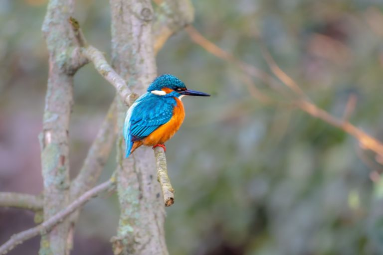
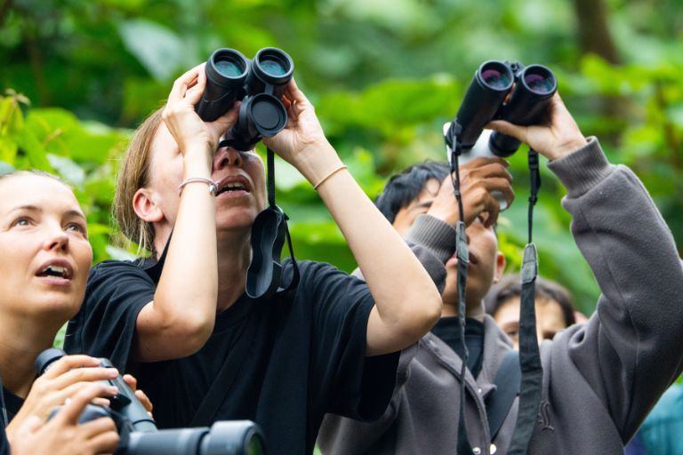
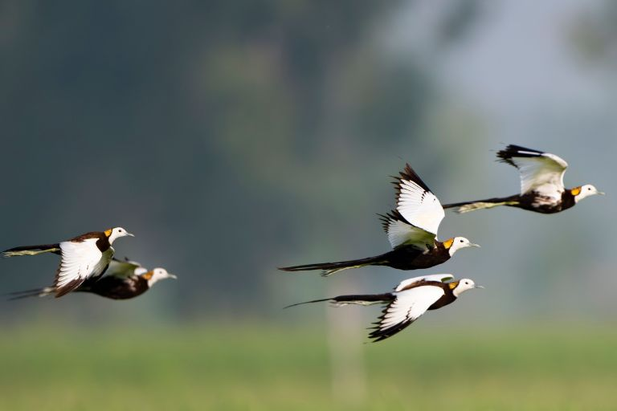
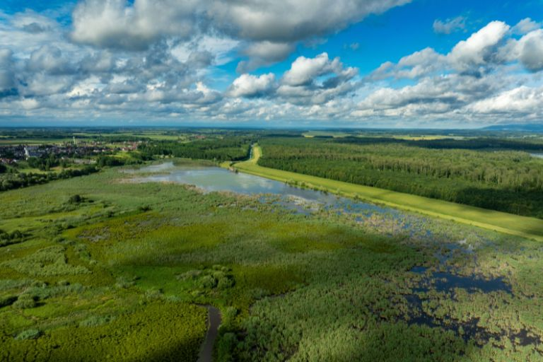
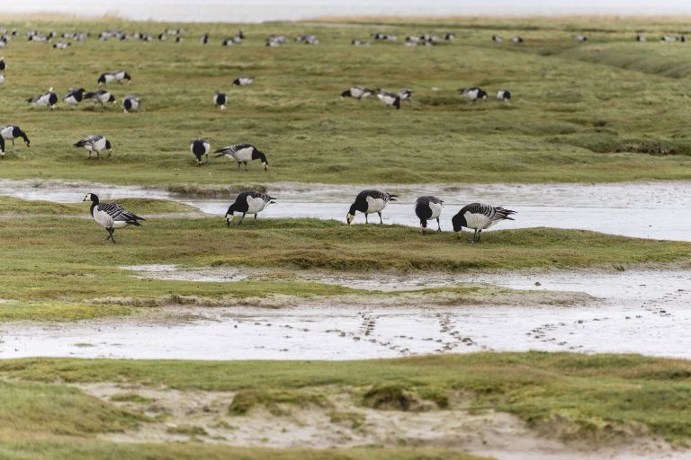
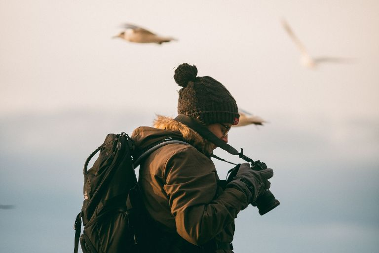

A pair of binoculars, a quiet morning in the woods, and the call of an unfamiliar bird. What used to be considered a stuffy hobby for retirees is currently experiencing a surprising resurgence. Birdwatching is booming—and not just among older people. More and more young people are discovering **that observing native and exotic bird species offers a [deliberate break from their digital daily lives]()**. 

In this article, you’ll learn why birdwatching is so popular right now, how to get started, whether birdwatching tours are worth it, and why digitally documenting your observations pays off.

## Why Birdwatching Is So Popular Today

Birdwatching is no longer just for people with decades of experience and expensive equipment. In recent years, the trend has become significantly more popular among younger people. Here’s why:

1.	**Social Media as a Gateway:** Paradoxically, a major driver is the very medium that many people are trying to escape through this hobby: social media. Under the hashtag #BirdTok, users share short videos of rare sightings, impressive courtship rituals, or simply the bird feeder in their own backyard. The birding community is growing rapidly on these platforms, giving modern birding a much younger, more urban image than it had just ten years ago.

2.  **Experiencing nature instead of screens:** At the same time, many people long for a conscious counterbalance to constant screen time. Birdwatching requires paying attention to the real world around you—to sounds, movements, and details that would otherwise be lost in the hustle and bustle of everyday life. Once you’ve tried to spot a wren in dense bushes, you’ll know just how much this hobby sharpens your focus and clears your mind.

3.  **Stress Relief, Mindfulness, and Exercise:** Birdwatching combines light physical activity in the fresh air with a form of mindfulness that you’d otherwise often have to work hard to learn. When you’re focused on looking for birds, you automatically think less about to-do lists or unread messages. This blend of learning and relaxation is a big part of what makes it so fascinating.

4.  **An Introduction to Ornithology:** For many, a passion for birdwatching begins as a casual hobby and, over time, develops into a more serious interest in ornithology. You begin to distinguish species by their songs, track migration patterns, or explore their habitats. The transition from occasional birdwatching to systematic birdwatching is usually a smooth one.



Birding sharpens your attention to detail and helps you hone your observational skills. Every time you spot or identify a new bird species, you experience a small sense of accomplishment that brings joy and motivation. At the same time, you spend time in nature and become much more aware of how it changes throughout the seasons.

 

## How to Get Started with Birdwatching

Getting started with birdwatching is easier than many people think. You don’t need a big budget or any prior knowledge to begin making your first observations.

### The Right Equipment for Birdwatching

A good **pair of binoculars for birdwatching is the most important purchase**. To get started, a model with 8x to 10x magnification and as light a weight as possible is sufficient, so that even longer observation sessions don’t become a burden. A **spotting scope is only worth it if you regularly want to observe birds at greater distances**, such as when watching waterfowl on open shores or birds of prey far away. For beginners, however, a spotting scope is usually overkill and unnecessarily expensive. 

In addition to binoculars for birdwatching, **weatherproof clothing is part of the basic gear**. Since you’ll often be standing or sitting still for long periods, your body cools down faster than when you’re moving, which is why dressing in layers works best. A **notebook or, alternatively, a smartphone** rounds out your gear and helps you record sightings right on the spot.

### How to Identify Species More Easily

When you’re starting out, it’s worth learning to identify native birds before venturing into rarer or exotic species. Blackbirds, great tits, and robins offer a good introduction to birdwatching because they’re common and relatively easy to distinguish. 

Whether you rely on a traditional field guide or an app is ultimately a matter of personal preference. Field guides often offer **more detailed illustrations and work regardless of cell phone reception**, while apps usually **can also play bird calls and make searching easier with filter functions**. Many experienced birdwatchers now use both at the same time.

To identify a species with certainty, five key characteristics are helpful:

- **Size** compared to familiar reference birds such as sparrows or pigeons
- **Plumage** and distinctive color patterns
- **Call** or song
- **Behavior**, such as the way it moves or forages
- **Habitat** where the observation takes place
  
### The best places for birdwatching and bird photography

Forests, lakes, parks, coastlines, and nature reserves each offer different levels of biodiversity because different bird species are adapted to different habitats. **Birding areas are particularly productive during the spring and fall migration seasons**, when migratory birds stop to rest on their way to their winter or summer habitats. If you visit a well-known resting spot during this time, you can spot significantly more species in just a few hours than on a typical weekend.

## Birdwatching Tours: The Most Beautiful Destinations for Birdwatching

If you’d like to look beyond your own region, birdwatching tours offer a great opportunity to discover new habitats and species. While birdwatching in your local area is usually limited to familiar species, trips to select locations open up a whole new perspective on the diversity of the bird world. For example, anyone who has never seen a white-tailed eagle in flight or an entire colony of nesting seabirds will quickly understand on a well-planned tour why many birdwatchers regularly go on trips. 

Such tours also offer the opportunity to learn from experienced guides and refine birdwatching techniques that are difficult to master on your own. Especially for people who want to make their passion for birdwatching a regular part of their year, it’s therefore worth looking beyond their own region.

### What Makes a Good Birdwatching Tour

Small groups are particularly important for guided birdwatching tours, as large groups unnecessarily disturb the birds and make observation more difficult. An **experienced guide with in-depth species knowledge often makes all the difference**, because they can identify calls and spot rare species based on the slightest clues that amateurs might easily miss. Birdwatching tour operators are also increasingly focusing on sustainability, for example by limiting group sizes, sticking to designated trails, and collaborating with local conservation organizations. This form of ecotourism benefits both the wildlife and the local community.

### Popular Destinations

Depending on the time available and the desired biodiversity, a wide variety of destinations are suitable for a birdwatching tour—ranging from long-distance trips to excursions right on your doorstep.



Iceland is famous for its impressive seabird colonies, which nest by the thousands on the steep cliffs along the coast. Visitors to the island can spot the following birds in particular:

- Puffins, especially along the coast during the summer months 
- Northern gannets in large breeding colonies 
- Fulmars, which often circle in the immediate vicinity of the cliffs.





The species-rich national parks of both countries are home to an extraordinary variety of bird species packed into a very small area, making this region one of the most exciting birdwatching destinations in the world. Highlights include, among others:

- The quetzal, one of the most colorful and sought-after sightings in the cloud forests
- Toucans with their distinctive, large beaks
- Hummingbirds, with an exceptionally high diversity of species
- Macaws, often in vibrant colors and clearly visible in the treetops





The Danube Delta is one of Europe’s most biodiverse wetlands, and with its vast reed beds and waterways, it offers ideal conditions for numerous rare species. Particularly worth seeing are, for example:

- Dalmatian pelicans, whose colonies are among the largest in Europe 
- White-tailed eagles, often circling above the reeds and waterways 
- Purple herons, hidden among dense vegetation





The Algarve boasts a diverse coastal and wetland landscape that is home to a remarkably high density of species. Nature lovers can spot the following birds here in particular:

- Bee-eaters, with their strikingly colorful plumage 
- Spoonbills, easily recognizable by their spatula-shaped beaks 
- White storks, which often nest in the region even outside of traditional nests





The Wadden Sea is one of the most important stopover sites for migratory birds in all of Europe and, during migration seasons, is the scene of impressive flocks of birds. In particular, you can observe the following here:

- Brent geese, which rest in large flocks during migration 
- Oystercatchers with their characteristic orange beaks 
- Dunlins, often seen in dense, coordinated flocks



## Key Rules of Conduct for Birdwatching

As fascinating as this hobby is, it also comes with responsibilities. Anyone who watches birds should always **keep their distance from the birds** and under no circumstances try to get unnecessarily close. **During the breeding season, in particular, being considerate is crucial**, as disturbances can cause parent birds to abandon their nests. Under no circumstances should you actively seek out nests, no matter how curious you may be. **Staying calm and moving slowly, without any sudden movements** also ensures that the birds do not feel disturbed and remain visible for longer.

## Why You Should Document Your Birdwatching Observations

Many experienced birdwatchers swear by consistently documenting their sightings—and for good reason. A personal species list highlights **just how diverse your own observations already are**, while also serving as motivation for future outings. Over time, you can also track your own progress in species identification—for example, when species that were previously difficult to identify can suddenly be recognized at a glance. 
Year-over-year comparisons also reveal **seasonal patterns, such as when certain migratory birds typically arrive in your region**. Last but not least, **documented observations serve as mementos of trips** and provide a personal look back at special experiences. Documenting your progress makes your personal achievements visible and helps you stay motivated in the long term.



- Use soft light in the early morning or late afternoon 
- Patience is more important than expensive equipment 
- Continuous shooting mode increases your chances of getting a sharp photo of a moving subject 
- Focus on capturing the bird's behavior, not just the technical perfection of the image

 

## Digital Documentation with SeaTable

Anyone who regularly observes and photographs birds will benefit greatly from collecting their sightings and photos in one place, rather than scattering them across different folders and apps. This is exactly where the [AI-powered no-code platform]() SeaTable comes in. With SeaTable, you can **build your own observation database where each sighting is recorded with the date, location, species, and other details**. Photos can be directly assigned to and saved with the corresponding sighting, so that the image and information are not separated from one another. 



Via a [Map View]() all observation locations can be displayed visually, which is especially useful for identifying patterns in your own observation region. Convenient filters by bird species make analysis easier—for example, if you want to see how often you’ve already spotted a particular species. Via the [Web Form]() you can easily log new sightings even when you're on the go. Last but not least, a well-maintained database helps you prepare for your next birdwatching trip, since you can view past observations and your "wish lists" at any time.

## Conclusion

Birdwatching combines experiencing nature, relaxation, and learning in a way that has become rare in our digital daily lives. Getting started is easy and affordable—a good pair of binoculars and a little patience are all you need to start seeing results. For those who want to delve deeper, birdwatching tours offer a chance to enjoy unique nature experiences in new places. And by documenting your observations digitally, you ensure that memories, species lists, and photos are preserved permanently, rather than getting lost in notebooks or scattered apps.

## FAQs



Birding is often associated with a more active, community-driven approach, where the focus is on actively tracking down as many species as possible and interacting within communities such as #BirdTok. Traditional birdwatching, on the other hand, is often more tranquil and doesn’t necessarily have to be focused on collecting new species.





Binoculars with 8x to 10x magnification, weatherproof clothing, and a notebook or smartphone for documentation are perfectly sufficient to get started. A spotting scope becomes relevant only for more advanced birdwatching.





Yes, guided tours with experienced guides make it much easier for beginners to get started, as calls and species can be correctly identified more quickly. Those who prefer to go out on their own can, of course, also get started independently with a field guide or an app.





Documenting the birds you’ve spotted helps you track your own progress, allows you to compare observations year over year, and preserves memories of special sightings and trips. With a digital solution like SeaTable, you can also manage this information in a structured and permanent way.


