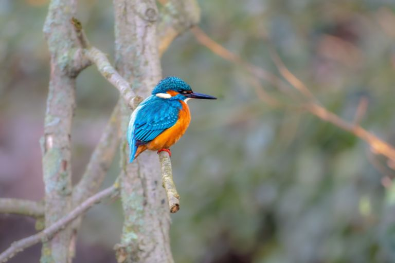
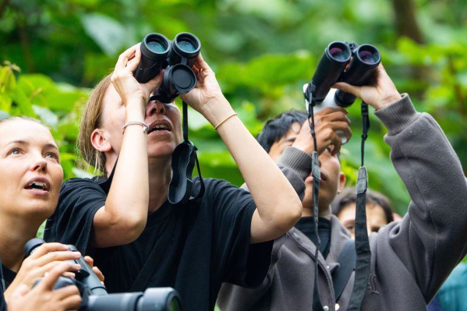
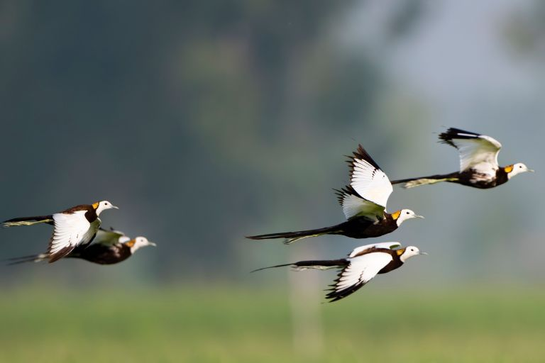
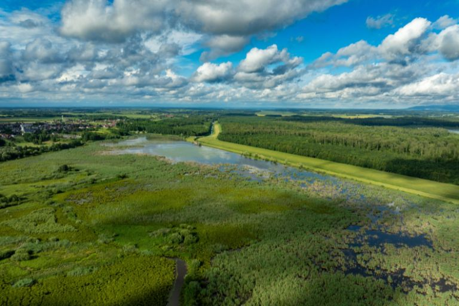
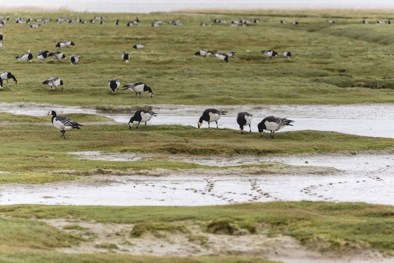
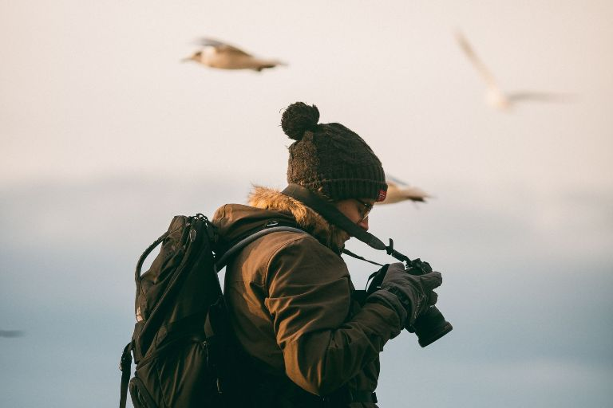

Unos prismáticos, una tranquila mañana en el bosque y el canto de un pájaro desconocido. Lo que antes se consideraba un pasatiempo anticuado para jubilados está viviendo ahora un sorprendente renacimiento. La observación de aves está en auge, y no solo entre el público de más edad. Cada vez son más los jóvenes que descubren **la observación de especies de aves autóctonas y exóticas como una forma consciente de [desconectar de la rutina digital]()**. 

En este artículo descubrirás por qué la observación de aves es tan popular precisamente ahora, cómo dar los primeros pasos, si merece la pena participar en excursiones de observación de aves y por qué resulta útil documentar digitalmente tus observaciones.

## Por qué la observación de aves es tan popular hoy en día

La observación de aves hace tiempo que dejó de ser algo exclusivo de personas con décadas de experiencia y equipos costosos. En los últimos años, el público que practica esta actividad se ha rejuvenecido notablemente. Esto se debe a las siguientes razones:

1.	**Las redes sociales como puerta de entrada:** Paradójicamente, uno de los principales impulsores es precisamente el medio del que muchas personas quieren escapar con esta afición: las redes sociales. Bajo el hashtag #BirdTok, los usuarios comparten vídeos cortos de avistamientos poco comunes, impresionantes rituales de cortejo o, simplemente, de la casita para pájaros de su propio jardín. La comunidad de observadores de aves crece rápidamente en estas plataformas, lo que confiere a la observación de aves moderna una imagen mucho más joven y urbana que hace diez años.

2.  **Experiencia en la naturaleza en lugar de pantallas:** Al mismo tiempo, muchas personas anhelan un contrapunto consciente al tiempo que pasan constantemente frente a las pantallas. La observación de aves exige prestar atención al entorno real, a los sonidos, los movimientos y los detalles que, de otro modo, pasarían desapercibidos en el ajetreo del día a día. Si alguna vez has intentado localizar a un chochín entre la espesa maleza, sabes hasta qué punto esta afición agudiza la vista y despeja la mente.

3.  **Reducción del estrés, atención plena y ejercicio:** La observación de aves combina un ejercicio físico suave al aire libre con una forma de atención plena que, de otro modo, a menudo cuesta mucho aprender. Cuando te concentras en buscar aves, automáticamente piensas menos en las listas de tareas pendientes o en los mensajes sin leer. Esta combinación de aprendizaje y relajación constituye gran parte de su encanto.

4.  **Iniciación a la ornitología:** Para muchos, la pasión por la observación de aves comienza como un pasatiempo informal y, con el tiempo, se convierte en un interés más serio por la ornitología. Empiezas a distinguir especies por su canto, a seguir los patrones migratorios o a interesarte por los hábitats. La transición de la observación ocasional a la observación sistemática de aves suele ser fluida.



Al practicar la observación de aves, agudizas tu atención por los detalles y, de este modo, entrenas tu percepción. Cada vez que descubres o identificas una nueva especie de ave, vives un pequeño momento de éxito que te llena de alegría y te motiva. Al mismo tiempo, pasas tiempo en la naturaleza y percibes sus cambios a lo largo de las estaciones de forma mucho más consciente.

 

## Cómo iniciarse en la observación de aves

Iniciarse en la observación de aves es más fácil de lo que muchos piensan. No necesitas ni un gran presupuesto ni conocimientos previos para empezar a hacer tus primeras observaciones.

### El equipo adecuado para la observación de aves

Unos buenos **prismáticos para la observación de aves son la adquisición más importante**. Para empezar, basta con un modelo con un aumento de entre ocho y diez veces y lo más ligero posible, para que incluso las sesiones de observación más largas no resulten una carga. Un **telescopio terrestre solo merece la pena si quieres cubrir regularmente grandes distancias**, por ejemplo, al observar aves acuáticas en la orilla abierta o aves rapaces a gran distancia. Sin embargo, para empezar, un telescopio terrestre suele ser excesivo e innecesariamente caro. 

Además de los prismáticos para la observación de aves, **la ropa resistente a la intemperie forma parte del equipamiento básico**. Dado que a menudo se permanece de pie o sentado durante largos periodos de tiempo, el cuerpo se enfría más rápido que cuando se está en movimiento, por lo que resulta muy útil vestirse por capas. Un **cuaderno de notas o, alternativamente, el smartphone** completan el equipo y ayudan a anotar los avistamientos directamente in situ.

### Cómo identificar las especies más fácilmente

Al principio, merece la pena aprender a identificar las aves autóctonas antes de aventurarse con especies más raras o exóticas. El mirlo, el carbonero común o el petirrojo son una buena forma de iniciarse en la observación de aves, ya que son muy comunes y relativamente fáciles de distinguir. 

Que optes por un libro de identificación clásico o por una aplicación es, en última instancia, cuestión de gustos. Los libros de identificación suelen ofrecer **ilustraciones más detalladas y funcionan independientemente de la cobertura móvil**, mientras que las aplicaciones suelen **reproducir además los cantos de las aves y facilitan la búsqueda mediante funciones de filtrado**. Muchos observadores de aves experimentados utilizan ahora ambos medios a la vez.

Para identificar una especie con seguridad, hay cinco características fundamentales que te ayudarán:

- **Tamaño** en comparación con aves de referencia conocidas, como el gorrión o la paloma
- **Plumaje** y patrones de color llamativos
- **Grito** o canto
- **Comportamiento**, como la forma de desplazarse o de buscar alimento
- **Hábitat** en el que se realiza la observación
  
### Los mejores lugares para observar y fotografiar aves

Los bosques, los lagos, los parques, las costas y las reservas naturales ofrecen cada uno una diversidad de especies diferente, ya que las distintas especies de aves se han adaptado a distintos hábitats. Las **zonas de observación durante la época de migración, en primavera y otoño**, resultan especialmente fructíferas, ya que es cuando las aves migratorias hacen una parada en su camino hacia sus zonas de invernada o de veraneo. Quien se encuentre en un lugar de descanso conocido durante este periodo podrá descubrir, en tan solo unas horas, muchas más especies que en un fin de semana normal.

## Excursiones de observación de aves: los destinos más bonitos para observar aves

Quien desee ampliar sus horizontes más allá de su propia región encontrará en los viajes de observación de aves una buena oportunidad para conocer nuevos hábitats y especies. Mientras que la observación de aves en el entorno cercano suele limitarse a especies conocidas, los viajes a lugares seleccionados ofrecen una perspectiva totalmente diferente de la diversidad del mundo de las aves. Quien, por ejemplo, nunca haya visto un águila marina en vuelo o toda una colonia de aves marinas anidando, comprenderá rápidamente, en una excursión bien planificada, por qué muchos observadores de aves se lanzan a viajar con regularidad. 

Además, estas excursiones ofrecen la oportunidad de aprender de guías experimentados y profundizar en técnicas de observación de aves que resultan difíciles de adquirir por cuenta propia. Por eso, especialmente para aquellas personas que desean que su pasión por la observación de aves se convierta en una parte integral de su año, merece la pena mirar más allá de la propia región.

### Qué caracteriza a una buena excursión de observación de aves

Los grupos reducidos son especialmente importantes en las excursiones guiadas de observación de aves, ya que los grupos grandes perturban innecesariamente a los animales y dificultan la observación. Un **guía experimentado con un profundo conocimiento de las especies suele marcar la diferencia**, ya que es capaz de identificar los cantos y reconocer especies raras a partir de indicios mínimos que a los aficionados les pasan fácilmente por alto. Además, cada vez más proveedores de excursiones de observación de aves prestan atención a la sostenibilidad, por ejemplo, limitando el tamaño de los grupos, estableciendo rutas fijas y colaborando con organizaciones locales de protección de la naturaleza. Esta forma de ecoturismo beneficia tanto a los animales como a la población local.

### Destinos populares

En función del tiempo disponible y de la biodiversidad que se desee observar, hay destinos muy diversos que pueden ser adecuados para una excursión de observación de aves, desde viajes largos hasta salidas cerca de casa.



Islandia es famosa por sus impresionantes colonias de aves marinas, que se asientan por miles en los escarpados acantilados de la costa. Quien visite la isla podrá observar, sobre todo, las siguientes aves:

- Frailecillos, sobre todo en los meses de verano en la costa 
- Alcatrazes, en grandes colonias de cría 
- Petreles polares, que a menudo sobrevuelan en círculos muy cerca de los acantilados.





En los parques nacionales de ambos países, ricos en biodiversidad, convive en un espacio muy reducido una extraordinaria variedad de especies de aves, lo que convierte a esta región en uno de los destinos más interesantes del mundo para la observación de aves. Entre los puntos destacados se encuentran, entre otros:

- El quetzal, uno de los avistamientos más coloridos y codiciados de los bosques nubosos 
- Los tucanes, con su característico y gran pico
- Los colibríes, con una diversidad de especies extraordinariamente alta
- Los guacamayos, a menudo de colores vivos y bien visibles en las copas de los árboles





El delta del Danubio es uno de los humedales con mayor biodiversidad de Europa y, con sus extensas zonas de juncos y cursos de agua, ofrece las condiciones ideales para numerosas especies raras. Merecen especial atención, por ejemplo:

- Los pelícanos de cabeza rizada, cuyas colonias se cuentan entre las más grandes de Europa 
- Las águilas marinas, que a menudo sobrevuelan en círculos los juncos y las masas de agua 
- Las garzas púrpuras, escondidas entre la densa vegetación





El Algarve destaca por su variado paisaje costero y de humedales, que alberga una densidad de especies notablemente elevada. Los amantes de la naturaleza pueden avistar aquí, sobre todo, las siguientes aves:

- El abejaruco, con su llamativo plumaje multicolor 
- La espátula, fácilmente reconocible por su pico en forma de espátula 
- La cigüeña blanca, que en la región suele anidar también fuera de los nidos tradicionales





El Mar de Wadden es una de las zonas de descanso más importantes para las aves migratorias de toda Europa y, durante las épocas de migración, es escenario de impresionantes bandadas de aves. Aquí se pueden observar, en particular:

- Gansos de cuello anillado, que descansan en grandes bandadas durante la migración 
- Ostreros, con su característico pico naranja 
- Correlimos alpinos, que a menudo se observan en bandadas densas que vuelan de forma coordinada



## Las normas de comportamiento más importantes para la observación de aves

Por muy fascinante que sea esta afición, también conlleva una responsabilidad. Quien observe aves debe **mantener siempre la distancia con los animales** y no intentar en ningún caso acercarse innecesariamente. **Durante la época de cría es especialmente importante ser respetuoso**, ya que las perturbaciones pueden provocar que los padres abandonen sus nidos. Por norma general, no se debe buscar activamente los nidos, por mucha curiosidad que se tenga. **Un comportamiento tranquilo y pausado, sin movimientos bruscos**, garantiza además que los animales no se sientan molestados y permanezcan observables durante más tiempo.

## Por qué deberías documentar tus observaciones de aves

Muchos observadores de aves experimentados apuestan por documentar sistemáticamente sus avistamientos, y con razón. Una lista personal de especies pone de manifiesto **la diversidad que ya tienen tus propias observaciones** y, al mismo tiempo, te motiva para futuras salidas. Además, con el tiempo, permite seguir la evolución de tus propios conocimientos sobre las especies, por ejemplo, cuando especies que antes resultaban difíciles de identificar se reconocen de repente a primera vista. 
Las comparaciones anuales muestran, además, **patrones estacionales, como cuándo suelen llegar a tu región determinadas aves migratorias**. Por último, pero no por ello menos importante, **las observaciones documentadas sirven como recuerdo de los viajes** y permiten repasar personalmente experiencias especiales. Quien documenta sus progresos hace visibles sus logros personales y mantiene la motivación a largo plazo.



- Aprovecha la luz suave de primera hora de la mañana o de última hora de la tarde 
- La paciencia es más importante que un equipo caro 
- El modo de disparo en ráfaga aumenta las posibilidades de conseguir una foto nítida en movimiento 
- Fotografía el comportamiento del pájaro, no solo la perfección técnica de la imagen

 

## Documentación digital con SeaTable

Quien quiera observar y fotografiar aves con regularidad sacará mucho provecho de recopilar los avistamientos y las fotos en un solo lugar, en lugar de dispersarlos entre diferentes carpetas y aplicaciones. Es precisamente aquí donde entra en juego la [Plataforma «no-code» basada en IA]() SeaTable. Con SeaTable se puede **crear una base de datos propia de avistamientos, en la que se registra cada avistamiento con la fecha, el lugar, la especie y otros detalles**. Las fotos se pueden asignar directamente al avistamiento correspondiente y guardarlas, de modo que la imagen y la información no estén separadas entre sí. 



A través de una [vista de mapa]() Se pueden visualizar todos los lugares de observación, lo cual resulta especialmente útil para detectar patrones en la propia zona de observación. Los prácticos filtros por especies de aves facilitan el análisis, por ejemplo, si desea comprobar cuántas veces ha avistado ya una especie concreta. A través del [formulario web]() Podrá registrar cómodamente nuevos avistamientos incluso cuando esté fuera de casa. Además, una base de datos bien mantenida resulta de gran ayuda a la hora de preparar la próxima excursión de observación de aves, ya que permite consultar en cualquier momento los avistamientos anteriores y las «listas de deseos» pendientes.

## Conclusión

La observación de aves combina el contacto con la naturaleza, la relajación y el aprendizaje de una forma que ya es poco habitual en el día a día digital. Empezar es fácil y económico, ya que unos prismáticos de buena calidad y un poco de paciencia bastan para obtener los primeros resultados. Quien quiera profundizar en esta afición encontrará en las excursiones de observación de aves una oportunidad para vivir experiencias naturales únicas en nuevos lugares. Y quien documente digitalmente sus observaciones se asegurará de que los recuerdos, las listas de especies y las fotos se conserven de forma permanente, en lugar de perderse en cuadernos o en aplicaciones dispersas.

## Preguntas frecuentes



La observación de aves se asocia a menudo con un enfoque más activo e impulsado por la comunidad, en el que prima la búsqueda específica del mayor número posible de especies y el intercambio en comunidades como #BirdTok. Por el contrario, la forma clásica de observar aves suele caracterizarse por un mayor reposo y no tiene por qué estar orientada necesariamente a la recopilación de nuevas especies.





Unos prismáticos con un aumento de entre ocho y diez veces, ropa resistente a la intemperie y un cuaderno o un smartphone para tomar notas son más que suficientes para empezar. Un telescopio terrestre solo resulta necesario para observaciones más avanzadas.





Sí, las excursiones guiadas con guías experimentados facilitan considerablemente los primeros pasos, sobre todo a los principiantes, ya que permiten identificar correctamente los cantos y las especies con mayor rapidez. Quien prefiera salir por su cuenta, por supuesto, también puede empezar de forma autónoma con una guía de identificación o una aplicación.





Documentar las aves que se avistan permite visualizar su propia evolución, realizar comparaciones anuales y conservar recuerdos de observaciones y viajes especiales. Además, con una solución digital como SeaTable, esta información se puede gestionar de forma estructurada y duradera.


