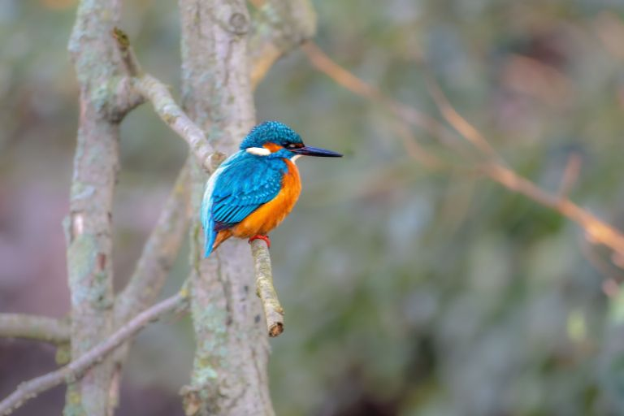
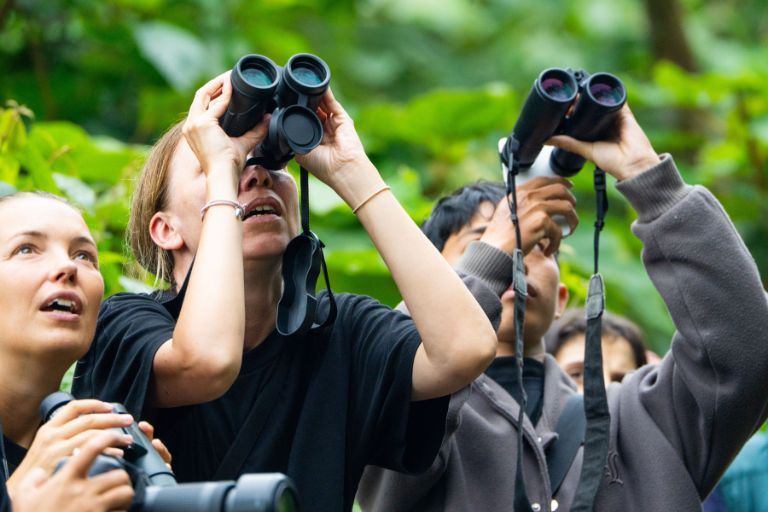
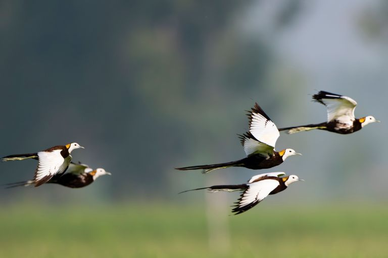
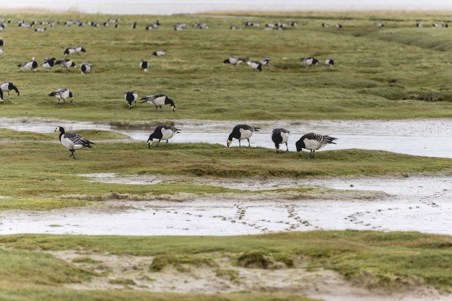
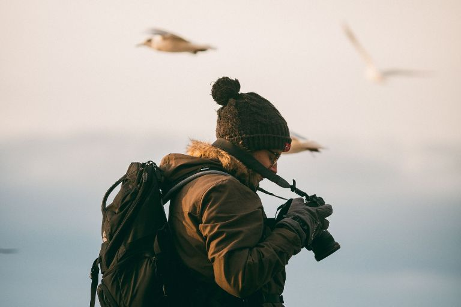

Une paire de jumelles, une matinée tranquille en forêt et le chant d'un oiseau inconnu. Ce qui était autrefois considéré comme un passe-temps désuet réservé aux retraités connaît actuellement un regain d'intérêt surprenant. L'observation des oiseaux est en plein essor, et pas seulement auprès des personnes âgées. De plus en plus de jeunes découvrent **l'observation d'espèces d'oiseaux locales et exotiques comme [une pause bienvenue loin du quotidien numérique]()**. 

Dans cet article, vous découvrirez pourquoi l’observation des oiseaux est si populaire en ce moment, comment vous y mettre, si les sorties d’observation valent le coup et pourquoi la documentation numérique de vos observations est utile.

## Pourquoi l'observation des oiseaux est-elle si populaire aujourd'hui ?

L'observation des oiseaux n'est plus depuis longtemps réservée aux personnes ayant des décennies d'expérience et disposant d'un équipement coûteux. Ces dernières années, cette activité a nettement rajeuni. Cela s'explique par les raisons suivantes :

1.	**Les réseaux sociaux, une porte d’entrée :** paradoxalement, l’un des principaux moteurs de cette tendance est justement le média que beaucoup cherchent à fuir pour se consacrer à ce loisir : les réseaux sociaux. Sous le hashtag #BirdTok, les utilisateurs partagent de courtes vidéos d’observations rares, de rituels d’accouplement impressionnants ou simplement de la mangeoire à oiseaux de leur propre jardin. La communauté des ornithologues amateurs connaît une croissance fulgurante sur ces plateformes, ce qui confère à l’ornithologie moderne une image nettement plus jeune et plus urbaine qu’il y a dix ans.

2.  **L’expérience de la nature plutôt que les écrans :** Parallèlement, de nombreuses personnes aspirent à un contrepoids conscient au temps passé sans cesse devant les écrans. L’observation des oiseaux exige d’être attentif à l’environnement réel, aux sons, aux mouvements et aux détails qui passent autrement inaperçus dans le tourbillon du quotidien. Si vous avez déjà essayé de repérer un troglodyte dans des buissons épais, vous savez à quel point ce loisir aiguise le regard et libère l’esprit.

3.  **Réduction du stress, pleine conscience et activité physique :** l’observation des oiseaux allie une activité physique modérée en plein air à une forme de pleine conscience que l’on doit souvent apprendre au prix de nombreux efforts. Lorsque vous vous concentrez pour repérer des oiseaux, vous pensez automatiquement moins à vos listes de tâches ou à vos messages non lus. Ce mélange d’apprentissage et de détente constitue une grande partie de la fascination que suscite cette activité.

4.	**Initiation à l’ornithologie :** Pour beaucoup, la passion pour l’observation des oiseaux commence comme un loisir décontracté et se transforme au fil du temps en un intérêt plus sérieux pour l’ornithologie. Vous commencez à distinguer les espèces à leur chant, à suivre les schémas de migration ou à vous intéresser à leurs habitats. La transition entre l’observation occasionnelle et l’ornithologie systématique s’effectue généralement en douceur.



L’observation des oiseaux aiguise votre attention aux détails et entraîne ainsi votre perception. Chaque fois que vous découvrez ou identifiez une nouvelle espèce d’oiseau, vous vivez un petit moment de réussite qui vous procure de la joie et vous motive. En même temps, vous passez du temps dans la nature et percevez ses changements au fil des saisons de manière beaucoup plus consciente.

 

## Comment se lancer dans l'observation des oiseaux

Se lancer dans l'observation des oiseaux est plus simple que beaucoup ne le pensent. Vous n'avez besoin ni d'un budget important ni de connaissances préalables pour commencer à faire vos premières observations.

### Le bon équipement pour l'observation des oiseaux

Une bonne **paire de jumelles d'observation est l'achat le plus important**. Pour débuter, un modèle offrant un grossissement de 8 à 10 fois et aussi léger que possible suffit, afin que même les longues sorties d'observation ne deviennent pas une corvée. Une **longue-vue ne vaut la peine que si vous souhaitez régulièrement observer des sujets situés à grande distance**, par exemple des oiseaux aquatiques sur des berges dégagées ou des rapaces au loin. Pour débuter, une longue-vue est toutefois généralement surdimensionnée et inutilement coûteuse. 

Outre les jumelles pour l’observation des oiseaux, **des vêtements résistants aux intempéries font partie de l’équipement de base**. Comme vous restez souvent immobile, debout ou assis, pendant de longues périodes, le corps se refroidit plus rapidement que lorsque vous bougez ; c’est pourquoi une tenue en plusieurs couches s’avère très utile. Un **carnet de notes ou, à défaut, un smartphone** complète l’équipement et permet de noter vos observations directement sur place.

### Comment reconnaître plus facilement les espèces

Au début, il est préférable d’apprendre à identifier les oiseaux locaux avant de s’aventurer vers des espèces plus rares ou exotiques. Le merle noir, la mésange charbonnière ou le rouge-gorge constituent une bonne introduction à l’observation des oiseaux, car ils sont courants et relativement faciles à distinguer. 

Que vous optiez pour un guide d’identification classique ou une application, c’est finalement une question de goût. Les guides d’identification proposent souvent **des illustrations plus détaillées et fonctionnent indépendamment de la couverture réseau**, tandis que les applications peuvent généralement **diffuser en plus des chants d’oiseaux et faciliter la recherche grâce à des fonctions de filtrage**. De nombreux ornithologues expérimentés utilisent désormais les deux en parallèle.

Pour identifier une espèce avec certitude, cinq caractéristiques essentielles sont utiles :

- **la taille** par rapport à des oiseaux de référence connus comme le moineau ou le pigeon
- **le plumage** et les motifs de couleur caractéristiques
- **le cri** ou le chant
- **le comportement**, par exemple la manière de se déplacer ou de chercher sa nourriture
- **l'habitat** dans lequel l'observation a lieu
  
### Les meilleurs endroits pour observer et photographier les oiseaux

Les forêts, les lacs, les parcs, les côtes et les réserves naturelles offrent chacun une biodiversité différente, car les différentes espèces d’oiseaux sont adaptées à des habitats variés. Les **sites d'observation sont particulièrement riches pendant les périodes de migration au printemps et en automne**, lorsque les oiseaux migrateurs font escale sur leur route vers leurs quartiers d'hiver ou d'été. En se rendant à cette période dans une aire de repos connue, on peut découvrir en quelques heures bien plus d'espèces que lors d'un week-end ordinaire.

## Circuits d'observation des oiseaux : les plus belles destinations pour l'observation des oiseaux

Si vous souhaitez élargir vos horizons au-delà de votre région, les circuits d'observation des oiseaux constituent un excellent moyen de découvrir de nouveaux habitats et de nouvelles espèces. Alors que l'observation des oiseaux dans son environnement immédiat se limite généralement à des espèces familières, les voyages vers des sites sélectionnés offrent une perspective tout à fait différente sur la diversité de l'avifaune. Par exemple, ceux qui n’ont encore jamais vu un pygargue à queue blanche en vol ou toute une colonie d’oiseaux marins en période de nidification comprendront rapidement, lors d’un circuit bien organisé, pourquoi de nombreux ornithologues amateurs partent régulièrement en voyage. 

Ces circuits offrent en outre la possibilité d’apprendre auprès de guides expérimentés et d’approfondir des techniques d’observation des oiseaux difficiles à acquérir seul. C’est donc particulièrement intéressant pour ceux qui souhaitent faire de leur passion pour l’observation des oiseaux un rendez-vous incontournable de leur année de regarder au-delà de leur propre région.

### Ce qui fait une bonne sortie d'observation des oiseaux

Les petits groupes sont particulièrement importants lors des sorties guidées d'observation des oiseaux, car les grands groupes dérangent inutilement les animaux et compliquent l'observation. Un **guide expérimenté, possédant une connaissance approfondie des espèces, fait souvent toute la différence**, car il est capable d’identifier les cris et de reconnaître les espèces rares à partir d’indices infimes qui échappent facilement aux non-initiés. De plus en plus, les prestataires proposant des excursions d’observation des oiseaux veillent à la durabilité, notamment en limitant la taille des groupes, en suivant des itinéraires balisés et en collaborant avec des associations locales de protection de la nature. Cette forme d’écotourisme profite tant à la faune qu’aux populations locales.

### Destinations populaires

En fonction du temps disponible et de la diversité des espèces recherchée, les destinations envisageables pour une excursion d’observation des oiseaux sont très variées, allant du voyage lointain à la sortie à deux pas de chez soi.



L'Islande est célèbre pour ses impressionnantes colonies d'oiseaux marins, qui s'installent par milliers sur les falaises abruptes du littoral. Les voyageurs qui visitent l'île pourront notamment y observer les oiseaux suivants :

- les macareux moines, surtout sur la côte pendant les mois d'été 
- les fous de Bassan, qui forment de grandes colonies de reproduction 
- les fulmars, qui tournent souvent à proximité immédiate des falaises.





Les parcs nationaux riches en biodiversité de ces deux pays abritent, sur un espace très restreint, une extraordinaire diversité d'espèces d'oiseaux, ce qui fait de cette région l'une des destinations les plus passionnantes au monde pour l'observation des oiseaux. Parmi les points forts, on peut citer notamment :

- le quetzal, l'une des espèces les plus colorées et les plus recherchées des forêts de nuages 
- Les toucans, avec leur grand bec caractéristique 
- Les colibris, dont la diversité d'espèces est exceptionnellement riche 
- Les aras, souvent aux couleurs vives et bien visibles dans la cime des arbres





Le delta du Danube compte parmi les zones humides les plus riches en espèces d'Europe et, avec ses vastes roselières et ses cours d'eau, offre des conditions idéales pour de nombreuses espèces rares. Parmi les espèces à ne pas manquer, on peut citer notamment :

- les pélicans frisés, dont les colonies comptent parmi les plus grandes d'Europe 
- les pygargues à queue blanche, qui tournent souvent au-dessus des roseaux et des plans d'eau 
- les hérons pourprés, cachés au milieu d'une végétation dense





L'Algarve séduit par la diversité de ses paysages côtiers et de ses zones humides, qui abritent une densité d'espèces remarquablement élevée. Les amoureux de la nature pourront notamment y observer les oiseaux suivants :

- les guêpiers, avec leur plumage aux couleurs vives 
- les spatules blanches, facilement reconnaissables à leur bec en forme de spatule 
- les cigognes blanches, qui, dans la région, nichent souvent en dehors des nids traditionnels





La mer des Wadden compte parmi les plus importantes aires de repos pour les oiseaux migrateurs de toute l'Europe et accueille, pendant les périodes de migration, d'impressionnantes volées d'oiseaux. On peut notamment y observer :

- des oies rieuses, qui font escale en grands volées pendant la migration 
- des huîtriers pies, avec leur bec orange caractéristique 
- des bécasseaux des Alpes, que l'on observe souvent en volées denses volant de manière coordonnée



## Les principales règles de conduite à respecter lors de l'observation des oiseaux

Aussi fascinant que soit ce loisir, il implique également des responsabilités. Toute personne qui observe des oiseaux doit toujours **veiller à garder ses distances avec les animaux** et ne doit en aucun cas tenter de s'en approcher inutilement. **Pendant la période de nidification, il est particulièrement important de faire preuve de considération**, car toute perturbation peut pousser les parents à abandonner leur nid. Il ne faut en principe jamais rechercher activement les nids, même si la curiosité est grande. **Un comportement calme et posé, sans mouvements brusques**, permet en outre de ne pas perturber les animaux et de pouvoir les observer plus longtemps.

## Pourquoi vous devriez consigner vos observations d’oiseaux

De nombreux ornithologues expérimentés ne jurent que par une documentation rigoureuse de leurs observations – et ce, pour de bonnes raisons. Une liste personnelle des espèces permet de se rendre compte **à quel point vos observations sont déjà variées**, tout en vous motivant pour de futures sorties. Au fil du temps, cela permet également de suivre l’évolution de ses propres connaissances sur les espèces, par exemple lorsque des espèces autrefois difficiles à identifier sont soudainement reconnaissables au premier coup d’œil. 

Les comparaisons annuelles révèlent en outre **des tendances saisonnières, comme la période à laquelle certains oiseaux migrateurs arrivent généralement dans votre région**. Enfin, **les observations documentées servent de souvenir de voyages** et permettent de revenir personnellement sur des expériences particulières. En documentant ses progrès, on rend visibles ses réussites personnelles et on reste motivé à long terme.



- Profitez de la lumière douce du petit matin ou de la fin d'après-midi 
- La patience est plus importante qu'un équipement coûteux 
- Le mode rafale augmente les chances d'obtenir une photo nette en mouvement 
- Photographiez le comportement de l'oiseau, et pas seulement la perfection technique de l'image

 

## Documentation numérique avec SeaTable

Si vous souhaitez observer et photographier régulièrement des oiseaux, vous avez tout intérêt à rassembler vos observations et vos photos en un seul endroit, plutôt que de les disperser dans différents dossiers et applications. C'est précisément là qu'intervient la [plateforme « no-code » basée sur l'IA]() SeaTable. SeaTable permet de **créer sa propre base de données d'observations, dans laquelle chaque observation est enregistrée avec la date, le lieu, l'espèce et d'autres détails**. Les photos peuvent être directement associées à l'observation correspondante et enregistrées, de sorte que l'image et les informations ne soient pas dissociées. 



Via une [Affichage de la carte]() Tous les lieux d'observation peuvent être visualisés, ce qui est particulièrement pratique pour repérer des tendances dans votre propre zone d'observation. Des filtres pratiques par espèce d'oiseau facilitent l'analyse, par exemple si vous souhaitez vérifier combien de fois vous avez déjà observé une espèce donnée. Via le [formulaire en ligne]() vous pouvez facilement enregistrer de nouvelles observations, même lorsque vous êtes en déplacement. Enfin, une base de données bien entretenue vous aide à préparer votre prochaine sortie d'observation des oiseaux, car elle vous permet de consulter à tout moment vos observations précédentes et vos « listes de souhaits » en cours.

## Conclusion

L'observation des oiseaux allie découverte de la nature, détente et apprentissage d'une manière qui s'est faite rare dans notre quotidien numérique. Il est facile et peu coûteux de s'y mettre, car une bonne paire de jumelles et un peu de patience suffisent déjà pour obtenir ses premiers résultats. Ceux qui souhaitent approfondir leur passion trouveront dans les circuits d’observation des oiseaux une occasion de vivre des expériences naturelles exceptionnelles dans de nouveaux lieux. Et ceux qui documentent leurs observations sous forme numérique s’assurent que leurs souvenirs, leurs listes d’espèces et leurs photos soient conservés de manière durable, au lieu de se perdre dans des carnets de notes ou des applications éparpillées.

## Foire aux questions



Le « birding » est souvent associé à une approche plus active et axée sur la communauté, où l'accent est mis sur la recherche ciblée d'un maximum d'espèces et sur les échanges au sein de communautés telles que #BirdTok. L'observation classique des oiseaux, en revanche, est souvent plus calme et ne vise pas nécessairement à ajouter de nouvelles espèces à son carnet.





Des jumelles avec un grossissement de 8 à 10 fois, des vêtements résistants aux intempéries ainsi qu’un carnet de notes ou un smartphone pour prendre des notes suffisent amplement pour débuter. Une longue-vue ne devient utile que pour les observations plus avancées.





Oui, les sorties guidées par des guides expérimentés facilitent considérablement les débuts des débutants, car elles permettent d'identifier plus rapidement et correctement les cris et les espèces. Ceux qui préfèrent partir seuls peuvent bien sûr se lancer de manière autonome à l’aide d’un guide d’identification ou d’une application.





En répertoriant les oiseaux que vous observez, vous visualisez votre propre progression, vous pouvez comparer vos observations d’une année à l’autre et vous conservez des souvenirs d’observations et de voyages particuliers. Une solution numérique telle que SeaTable permet en outre de gérer ces informations de manière structurée et durable.


