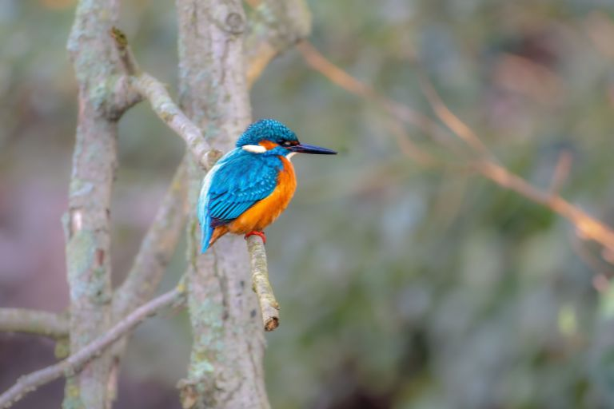
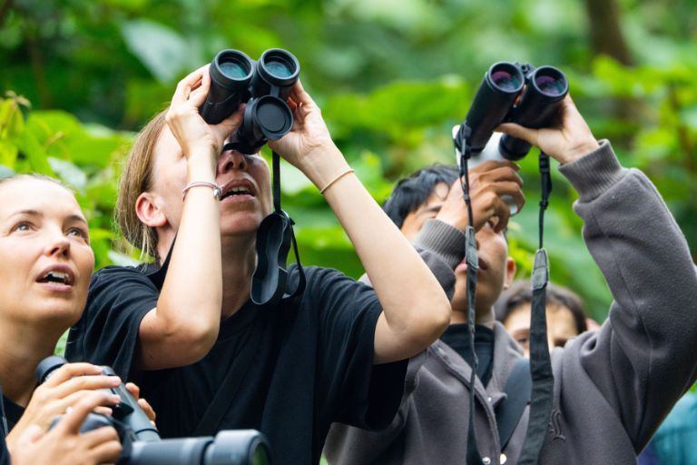
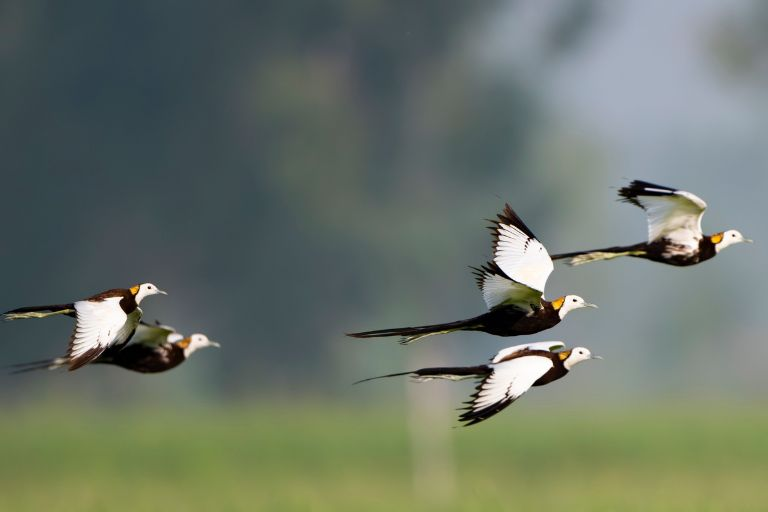
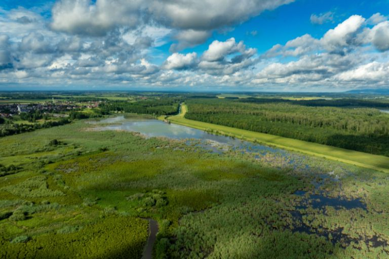
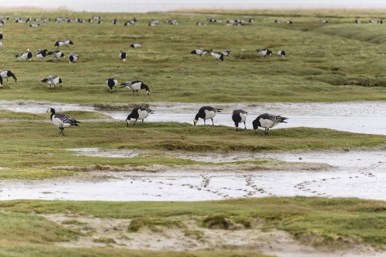
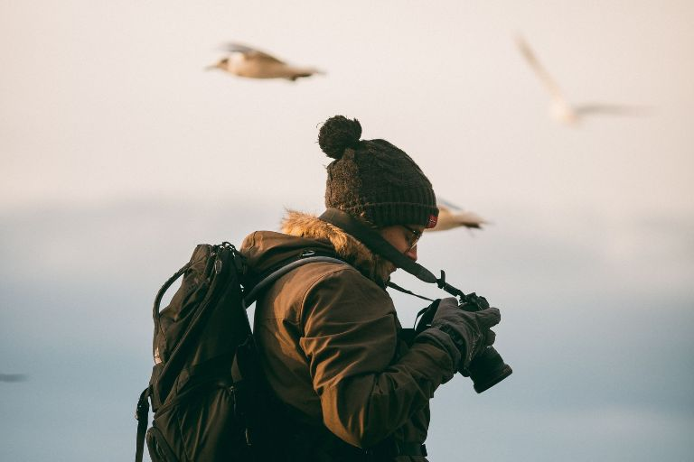

Бинокль, тихое утро в лесу и крик неизвестной птицы. То, что раньше считалось устаревшим увлечением пенсионеров, сейчас переживает неожиданный ренессанс. Наблюдение за птицами переживает бум, и не только среди пожилых людей. Все больше молодых людей открывают для себя **наблюдение за местными и экзотическими видами птиц [как осознанный отдых от цифровой повседневности]()**. 

Из этой статьи вы узнаете, почему наблюдение за птицами так популярно именно сейчас, как начать заниматься этим, стоят ли того туры по наблюдению за птицами и почему цифровая фиксация ваших наблюдений окупается.

## Почему наблюдение за птицами сегодня так популярно

Наблюдение за птицами уже давно перестало быть уделом только тех, кто имеет многолетний опыт и дорогостоящее оборудование. В последние годы эта тенденция заметно омолодилась. Это объясняется следующими причинами:

1.	**Социальные сети как отправная точка:** Парадоксально, но одним из основных движущих факторов является именно то средство коммуникации, от которого многие люди стремятся уйти, увлекаясь этим хобби: социальные сети. Под хэштегом #BirdTok пользователи делятся короткими видеороликами о редких наблюдениях, впечатляющих брачных ритуалах или просто о скворечнике в собственном саду. Сообщество орнитологов-любителей на этих платформах стремительно растёт, благодаря чему современное наблюдение за птицами приобретает гораздо более молодой и урбанистический облик, чем ещё десять лет назад.

2.  **Ощущение природы вместо экрана:** В то же время многие люди стремятся найти осознанную альтернативу постоянному времяпрепровождению за экраном. Наблюдение за птицами требует внимания к реальному окружению, к звукам, движениям и деталям, которые в суете повседневной жизни обычно ускользают от внимания. Если вы хотя бы раз пытались разглядеть королька в густых зарослях, то знаете, насколько это хобби обостряет зрение и проясняет ум.

3.  **Снятие стресса, осознанность и физическая активность:** наблюдение за птицами сочетает в себе легкую физическую активность на свежем воздухе с формой осознанности, которой иначе часто приходится с трудом учиться. Когда вы сосредоточенно высматриваете птиц, вы автоматически меньше думаете о списках дел или непрочитанных сообщениях. Именно это сочетание обучения и расслабления составляет значительную часть всего очарования этого занятия.

4.  **Введение в орнитологию:** Для многих увлечение наблюдением за птицами начинается как непринуждённое хобби и со временем перерастает в более серьёзный интерес к орнитологии. Вы начинаете различать виды по пению, отслеживать схемы миграции или изучать места обитания. Переход от случайного наблюдения к систематическому изучению птиц обычно происходит плавно.



Занимаясь наблюдением за птицами, вы развиваете внимание к деталям и тем самым тренируете свою восприимчивость. Каждый раз, когда вы обнаруживаете или определяете новый вид птиц, вы испытываете небольшой момент успеха, который доставляет радость и мотивирует. В то же время вы проводите время на природе и гораздо осознаннее воспринимаете её изменения в течение сезонов.

 

## Как начать заниматься наблюдением за птицами

Начать заниматься наблюдением за птицами проще, чем многие думают. Для первых наблюдений вам не понадобится ни большой бюджет, ни предварительные знания.

### Правильное снаряжение для наблюдения за птицами

Хороший **бинокль для наблюдения за птицами — это самое важное приобретение**. Для начала достаточно модели с 8–10-кратным увеличением и как можно меньшим весом, чтобы даже длительные прогулки с целью наблюдения не становились обременительными. **Спектив оправдывает себя только в том случае, если вы регулярно хотите наблюдать за птицами на больших расстояниях**, например, за водоплавающими птицами на открытом берегу или за хищными птицами вдали. Однако для начала спектив, как правило, излишне габаритный и неоправданно дорогой. 

Помимо бинокля для наблюдения за птицами **к базовому снаряжению относится погодоустойчивая одежда**. Поскольку вам часто приходится долго стоять или сидеть на одном месте, тело остывает быстрее, чем при движении, поэтому лучше всего подойдет многослойный наряд. **Записная книжка или, в качестве альтернативы, смартфон** дополняют снаряжение и помогают фиксировать наблюдения прямо на месте.

### Как легче определять виды

Для начала стоит научиться определять местных птиц, прежде чем переходить к более редким или экзотическим видам. Черная дрозд, большая синица или зарянка — отличный старт для наблюдения за птицами, поскольку они встречаются часто и их относительно легко различить. 

Использовать ли для этого классический определитель или приложение — в конечном счёте дело вкуса. Определители часто содержат **более подробные иллюстрации и работают независимо от наличия мобильного сигнала**, тогда как приложения, как правило, **могут дополнительно воспроизводить голоса птиц и облегчают поиск с помощью фильтров**. Многие опытные орнитологи в настоящее время используют и то, и другое одновременно.

Для точного определения вида помогут пять основных признаков:

- **размер** по сравнению с известными птицами-эталонами, такими как воробей или голубь
- **оперение** и характерные цветовые узоры
- **крик** или пение
- **поведение**, например, способ передвижения или поиска пищи
- **Среда обитания**, в которой происходит наблюдение
  
### Лучшие места для наблюдения за птицами и их фотографирования

Леса, озёра, парки, побережья и природные заповедники предлагают различное видовое разнообразие, поскольку разные виды птиц приспособлены к разным средам обитания. Особенно плодотворны **места наблюдения во время весенней и осенней миграции**, когда перелётные птицы отдыхают на пути к зимним или летним местам обитания. Тот, кто в это время окажется в известном месте остановки, сможет за несколько часов обнаружить гораздо больше видов, чем за обычные выходные.

## Туры по наблюдению за птицами: самые красивые направления для наблюдения за птицами

Тем, кто хочет выйти за пределы своего региона, туры по наблюдению за птицами предоставляют отличную возможность познакомиться с новыми местами обитания и видами. В то время как наблюдение за птицами в привычной обстановке обычно ограничивается знакомыми видами, поездки в специально подобранные места открывают совершенно иной взгляд на разнообразие птичьего мира. Например, тот, кто никогда не видел орлана-белохвоста в полёте или целую колонию гнездящихся морских птиц, во время хорошо спланированного тура быстро поймёт, почему многие орнитологи регулярно отправляются в путешествия. 

Кроме того, такие туры дают возможность учиться у опытных гидов и углублять знания о методах наблюдения за птицами, которые самостоятельно освоить довольно сложно. Именно тем, кто хочет сделать свою страсть к наблюдению за птицами неотъемлемой частью своей жизни, стоит заглянуть за пределы своего региона.

### Что делает тур по наблюдению за птицами удачным

Небольшие группы имеют особое значение при проведении экскурсий по наблюдению за птицами, поскольку большие группы излишне беспокоят животных и затрудняют наблюдение. **Опытный гид с глубокими знаниями о видах птиц часто играет решающую роль**, поскольку он может распознавать голоса птиц и выявлять редкие виды по мельчайшим признакам, которые легко ускользают от внимания непрофессионалов. Кроме того, организаторы туров по наблюдению за птицами всё чаще уделяют внимание принципам устойчивого развития, например, ограничивая размер групп, следуя установленным маршрутам и сотрудничая с местными природоохранными организациями. Такая форма экотуризма приносит пользу как животным, так и местному населению.

### Популярные направления

В зависимости от имеющегося времени и желаемого разнообразия видов для тура по наблюдению за птицами подходят самые разные направления — от дальних путешествий до прогулок прямо у своего дома.



Исландия славится своими впечатляющими колониями морских птиц, которые тысячами селятся на крутых утесах побережья. Путешествуя по острову, можно увидеть, в частности, следующих птиц:

- тупики, особенно в летние месяцы на побережье; 
- олухи в крупных гнездовых колониях; 
- ледяные буревестники, которые часто кружат в непосредственной близости от крутых берегов.





В богатых видами национальных парках обеих стран на небольшой территории обитает необычайное разнообразие видов птиц, что делает этот регион одним из самых увлекательных мест для наблюдения за птицами во всем мире. Среди основных достопримечательностей можно выделить, в частности:

- кетсаль — одна из самых ярких и желанных находок в туманных лесах 
- туканы с их характерным большим клювом 
- колибри, представленные необычайно большим разнообразием видов 
- ара, часто обладающие ярким оперением и хорошо заметные в кронах деревьев





Дельта Дуная входит в число самых биологически разнообразных водно-болотных угодий Европы и, благодаря своим обширным тростниковым зарослям и водотокам, создает идеальные условия для обитания множества редких видов. Особенно интересны, например:

- пеликаны-кудрявки, колонии которых считаются одними из крупнейших в Европе 
- орланы-белохвосты, часто кружащие над камышовыми зарослями и водоемами 
- пурпурные цапли, скрывающиеся среди густой растительности





Алгарве привлекает разнообразными прибрежными ландшафтами и водно-болотными угодьями, где обитает удивительно большое количество видов. Любители природы могут встретить здесь, в частности, следующих птиц:

- щуроклювы с их ярким разноцветным оперением 
- лопатоносы, легко узнаваемые по клюву в форме лопатки 
- белые аисты, которые в этом регионе часто гнездятся даже вне традиционных гнезд





Ваттовое море считается одним из важнейших мест остановки перелетных птиц во всей Европе, и в период миграции здесь можно наблюдать впечатляющие стаи птиц. Здесь можно наблюдать, в частности:

- кольчатых гусей, которые останавливаются здесь большими стаями во время перелёта 
- куликов-сорокопутов с их характерным оранжевым клювом 
- альпийских песочников, которых часто можно увидеть в плотных, слаженно летящих стаях



## Основные правила поведения при наблюдении за птицами

Несмотря на всю увлекательность этого хобби, оно также влечет за собой ответственность. Наблюдая за птицами, следует всегда **соблюдать дистанцию** и ни в коем случае не пытаться приближаться к ним без необходимости. Особенно **во время гнездового периода очень важно проявлять осторожность**, поскольку беспокойство может привести к тому, что родители покинут свои гнезда. Ни в коем случае не следует активно искать гнезда, даже если любопытство еще так велико. **Спокойное, неторопливое поведение без резких движений** также гарантирует, что птицы не будут чувствовать себя потревоженными и останутся на виду дольше.

## Почему стоит документировать свои наблюдения за птицами

Многие опытные орнитологи твердо убеждены в необходимости систематического документирования своих наблюдений — и на то есть веские причины. Личный список видов позволяет увидеть, **насколько разнообразны уже ваши собственные наблюдения**, и одновременно служит мотивацией для будущих выездов на природу. Кроме того, со временем можно проследить собственное развитие знаний о видах, например, когда виды, которые раньше было трудно определить, вдруг становятся узнаваемыми с первого взгляда. 

Ежегодные сравнения также показывают **сезонные закономерности, например, когда определенные перелетные птицы обычно прибывают в ваш регион**. И, наконец, **задокументированные наблюдения служат воспоминанием о путешествиях** и позволяют оглянуться назад на особые впечатления. Тот, кто документирует свои успехи, видит их и сохраняет мотивацию надолго.



- Используйте мягкий свет ранним утром или поздним днём 
- Терпение важнее дорогого оборудования 
- Режим серийной съёмки повышает шансы получить чёткий снимок в движении 
- Снимайте поведение птицы, а не только стремитесь к техническому совершенству снимка

 

## Цифровая документация с помощью SeaTable

Тем, кто хочет регулярно наблюдать за птицами и фотографировать их, будет очень полезно собирать записи о наблюдениях и фотографии в одном месте, а не разбрасывать их по разным папкам и приложениям. Именно здесь на помощь приходит [Платформа без программирования на основе искусственного интеллекта]() SeaTable. С помощью SeaTable можно **создать собственную базу данных наблюдений, в которой каждое наблюдение фиксируется с указанием даты, места, вида и других сведений**. Фотографии можно напрямую привязывать к конкретному наблюдению и сохранять, благодаря чему изображение и информация не существуют отдельно друг от друга. 



Через [просмотр карты]() все места наблюдений можно отобразить визуально, что особенно удобно для выявления закономерностей в пределах вашего региона наблюдений. Удобные фильтры по видам птиц упрощают анализ данных, например, если вы хотите проверить, сколько раз вы уже видели тот или иной вид. С помощью [веб-формы]() Вы сможете удобно вносить новые наблюдения даже находясь в пути. Не в последнюю очередь, хорошо ведёмая база данных помогает подготовиться к следующему туру по наблюдению за птицами, поскольку в любой момент можно просмотреть предыдущие наблюдения и незавершённые «списки желаний».

## Вывод

Наблюдение за птицами сочетает в себе общение с природой, отдых и обучение таким образом, который стал редкостью в нашей цифровой повседневной жизни. Начать заниматься этим просто и недорого, ведь для первых успехов достаточно хороших биноклей и немного терпения. Те, кто хочет углубить свои знания, найдут в турах по наблюдению за птицами возможность получить незабываемые впечатления от природы в новых местах. А те, кто документирует свои наблюдения в цифровом формате, могут быть уверены, что воспоминания, списки видов и фотографии сохранятся навсегда, а не потеряются в записных книжках или разрозненных приложениях.

## FAQs



Наблюдение за птицами часто ассоциируется с более активным подходом, ориентированным на сообщество, при котором на первый план выходят целенаправленное выявление как можно большего числа видов и обмен информацией в таких сообществах, как #BirdTok. Классический способ наблюдения за птицами, напротив, часто отличается более спокойным характером и не обязательно должен быть направлен на добавление новых видов в список.





Для начала вполне достаточно бинокля с 8–10-кратным увеличением, одежды, защищающей от непогоды, а также блокнота или смартфона для записей. Спиктив понадобится только при более продвинутых наблюдениях.





Да, экскурсии в сопровождении опытных гидов значительно облегчают начало пути, особенно новичкам, поскольку позволяют быстрее правильно определять голоса и виды птиц. Те, кто предпочитает путешествовать в одиночку, конечно же, могут начать самостоятельно, воспользовавшись определителем или приложением.





Если вы ведете учет замеченных птиц, это позволяет отслеживать ваш собственный прогресс, проводить сравнения по годам и сохранять воспоминания об особых наблюдениях и путешествиях. Кроме того, с помощью такого цифрового решения, как SeaTable, эту информацию можно систематизировать и хранить надолго.


